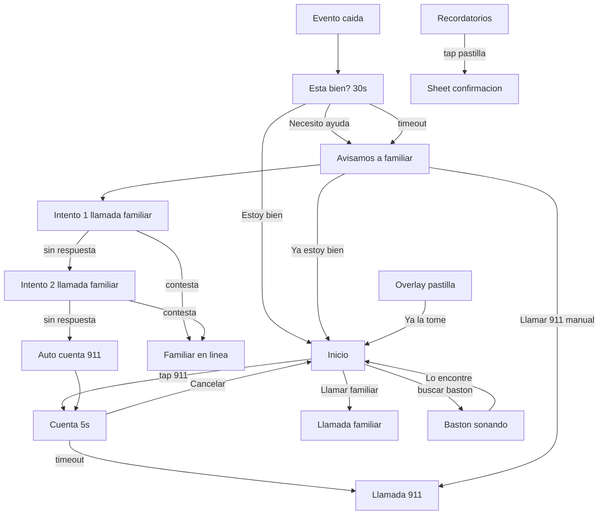

# App Persona — especificación de pantallas

**Usuario:** adulto mayor o persona con movilidad reducida que usa el bastón GuardMe.  
**Fuente primaria de interacción:** tablero «Persona mayor · app GuardMe» (pestañas + overlays).  
**Fuente de layout detallado:** tableros «Mis contactos», «Editar contacto», «Recordatorios», «Mi bastón» cuando son más completos.  
**Frame:** 390 × 844 · fondo `cream` · tipografía Atkinson (cuerpo) + Figtree (títulos).  
**Tokens:** ver [01-fundamentos.md](01-fundamentos.md).

---

## 1. Arquitectura de navegación

Pestañas inferiores (4): **Inicio** · **Contactos** · **Recordatorios** · **Bastón**.

Overlays a pantalla completa (bloquean tabs):

| Overlay | Disparador | Temporizador |
|---|---|---|
| Cuenta atrás 911 | Botón 911, pulsación del bastón o autoescalado tras 2 intentos fallidos al familiar | 5 s → llamada 911 |
| Llamada en curso | Fin de cuenta 911 o intento de llamada a familiar | — |
| Caída detectada | Evento del bastón | 30 s → escalado |
| Escalado (avisamos al familiar) | Timeout de caída o «Necesito ayuda» | Inicia intentos de llamada al familiar |
| Reintento de llamada al familiar | 1.er intento sin respuesta | 2.º intento inmediato / tras breve pausa |
| Auto 911 | 2 intentos consecutivos al familiar sin respuesta | → cuenta atrás 911 (5 s) |
| Bastón sonando | «¿Dónde está mi bastón?» | — |
| Hora de pastilla | Recordatorio programado / escenario | — |
| Ayuda en camino | Familiar o sistema llamó al 911 | — |
| Sheet «¿Ya tomaste…?» | Tap en pastilla de la lista | — |
| Toast aviso | Tras confirmar toma | 3 s |



### Regla de autoescalado a 911

Cuando la persona pide ayuda (caída sin respuesta, «Necesito ayuda» o el flujo de escalado tras avisar al familiar), GuardMe **llama al familiar preferido**. Si ese familiar **no responde en 2 intentos de llamada consecutivos**, el sistema pasa solo a la cuenta atrás de 911 (5 s, con Cancelar) y luego marca la llamada al 911.

| Concepto | Definición |
|---|---|
| Intento | Llamada saliente al familiar preferido (o al familiar de la alerta) hasta «sin respuesta» |
| Sin respuesta | No contesta, ocupado, rechazo o timeout de timbre (p. ej. 25–30 s sin pickup). No cuenta si la persona cancela o pulsa «Ya estoy bien» |
| Consecutivos | Dos fallos seguidos en el mismo episodio de ayuda, sin que nadie del equipo se haya encargado ni contestado |
| Tras el 2.º fallo | Overlay de transición → cuenta atrás 911 automática; se notifica al equipo que se está llamando al 911 |
| Contesta en intento 1 o 2 | Se detiene el autoescalado; no se llama al 911 solo |
| «Llamar al 911» manual | Sigue disponible en cualquier momento del escalado y no espera los 2 intentos |

---

## 2. Shell común

### Header

```
[Logo 40×44]  GuardMe (26/800)          [chip batería]
              Hola, {nombre} (15, warmGray)
```

- Chip batería: fondo `white`, borde `border`, radio 20, padding `6 12`, Figtree/Atkinson 15/700, ícono batería 14×22. Color de relleno dinámico (`ok` / `attention` / `emergency` según %).
- Escenario batería baja del prototipo: 15 %; normal: 78 %.

### Tab bar

Ver fundamentos §5.6. Labels exactos: Inicio, Contactos, Recordatorios, Bastón.

---

## 3. Pestaña Inicio

### Propósito

Acción rápida de emergencia, llamada al familiar preferido, localizar bastón, ver próximo recordatorio y resumen de actividad del día.

### Jerarquía

1. Card de estado del día (ícono circular 60 + título 28/800 + subtítulo 16).
2. Grid 2 columnas: **911** | **Llamar a {familiar}**.
3. CTA outline «¿Dónde está mi bastón?».
4. Card «Próximo recordatorio».
5. Sección «Tu actividad de hoy» (3 métricas).

### Layout

- Contenido: columna, gap 14, padding `22 18 16`, scroll vertical.
- Card estado: `white` + borde, radio 22, padding 18, gap 16. Círculo 60 con color de estado (`ok` / `attention` / `emergency`) e ícono blanco 32.
- Botones grid: alto **150**, radio 24, gap 12.
  - 911: fondo `emergency`, ícono cruz 40, título «911» 30/800, subtítulo «Emergencia médica» 16.
  - Familiar: fondo `brown`, ícono teléfono 40, título «Llamar a {nombre}» 24/800, subtítulo «{relación}» 16 (ej. «Tu hija»).
- Buscar bastón: min-height 64, borde 2 `caramel`, fondo `white`, texto 19/700, ícono ondas 26.
- Próximo recordatorio: card white, ícono pastilla en círculo `#DCE6F2` 48, label 15 `warmGray`, valor Figtree 21/700 («20:00 · Losartán 50 mg»).
- Actividad: título 20/700; grid 3 cols gap 10; celdas `sand` radio 18 padding `14 12`; número 26/800; unidad 15 `warmGray`.

### Microcopy

| Elemento | Texto |
|---|---|
| Saludo | `Hola, {nombre}` |
| 911 | `911` / `Emergencia médica` |
| Familiar | `Llamar a {nombre}` / `{relación}` |
| Bastón | `¿Dónde está mi bastón?` |
| Recordatorio | `Próximo recordatorio` |
| Actividad | `Tu actividad de hoy` · `pasos` · `km` · `calorías` |

### Estados límite (complemento)

| Estado | UI |
|---|---|
| Sin familiar preferido | Botón familiar deshabilitado + texto «Agrega un familiar preferido en Contactos» |
| Sin próximo recordatorio | Card con «No hay recordatorios para hoy» |
| Sin actividad / 0 | Mostrar `0` / `0` / `0` |
| Cargando | Skeleton de cards; botones 911 y familiar siempre interactivos si hay red |
| Error de red | Banner no bloqueante; 911 sigue intentando llamada nativa |

---

## 4. Pestaña Contactos

**Fuente de layout:** tablero «Persona · Mis contactos» (más completo que el listado embebido del inicio interactivo).

### Propósito

Ver, llamar y editar contactos; marcar el familiar preferido (único) que alimenta el botón grande de Inicio.

### Estructura

1. Título «Mis contactos» 26/800.
2. Campo buscar (placeholder «Buscar contacto»), alto ≥ 52, radio 18.
3. Sección «Familiar preferido»: card destacada con avatar, nombre, rol · teléfono, CTA «Llamar a {nombre}» marrón a ancho completo.
4. Sección «Todos mis contactos»: lista de filas (avatar 56 · nombre 20/700 · rol 15 · editar 48 · llamar 56).
5. Botón dashed «+ Agregar contacto» / «Agregar contacto».
6. Nota 15 `warmGray`: «La estrella marca a tu familiar preferido: es a quien llama el botón grande de Inicio.»

### Fila de contacto

| Parte | Spec |
|---|---|
| Avatar | 56, inicial 24/800 |
| Nombre | puede incluir ★ en familiar preferido |
| Editar | 48 circular, borde `border`, ícono lápiz, `aria-label="Editar contacto"` |
| Llamar | 56 circular `brown`, ícono teléfono blanco, `aria-label="Llamar"` |

### Vacío / error

- 0 contactos: ilustración mínima + «Agrega a quien quieras llamar en un toque» + CTA Agregar.
- Búsqueda sin resultados: «No encontramos a “{query}”».

---

## 5. Editar contacto

**Fuente:** tablero «Persona · Editar contacto». Pantalla push (no tab).

### Estructura

1. Back + título «Editar contacto».
2. Avatar grande + «Cambiar foto».
3. Campos: Nombre · Relación · Teléfono (alto ≥ 52).
4. Toggle «Familiar preferido» + ayuda: «Es a quien llama el botón grande de Inicio. Solo puede haber uno.»
5. Primario: «Guardar cambios» (marrón, min-height 60).
6. Destructivo: «Borrar contacto» (texto `dangerText` o outline) + nota «Le preguntaremos antes de borrarlo.»

### Confirmación de borrado (complemento)

Diálogo: «¿Borrar a {nombre}?» · Cancelar · Borrar. Si era preferido, exigir elegir otro antes o avisar que Inicio quedará sin botón familiar.

---

## 6. Pestaña Recordatorios

**Fuentes:** pestaña embebida + tablero «Persona · Recordatorios».

### Propósito

Ver tomas del día / semana y confirmar pastillas con un toque.

### Estructura (tablero estático)

1. Título «Recordatorios» + segment «Hoy» | «Esta semana».
2. Lista de pastillas: hora 24/800 (ancho ~74) · título 18/700 · indicación · chip estado · borde `caramel` si pendiente.
3. CTA en card o sheet: «Ya la tomé».
4. Estado completo: «Tomaste todas las de hoy» + «Mañana a las {hora} te recordamos la siguiente».
5. Sección «Próximos días»: citas (Vie · Cita con Dr. … · 10:00 · Consultorio…).
6. Hint: «Hoy · toca una pastilla para confirmarla».

### Chips

Ver fundamentos §5.4: Tomada / Pendiente / Cita.

### Sheet de confirmación (`hayPregunta`)

- Título pendiente: «¿Ya tomaste tu pastilla?»
- Título tomada: «Ya tomaste esta pastilla»
- Card medicamento (ícono pastilla + nombre + subtítulo con hora/indicación).
- Pendiente: «Sí, ya la tomé» (`ok`, 80) · «Todavía no» (outline caramelo, 64).
- Tomada: «Entendido» (`brown`, 72) · «Me equivoqué, no la tomé» (underline `dangerText`).
- Tras confirmar: toast «¡Listo! Le avisamos a {familiar}.»

### Overlay «Hora de tu pastilla»

Pantalla completa crema:

- Título 34/800 «Hora de tu pastilla».
- Sub 19: `{hora} · recordatorio de {familiar}`.
- Card white: ícono 88 · medicamento 30/800 · indicación 18.
- «Ya la tomé» (`ok`, 84) · «Recordar en 10 min» (outline, 60).

### Estados límite

| Estado | UI |
|---|---|
| Lista vacía hoy | «No hay pastillas para hoy» |
| Fallo al sincronizar | Mantener última lista + banner «Sin conexión · se guardará al volver» |
| Deshacer toma | Quita marca; vuelve a Pendiente |

---

## 7. Pestaña Mi bastón

**Fuente:** tablero «Persona · Mi bastón».

### Propósito

Estado del dispositivo y ayuda sobre el botón físico.

### Estructura

1. Título «Mi bastón».
2. Hero batería: % grande + «batería» + mensaje («Funciona bien» / «Dura unos 3 días más…» / aviso de carga).
3. Filas estado: Conexión · Sensores · Último uso (label 15 `warmGray` + valor 700).
4. CTA «Hacer sonar el bastón» (outline caramelo o primario marrón según tablero; en inicio interactivo es outline).
5. Bloque «El botón de tu bastón»:
   1. Una pulsación: pide ayuda al 911. Tienes 5 segundos para cancelar.
   2. Mantener 3 segundos: cancela la llamada o una alerta.
   3. Cuando suene un recordatorio: una pulsación marca la pastilla como tomada.

### Estados

| Estado | UI |
|---|---|
| Conectado | «Conectado» + `ok` |
| Sin conexión | «Sin conexión» + `attention`/`emergency` + texto de ayuda |
| Sensores OK | «Funcionan bien» |
| Batería &lt; 20 % | Color `attention`/`emergency` + «Te avisaremos cuando haya que cargarlo» ya mostrado en copy preventivo |

---

## 8. Overlays de emergencia y bastón

### 8.1 Cuenta atrás 911 (`ov.cuenta911`)

- Fondo crema o panel centrado; número grande (48–96) con segundos restantes (desde 5).
- Título: «Llamando al 911».
- Nota: «También avisaremos a {familiar} con tu ubicación».
- CTA: «Cancelar» (outline o secundario grande).
- Al llegar a 0 → overlay llamada 911.

### 8.2 Llamada en curso (`ov.llamada`)

- Fondo dinámico (`emergency` para 911, `brown` para familiar).
- Texto «Llamando…» + destino (`911` o nombre).
- Nota contextual si aplica («Ana ya recibió una alerta con tu ubicación»).
- En intentos al familiar dentro de un episodio de ayuda, mostrar contador de intento: «Llamando a {familiar} · intento {n} de 2».
- Si el intento termina sin respuesta y `n < 2`: breve estado «{familiar} no contestó. Intentamos de nuevo…» (2–3 s) → 2.º intento.
- Si `n = 2` y sin respuesta → §8.4b (auto 911).

### 8.3 Caída detectada (`ov.caida`) — 30 s

- Título grande: «¿Está bien?»
- Sub: «Su bastón detectó una posible caída».
- Contador de segundos.
- Ayuda: «Si no responde, avisaremos a {familiar} con su ubicación. Si no contesta, llamaremos al 911.»
- Botones apilados:
  - «Estoy bien» (`ok`, grande).
  - «Necesito ayuda» (`emergency` o marrón fuerte según contraste — priorizar rojo solo si dispara 911; en prototipo es acción de escalar ayuda).
- Timeout → escalado.

### 8.4 Escalado (`ov.escalado`)

- Ícono check en círculo `brown` 96.
- Título: «Avisamos a {familiar}».
- Cuerpo: «Recibió una alerta con su ubicación. La estamos llamando ahora. Si no contesta en 2 intentos, llamaremos al 911.»
- Mientras corren los intentos: estado vivo «Llamando a {familiar}… intento {n} de 2» (o reutilizar overlay de llamada §8.2).
- «Llamar al 911» (`emergency`, 72) — manual, no espera los intentos.
- «Ya estoy bien» (outline `ok`, 64) — cancela intentos pendientes y el auto 911.

### 8.4b Autoescalado a 911 (`ov.auto911`)

Se muestra tras **2 intentos consecutivos** al familiar sin respuesta en el mismo episodio.

- Fondo `cream` o transición breve a la cuenta 911.
- Título Figtree 28–32/800: «{familiar} no contestó».
- Cuerpo 18–19: «Vamos a llamar al 911 con tu ubicación. Puedes cancelar en los próximos 5 segundos.»
- Pasa automáticamente a §8.1 (cuenta atrás 911, 5 s, con «Cancelar»).
- Al iniciar la llamada 911: notificar al equipo cuidador («GuardMe está llamando al 911 porque {familiar} no respondió»).
- Si la persona pulsa «Cancelar» en la cuenta 911: no marcar 911; ofrecer de nuevo «Llamar al 911» y «Ya estoy bien» (no reiniciar en bucle los 2 intentos al familiar salvo que la persona pida ayuda otra vez).

### 8.5 Bastón sonando (`ov.buscando`)

- Título: «Tu bastón está sonando».
- Sub: «Escucha el pitido y busca la luz que parpadea».
- Animación de ondas + ícono bastón en círculo `brown` 112 (o estático si reduced motion).
- Nota: «También se apaga al presionar el botón del bastón».
- CTA: «Lo encontré» (`ok`, 76).

### 8.6 Ayuda en camino (`ov.ayuda`)

- Fondo `emergency`, texto blanco.
- Ícono ambulancia en círculo semitransparente 104.
- Título 36/800: «La ayuda va en camino».
- Cuerpo 20 según origen:
  - Familiar: «{familiar} llamó al 911 por usted. Su bastón está sonando para que la encuentren.»
  - Autoescalado: «Como {familiar} no contestó, GuardMe llamó al 911. Su bastón está sonando para que la encuentren.»
- CTA: «Entendido» (fondo `white`, texto `emergency`, 76, radio pill ~38).

---

## 9. Microcopy crítico (lista maestra persona)

| Contexto | Copy |
|---|---|
| 911 | Emergencia médica |
| Buscar | ¿Dónde está mi bastón? / Lo encontré / Tu bastón está sonando |
| Caída | ¿Está bien? / Estoy bien / Necesito ayuda / Avisamos a {familiar} |
| Intentos familiar | Llamando a {familiar} · intento {n} de 2 / {familiar} no contestó. Intentamos de nuevo… |
| Auto 911 | {familiar} no contestó / Vamos a llamar al 911 con tu ubicación. Puedes cancelar en los próximos 5 segundos. |
| Pastilla | Hora de tu pastilla / Ya la tomé / Recordar en 10 min / Sí, ya la tomé / Todavía no / Me equivoqué, no la tomé |
| Ayuda | La ayuda va en camino / Entendido / Como {familiar} no contestó, GuardMe llamó al 911… |
| Toast | ¡Listo! Le avisamos a {familiar}. |

---

## 10. Criterios de aceptación — persona

1. Los botones 911 y familiar nunca comparten el mismo color de fondo.
2. Todo CTA primario de persona mide ≥ 56 px de alto; los de grid de emergencia 150 px.
3. Tras 5 s sin cancelar 911 se inicia la llamada (o el estado «Llamando…»).
4. Tras 30 s sin respuesta en caída se muestra «Avisamos a {familiar}» y arrancan los intentos de llamada al familiar.
5. Tras **2 intentos consecutivos** al familiar sin respuesta se abre la cuenta atrás de 911; un solo fallo no basta.
6. Si el familiar contesta en el 1.er o 2.º intento, no se llama al 911 automáticamente.
7. «Ya estoy bien» o Cancelar en la cuenta 911 detiene el autoescalado.
8. Confirmar pastilla actualiza chip a Tomada y muestra toast.
9. TalkBack anuncia títulos de overlays, número de intento («intento 1 de 2») y botones solo-ícono.
10. Con `prefers-reduced-motion`, las ondas del bastón no animan.
