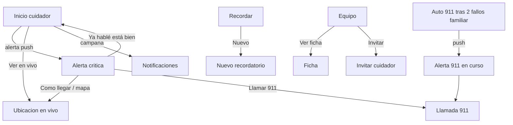

# App Cuidador — especificación de pantallas

**Usuario:** familiar o cuidador (rol Familiar) y, con permisos reducidos, médico (rol Médico).  
**Fuente primaria de interacción:** tablero «Cuidador · app GuardMe».  
**Fuentes de layout detallado:** Historial, Recordatorios, Nuevo recordatorio, Bastón, Equipo, Invitar, Alerta de caída, Ubicación en vivo, Notificaciones, Ficha.  
**Frame:** 390 × 844 · fondo `cream` · misma marca que persona, densidad mayor.  
**Tokens:** ver [01-fundamentos.md](01-fundamentos.md).

---

## 1. Arquitectura de navegación

Pestañas (5): **Inicio** · **Historial** · **Recordar** · **Bastón** · **Equipo**.

Pantallas push / modales:

| Pantalla | Entrada |
|---|---|
| Alerta crítica de caída | Push prioritario / deep link desde notificación |
| Ubicación en vivo | «Ver en vivo» desde Inicio o alerta |
| Notificaciones | Campana / lista de avisos |
| Nuevo recordatorio | «+ Nuevo» en Recordar |
| Invitar cuidador | «+ Invitar» en Equipo |
| Ficha de {persona} | «Ver ficha» en Equipo |



### Eco del autoescalado a 911 (lado cuidador)

Si la app Persona agota **2 intentos consecutivos** de llamada al familiar sin respuesta y dispara el 911 (ver [02-persona.md](02-persona.md) § Regla de autoescalado):

1. Push prioritario a todos los Familiares del equipo: «GuardMe está llamando al 911 · {nombre} necesita ayuda · {familiarPreferido} no contestó».
2. La alerta crítica pasa a modo **911 en curso** (header rojo, timeline actualizada).
3. Quien no contestó sigue viendo la alerta; «Yo me encargo» ya no evita la llamada al 911 si ya se inició, pero sí coordina el seguimiento en sitio.

---

## 2. Shell común

### Header Inicio

```
[Logo] GuardMe (26/800)
       Que la distancia no sea un riesgo (15–16, warmGray)
```

Otras pestañas: título de pantalla Figtree 26/800, padding top ~20, sin wordmark completo (salvo consistencia de marca en Inicio).

### Tab bar

5 columnas. Labels: Inicio, Historial, Recordar, Bastón, Equipo. Spec en fundamentos §5.6. Activa: color `#6B4426` + indicador `brown`.

---

## 3. Pestaña Inicio

### Propósito

Estado de la persona cuidada, acceso a emergencia, actividad del día, adherencia, bastón y atajos al equipo.

### Bloques (orden del prototipo interactivo)

1. **Banner de alerta activa** (si hay caída sin resolver): fondo/borde emergencia, título «Posible caída de {nombre}», meta hora + motivo («No respondió en 30 s…»), CTAs «Llamar al 911» (`emergency`) y «Llamar a {nombre}» (`brown`).
2. **Card persona:** avatar · «{nombre} · {estadoTitulo}» · ubicación corta · link «Ver en vivo».
3. **Hoy:** pasos, km, pastillas (métricas).
4. **Acceso Historial** + **Adherencia 7 días** (ej. 86 % · 18 tomadas, 3 omitidas).
5. **Recordatorios** resumen + «+ Nuevo».
6. **Bastón de {nombre}:** batería, conexión, diagnóstico; toggles de avisos (batería &lt; 20 %, sin conexión &gt; 10 min, quieto &gt; 3 h 8:00–20:00); «Hacer sonar el bastón».
7. **Equipo de cuidado** preview + «+ Invitar cuidador».
8. Nota de roles: Familiar = ubicación, alertas, 911, recordatorios; Médico = historial, medicamentos y recordatorios; sin ubicación ni alertas.

### Jerarquía en crisis

Si hay alerta activa, el banner ocupa el primer scroll; el resto de la home permanece accesible debajo.

### Estados límite

| Estado | UI |
|---|---|
| Todo tranquilo | Sin banner; card persona con estado `ok` («Todo bien» / caminando / en casa) |
| Sin ubicación reciente | «Última ubicación hace {n}» + CTA Ver en vivo deshabilitado o con aviso |
| Médico (rol) | Ocultar mapa, alertas 911 y sonar bastón; mostrar adherencia e historial médico |

---

## 4. Alerta crítica de caída

**Fuente:** tablero «Cuidador · Alerta de caída». Pantalla prioritaria a pantalla completa (sin tab bar).

### Anatomía

1. **Header rojo** `emergency`:
   - Eyebrow 14/700 letter-spacing 0.5: `ALERTA CRÍTICA · HACE {n} MIN`
   - Título 28/800: `{nombre} puede haberse caído`
   - Sub 16: `{hora} · No tocó «Estoy bien» en 30 s`
2. **Mapa** alto 170 (ilustración o mapa real): pin de persona centrado.
3. **Dirección:** título calle 17/700 · ciudad · precisión · botón outline «Cómo llegar» (40).
4. **Grid 2 CTAs** alto 60: «Llamar al 911» | «Llamar a {nombre}».
5. **Outline:** «Hacer sonar su bastón» (52).
6. **Card coordinación** `sand`: avatar otro cuidador + «{otro} también recibió la alerta y aún no responde.» + botón navy «Yo me encargo».
7. **Timeline** de eventos (puntos `emergency`/`brown` + hora en negrita).
8. **Cierre positivo:** «Ya hablé con {nombre}, está bien» (outline `ok`, 52).

### Microcopy de timeline (ejemplo de producto)

- El bastón detectó un golpe con giro
- {nombre} vio «¿Está bien?» en su celular
- Sin respuesta: te avisamos a ti y a {otros}
- Llamada a {familiarPreferido} · intento 1 · sin respuesta
- Llamada a {familiarPreferido} · intento 2 · sin respuesta
- GuardMe inició llamada al 911 (autoescalado)

### Estados

| Estado | UI |
|---|---|
| Alguien más se encargó | Sustituir card por «{nombreCuidador} se está encargando» |
| Intentos al familiar en curso | Banner o timeline: «Llamando a {familiar}… intento {n} de 2» |
| Auto 911 disparado | Header/eyebrow `911 EN CURSO · AUTO`; subtítulo «{familiar} no contestó en 2 intentos»; CTA primario sigue siendo seguimiento (llamar a {nombre}, sonar bastón, cómo llegar) |
| Resuelta OK | Navegar a Inicio; evento queda en Historial como «Atendida» / falsa alarma según corresponda |
| Error al llamar | Snackbar + reintento; no cerrar la alerta |

---

## 5. Ubicación en vivo

**Fuente:** «Cuidador · Ubicación en vivo».

### Estructura

1. Header: «En vivo · cada 2 min mientras camina» (o frecuencia real).
2. Card estado: avatar · «{nombre} está caminando» · dirección · hace {n} min.
3. Métricas: km desde casa · min fuera · precisión.
4. CTAs: «Cómo llegar» · «Llamar a {nombre}».
5. «Recorrido de hoy»: lista cronológica inversa (lugar · hora).

### Estados

| Estado | UI |
|---|---|
| En casa | Copy «En casa» · sin «fuera» |
| Sin señal | Mapa gris + «Sin ubicación · hace {n}» |
| Rol Médico | Pantalla no disponible (ocultar entrada) |

Actualización: indicar frescura del dato; no inventar animación de GPS si el dato es estático.

---

## 6. Notificaciones

**Fuente:** «Cuidador · Notificaciones».

### Estructura

1. Título + «Marcar leídas».
2. Filtros: Todas | Urgentes.
3. Agrupación Hoy / Ayer.
4. Filas: título · cuerpo · hora. Tipos del prototipo + autoescalado:
   - Pastilla sin confirmar
   - Bastón quieto hace 3 h
   - Pastilla tomada
   - Posible caída · atendida
   - Batería del bastón al 20 %
   - {persona} se unió al equipo
   - **Urgente:** 911 automático · {familiar} no contestó en 2 intentos
5. Footer: «Elegir qué avisos recibo» (pantalla de preferencias — no está en el prototipo; ver handoff).

### Vacío

«No tienes notificaciones» + ilustración mínima.

---

## 7. Pestaña Historial

**Fuente:** «Cuidador · Historial».

### Estructura

1. Título «Historial de {nombre}».
2. Filtros chip: Todo · Caídas · Medicamentos · Actividad.
3. Resumen superior: N caídas · 7 días · falsas alarmas · % adherencia · km semana + sparkline/barras por día (L–D).
4. Feed agrupado Hoy / Ayer:
   - Pastilla tomada · medicamento · hora · canal (app / botón bastón)
   - Caminata · km · pasos · rango horario
   - Posible caída · no respondió · dirección · badge «Atendida» + subtimeline

### Estados

| Estado | UI |
|---|---|
| Sin eventos del filtro | «No hay {filtro} en este período» |
| Carga | Skeleton de resumen + 3 filas |
| Error | Reintentar |

---

## 8. Pestaña Recordatorios (Recordar)

**Fuente:** «Cuidador · Recordatorios» + «Nuevo recordatorio».

### Lista

1. Header «Recordatorios» + botón «Nuevo».
2. Banner atención si hay toma sin confirmar: título + cuerpo («{nombre} no lo confirmó en 15 minutos…») + «Llamar a {nombre}».
3. Sección Hoy: filas hora · medicamento · confirmación · chip Tomada / Sin confirmar.
4. Medicamentos activos (dosis · frecuencia · horas).
5. Citas (día · hora · aviso previo).

### Nuevo recordatorio

1. Título «Nuevo recordatorio».
2. Tipo segment: Pastilla | Cita médica | Otro.
3. Campos: Medicamento · Dosis e indicación · Horarios (chips hora + «+ Agregar hora») · Días L–D.
4. Toggles:
   - Avisarme si no confirma (15 min)
   - Repetir el aviso a {nombre} (10 min)
   - Compartir con el médico
5. CTA «Guardar recordatorio» (marrón, ≥ 52).

### Vacío

«Crea el primer recordatorio para {nombre}» + CTA Nuevo.

---

## 9. Pestaña Bastón (cuidador)

**Fuente:** «Cuidador · Bastón».

### Estructura

1. Título «Bastón de {nombre}».
2. Identidad: «Bastón GuardMe» · «Firmware {ver} · vinculado al celular de {nombre}».
3. Batería % + «≈ {n} días restantes».
4. Conexión · última señal · vía celular de la persona.
5. Diagnóstico de sensores (Revisado hoy {hora}):
   - Acelerómetro — Detecta caídas y cuenta pasos — OK
   - Giroscopio — Confirma el giro del cuerpo al caer — OK
   - Botón de alerta — Última pulsación…
   - Buzzer y LED — Probado al buscar…
   - Bluetooth — Señal fuerte (−58 dBm)
6. «Probar sensores ahora».
7. Avisos (toggles): Batería baja (&lt; 20 %) · Sin conexión (&gt; 10 min) · Inactividad (&gt; 3 h entre 8:00 y 20:00).
8. «Hacer sonar el bastón».

### Rol Médico

Ocultar o deshabilitar sonar y avisos de ubicación/conexión si la matriz lo restringe; el prototipo reserva estado del bastón a Familiar.

---

## 10. Pestaña Equipo

**Fuente:** «Cuidador · Equipo» + «Invitar cuidador» + «Ficha».

### Lista

1. Título «Equipo de cuidado».
2. Card persona cuidada (`sand`): avatar · «Persona cuidada» · nombre · edad · N cuidadores · «Ver ficha».
3. Lista de miembros: avatar · nombre («Ana (tú)») · rol descriptivo · chip Familiar/Médico · estado invitación pendiente.
4. CTA dashed «Invitar cuidador».
5. **Matriz «Qué puede ver cada rol»:**

| Permiso | Familiar | Médico |
|---|---|---|
| Ubicación en vivo | Sí | — |
| Alertas de caída y 911 | Sí | — |
| Historial de caídas | Sí | Sí |
| Medicamentos y adherencia | Sí | Sí |
| Crear recordatorios | Sí | Sí |
| Estado del bastón | Sí | — |

### Invitar cuidador

Campos: Nombre · Teléfono o correo · Rol (Familiar / Médico) con descripción:

- Familiar: ve ubicación en vivo, recibe alertas de caída y puede llamar al 911.
- Médico: (según copy del tablero; historial y medicamentos sin ubicación ni alertas).

CTA «Enviar invitación».

### Ficha de {nombre}

**Fuente:** «Cuidador · Ficha de Rosa».

Secciones:

- Identidad: avatar · nombre · edad · estatura · peso
- Salud: condiciones · alergias · tipo de sangre
- Medicamentos
- Contacto y dirección: dirección · teléfono · médico de cabecera · seguro médico (placeholder de póliza)

Solo lectura en el prototipo; edición queda como decisión abierta (handoff).

---

## 11. Microcopy crítico (cuidador)

| Contexto | Copy |
|---|---|
| Tagline | Que la distancia no sea un riesgo |
| Alerta | ALERTA CRÍTICA · {nombre} puede haberse caído · Yo me encargo · Ya hablé con {nombre}, está bien |
| Auto 911 | GuardMe está llamando al 911 · {familiar} no contestó en 2 intentos · 911 EN CURSO · AUTO |
| 911 / llamada | Llamar al 911 · Llamar a {nombre} · Hacer sonar su bastón · Cómo llegar |
| Recordatorios | Avisarme si no confirma · Repetir el aviso · Compartir con el médico · Guardar recordatorio |
| Roles | Familiar · Médico · Invitar cuidador · Ver ficha |

---

## 12. Criterios de aceptación — cuidador

1. Con alerta activa, la UI prioriza CTAs 911 y llamar a la persona; 911 sigue en rojo.
2. Rol Médico no ve ubicación en vivo ni alertas de caída/911 ni estado del bastón.
3. «Yo me encargo» refleja coordinación con otros familiares (estado visible).
4. Si Persona autoescala a 911 tras 2 intentos fallidos al familiar, todos los Familiares reciben push y la alerta muestra timeline + modo «911 EN CURSO · AUTO».
5. Historial filtra por Todo / Caídas / Medicamentos / Actividad sin perder el resumen; el auto 911 queda registrado en el evento de caída.
6. Nuevo recordatorio exige al menos un horario y un día antes de habilitar Guardar (complemento de validación; el prototipo no muestra error — implementar validación inline).
7. Tab bar de 5 ítems mantiene objetivos ≥ 48–52 px de alto.
8. Textos de precisión/ubicación siempre presentes junto al mapa (el mapa no es la única fuente de información).
