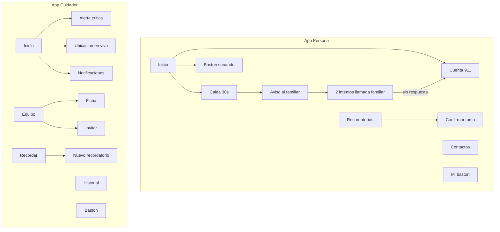

# Documentación de UI — GuardMeMobile

Especificación de interfaz para las dos experiencias móviles de **GuardMe**, derivada del prototipo HTML *GuardMe — Prototipo de las dos apps* (marca + persona + cuidador).

**Objetivo:** que un desarrollador o agente de código pueda implementar la UI en [GuardMeMobile](../../GuardMeMobile) (Android, Jetpack Compose) sin tomar decisiones de diseño importantes por su cuenta.

**Qué no es:** código Compose, firmware del bastón, backend ni pantallas ausentes del prototipo (login, emparejamiento BLE, etc.).

---

## Estándares

| Prioridad | Fuente |
|---|---|
| 1 | Prototipo HTML (tablero de marca + pantallas Persona/Cuidador) |
| 2 | WCAG 2.2 AA |
| 3 | Material 3 / Android HIG solo como patrón de plataforma cuando el prototipo no define un valor |

**Usuarios**

- **Persona:** adulto mayor o persona con movilidad reducida; botones grandes, tipografía Atkinson Hyperlegible, 911 y familiar siempre a un toque. Si el familiar no contesta en **2 intentos consecutivos** tras un pedido de ayuda, GuardMe escala solo al 911.
- **Cuidador (Familiar):** monitoreo, alertas de caída, ubicación, recordatorios, equipo; recibe aviso cuando el 911 se dispara por autoescalado.
- **Médico:** mismo shell de cuidador con permisos reducidos (sin ubicación ni alertas de caída/911 ni estado del bastón).

**Frame de diseño:** 390 × 844 px · tema claro fijo · tagline «Que la distancia no sea un riesgo».

---

## Cómo leer esta carpeta

| Documento | Contenido |
|---|---|
| [01-fundamentos.md](01-fundamentos.md) | Tokens (color, tipo, espacio, radio), componentes compartidos, motion, checklist a11y |
| [02-persona.md](02-persona.md) | Pantallas, overlays y flujos de la app Persona |
| [03-cuidador.md](03-cuidador.md) | Pantallas del cuidador, alerta crítica, matriz de roles |
| [04-handoff.md](04-handoff.md) | Orden de implementación Compose, criterios globales, decisiones abiertas |

Orden de lectura recomendado: fundamentos → persona → cuidador → handoff.

---

## Mapa de navegación

**Reconciliación de fuentes:** los tableros interactivos definen flujos y temporizadores; los tableros estáticos más detallados mandan en layout cuando hay conflicto (contactos con búsqueda, guía del botón del bastón, matriz de permisos, alerta, mapa). Detalle en [04-handoff.md §6](04-handoff.md).

---

## Inventario de pantallas del prototipo

| Tablero | Documento |
|---|---|
| Marca · colores y tipografía | 01 |
| Persona mayor · app (Inicio + overlays) | 02 |
| Persona · Mis contactos / Editar / Recordatorios / Mi bastón | 02 |
| Cuidador · app (Inicio) | 03 |
| Cuidador · Historial / Recordatorios / Nuevo / Bastón / Equipo / Invitar | 03 |
| Cuidador · Alerta de caída / Ubicación / Notificaciones / Ficha | 03 |

---

## Fuera de alcance (por ahora)

- Inicio de sesión, registro, recuperación
- Selección de rol al instalar
- Emparejamiento inicial del bastón
- Preferencias finas de notificaciones
- Tema oscuro
- Firmware ESP32 y protocolos BLE/datos

Quedan listados como decisiones abiertas en el handoff.
