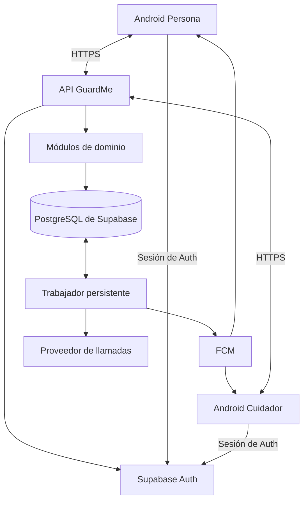

# GUARDMe — Arquitectura, stack, módulos y decisiones

**Documento:** BE-02 de 10 · **Versión:** 1.1 · **Fecha:** 14 de noviembre de 2026  
**Estado:** desglose documental de la propuesta aprobada; no acredita implementación.  
**Origen:** secciones 1, 3, 4, 5, 13, 17 y 18 de [Propuesta de backend](https://chatgpt.com/library?file_id=libfile_856c231c19bc819186a42b13a9a6c5c4&account_id=personal).  
**Lectura del conjunto:** [BE-01 — Índice y trazabilidad](01_Vision_Alcance_Requisitos_y_Trazabilidad.md).

Las reglas confirmadas del producto se conservan. Las precisiones nuevas se identifican como diseño propuesto; los puntos abiertos de la propuesta original siguen pendientes de definición. Este documento no contiene código de aplicación ni despliega servicios.

**Revisión 1.3 (17 nov 2026):** identidad viva = Better Auth + PostgreSQL (implementado). Diagrama histórico con Supabase Auth queda como registro.

**Revisión 1.1:** autenticación con Supabase Auth (histórico).

## 1. Objetivo arquitectónico

El backend debe coordinar un episodio compartido aunque las dos aplicaciones móviles no estén abiertas simultáneamente. La consistencia de contactos, decisiones e historial tiene prioridad sobre distribuir prematuramente el sistema.

Se conserva el monolito modular aprobado: un único proyecto de backend, dos procesos de ejecución y una base de datos relacional. API y trabajador comparten lenguaje de dominio y políticas. Son procesos independientes, no microservicios con bases de datos separadas.

La primera entrega no exige un portal web. Una futura interfaz administrativa operativa no debe confundirse con la aplicación móvil del cuidador ni formar parte implícita del alcance.

## 2. Vista de componentes

El bastón se integra con Android mediante el contrato de BE-08. No se dibuja como cliente directo de la API. El backend conoce eventos autenticados de la pasarela, sin atribuirles una conectividad autónoma que no existe.

## 3. Elección y alternativas

| Criterio | Base seleccionada: Supabase + GuardMe | Posible evolución en Supabase | Referencia anterior |
| --- | --- | --- | --- |
| Identidad | Supabase Auth | Se conserva | Identidad Firebase no seleccionada |
| Datos | PostgreSQL gestionado por Supabase | Se conserva | PostgreSQL externo o Firestore |
| Reglas de producto | NestJS modular | Evaluar funciones sin duplicar reglas | No importar implementación anterior |
| Trabajo diferido | pg-boss y trabajador persistente | Evaluar Queues/Cron solo con decisión propia | Cloud Tasks no se incorpora |
| Push móvil | FCM | Se conserva mientras no cambie el canal | No es servicio de autenticación |
| Datos accesibles desde Android | API NestJS | Lecturas directas solo con nueva revisión | No acceso libre a tablas |

La elección del responsable aplica a Auth y base de datos. No obliga a sustituir el backend de dominio por Edge Functions ni a activar Realtime. La recomendación vigente conserva una única fuente de estado del producto en PostgreSQL de Supabase.

Los SDK de Android administran sesión de Supabase Auth y llaman a GuardMe con su access token. El servidor conserva reglas de incidentes, transacciones y tareas, incluidas las operaciones de varios cuidadores.

## 4. Catálogo de módulos

| Módulo | Responsabilidad | Datos que gobierna | Lo que no debe hacer |
| --- | --- | --- | --- |
| Identidad y acceso | Resolver principal y vinculaciones | Cuentas, accesos, invitaciones | Confiar en roles declarados por Android |
| Configuración | Progreso de incorporación | Estado de incorporación y pasos | Marcar una prueba física como hecha por defecto |
| Perfiles | Persona asistida y preferencias | Perfil y zona horaria | Almacenar contraseña del proveedor |
| Dispositivos | Bastón, asignación y pasarela | Inventario y vinculaciones físicas | Inferir batería sin medición |
| Incidencias | Reglas y transiciones del episodio | Incidencias y eventos | Enviar push antes del registro |
| Contacto | Plan e intentos de llamada | Contactos e intentos | Resolver permisos por teléfono únicamente |
| Notificaciones | Avisos y evidencias de entrega | Notificación y entregas | Equiparar envío con atención |
| Agenda | Definiciones y ocurrencias | Recordatorios y horarios | Marcar ingesta sin declaración |
| Seguimientos | Consultas posteriores | Rondas y respuestas | Reabrir automáticamente la incidencia cerrada |
| Ubicación | Consentimiento y última posición | Autorizaciones y posición | Crear recorridos por defecto |
| Sincronización | Reenvío y cambios incrementales | Recepciones y cursores | Saltarse autorización actual |
| Operación | Salud, auditoría y recuperación | Auditoría y métricas | Exponer secretos en diagnósticos |

Cada dato tendrá un módulo propietario. Otros módulos lo consultan por interfaces internas y no aplican modificaciones arbitrarias a sus tablas.

## 5. Reglas de dependencia

La entrada HTTP transforma la petición en una operación del dominio; no concentra reglas de llamadas ni temporizadores. La autorización valida identidad y alcance antes de acceder al recurso. El dominio define transiciones y restricciones. La infraestructura implementa almacenamiento, tareas y proveedores.

Un cambio de proveedor de telefonía debe afectar al adaptador y a sus pruebas, no al significado de “Yo me encargo”. Un cambio de FCM no debe borrar el historial de notificaciones. Un cambio de ORM no debe cambiar la prohibición de borrar un recordatorio creado por cuidador.

El trabajador invoca las mismas operaciones de dominio que la API. No dispone de una segunda versión, más permisiva, del cierre de incidentes.

## 6. Fronteras transaccionales

| Operación | Cambios que deben confirmar juntos | Efecto externo posterior |
| --- | --- | --- |
| Activar incidencia | Incidencia, evento inicial, plan/acción pendiente | Avisos y primer intento |
| Confirmar asistencia | Cierre, decisión, invalidación lógica y seguimiento | Aviso de estado actualizado |
| Posponer | Decisión y vencimientos | Notificación a cinco minutos |
| Aceptar invitación | Consumo de invitación y acceso | Actualizar interfaces |
| Registrar medicamento | Ocurrencia y evento de confirmación | Compartir cambio |
| Revocar acceso | Vinculación revocada y auditoría | Invalidar consultas y avisos futuros |

No se mantiene una transacción de base de datos esperando una llamada o una petición lenta a FCM. El registro pendiente conecta el cambio local confirmado con el efecto externo. La incertidumbre externa se conserva como tal y se reconcilia.

## 7. Stack y responsabilidades operativas

NestJS organiza API y módulos; TypeScript es el lenguaje del backend. PostgreSQL de Supabase conserva el dominio. Prisma se utiliza como ORM de consulta, mientras las migraciones del dominio, permisos y RLS se versionan mediante Supabase CLI en un solo historial. El modelo del ORM se actualiza desde ese esquema; no se ejecuta Prisma Migrate sobre las mismas tablas. pg-boss programa tareas persistentes y mantiene su esquema técnico bajo control de versión propio, separado de Auth.

Supabase Auth identifica al principal y FCM distribuye notificaciones. El UUID de Auth se vincula a la cuenta de dominio. Una sesión válida no implica acceso a todos los perfiles y un token push no autoriza lecturas. No se utiliza la emisión de tokens personalizados de Firebase.

HTTPS es el canal de operaciones. SSE puede complementar pantallas abiertas, pero no despierta una aplicación cerrada ni sustituye FCM. El diseño del núcleo funciona sin SSE.

Las versiones se decidirán al iniciar construcción y se registrarán junto con compatibilidades. No se incluyen aquí versiones inventadas, archivos de dependencias, contenedores ni comandos de instalación.

### Integración concreta con PostgreSQL de Supabase

El esquema guardme es privado y no se expone por Data API. Android usa directamente Auth para sesión, no PostgREST para modificar el dominio. La API ordinaria utiliza un rol SQL no propietario y sin BYPASSRLS. Verificar un JWT en NestJS no configura automáticamente RLS: las operaciones Prisma establecen contexto verificado y local a su transacción, con políticas aplicables al rol SQL real.

El trabajador opera con rol de servicio limitado a sus tareas y no conserva access tokens personales. Migraciones y conexiones que necesitan sesión tienen ruta separada del pool transaccional de la API. Esta separación se prueba antes de ampliar trabajadores o activar LISTEN/NOTIFY.

## 8. Decisiones de arquitectura

| ID | Decisión conservada | Motivo | Condición para reconsiderar |
| --- | --- | --- | --- |
| DA-01 | Monolito modular | Equipo y dominio manejables con una sola base | Evidencia de límites organizativos o carga |
| DA-02 | PostgreSQL de Supabase como fuente única | Plataforma gestionada elegida y relaciones coordinadas | Cambio de plataforma explícito |
| DA-03 | API y trabajador separados | Tareas no dependen de vida de petición | Puede ampliarse el número de trabajadores |
| DA-04 | Cola persistente sin Redis inicial | Menos infraestructura | Carga o capacidades justifican un componente adicional |
| DA-05 | Adaptadores externos | Evitar reglas acopladas a proveedor | Contrato estable, implementación intercambiable |
| DA-06 | Ubicación opcional | Prioridad del recorrido de emergencia | Incorporar cuando permisos e integración se validen |
| DA-07 | Primera ventana local | Cancelación física independiente de nube | Nueva política de prealerta aprobada |
| DA-08 | Sin base directa desde Android | Autorización y reglas centralizadas | Cambio de arquitectura explícito, no un atajo |
| DA-09 | Supabase Auth como identidad | Decisión del responsable; sesión separada del PIN | Cambio de proveedor documentado |
| DA-10 | Supabase CLI como autoridad de migraciones del dominio | Incluir grants y RLS en el mismo historial | Cambio coordinado sin dos motores concurrentes |
| DA-11 | RLS con contexto transaccional y roles limitados | Impedir acceso entre perfiles aun con errores de consulta | Nueva política de acceso revisada |

## 9. Capacidad y calidad

El diseño debe medir latencia de API, antigüedad del trabajo, conexiones a PostgreSQL y uso de recursos. No se promete una cifra universal de segundos desde caída hasta llamada: intervienen ventana local, red, trabajador y proveedor.

Como metas internas propuestas se pueden definir presupuestos por tramo. Deberán distinguir distribución observada, objetivo del piloto y garantía contractual. El tamaño del piloto de BE-09 determina la capacidad inicial.

La única región de datos, base y procesos simplifica el piloto. No equivale a alta disponibilidad demostrada. Replicar API sin controlar trabajos puede duplicar efectos; ampliar trabajadores exige las reglas de idempotencia de BE-07.

## 10. Evolución y compatibilidad

Las primeras ampliaciones deben conservar contratos versionados, campos opcionales y eventos antiguos interpretables. Una aplicación atrasada no debe interpretar un estado nuevo como asistencia recibida.

Solo se extraerá un módulo a servicio separado con una razón explícita: por ejemplo, necesidades de escalado independientes, aislamiento operativo o equipo responsable. La extracción deberá conservar un propietario para cada dato y rediseñar las transacciones que dejen de ser locales.

## 11. Revisión arquitectónica

La arquitectura se considera documentada cuando están definidos propietarios, dependencias, transacciones, efectos externos y límites. Su implementación no se da por aprobada solo porque un diagrama sea correcto.

La revisión debe probar que ninguna emergencia depende de mantener abierta una pantalla, que el 911 no aparece como resuelto por un adaptador genérico y que ningún cuidador obtiene privilegios por su categoría profesional.

## 12. Referencias y documentos relacionados

Fuentes técnicas de la propuesta vigente: S1, S2, S3, S5 y S18–S22. S6/S7 quedan como antecedentes no seleccionados. Véanse [NestJS](https://docs.nestjs.com/), [pg-boss](https://pgboss.io/introduction) y [Prisma con NestJS](https://docs.prisma.io/docs/guides/frameworks/nestjs).

Los contratos concretos se desarrollan en [BE-05](05_Contratos_API_Eventos_y_Sincronizacion.md), la consistencia temporal en [BE-07](07_Notificaciones_Tareas_Recordatorios_y_Seguimientos.md) y el despliegue en [BE-09](09_Seguridad_Privacidad_Despliegue_y_Operacion.md).

