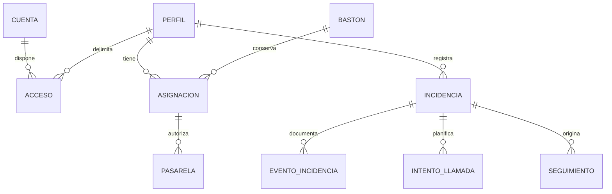

# GUARDMe — Modelo de datos, diccionario y persistencia

**Documento:** BE-04 de 10 · **Versión:** 1.1 · **Fecha:** 14 de noviembre de 2026  
**Estado:** desglose documental de la propuesta aprobada; no acredita implementación.  
**Origen:** secciones 11, 13, 14, 15, 16 y 20 de [Propuesta de backend](https://chatgpt.com/library?file_id=libfile_856c231c19bc819186a42b13a9a6c5c4&account_id=personal).  
**Lectura del conjunto:** [BE-01 — Índice y trazabilidad](01_Vision_Alcance_Requisitos_y_Trazabilidad.md).

Las reglas confirmadas del producto se conservan. Las precisiones nuevas se identifican como diseño propuesto; los puntos abiertos de la propuesta original siguen pendientes de definición. Este documento no contiene código de aplicación ni despliega servicios.

**Revisión 1.3 (17 nov 2026):** identidad viva = Better Auth + PostgreSQL (implementado).

**Revisión 1.1:** autenticación con Supabase Auth (histórico).

## 1. Objetivo y convenciones

PostgreSQL gestionado por Supabase conserva la fuente de verdad del producto. Este diccionario es conceptual: no contiene migraciones ni sentencias de creación de tablas. Los nombres lógicos orientan el modelo definitivo y su revisión.

Se proponen identificadores UUID, instantes con zona guardados en UTC y zona IANA separada para horarios de calendario. Los datos temporales distinguen ocurrencia, captura, recepción y modificación. Un reloj del teléfono no se trata como reloj confiable del servidor.

Los campos obligatorios mínimos son identificador, referencias necesarias, estado y fechas relevantes. Un valor desconocido no se sustituye por cero: batería desconocida es diferente de batería agotada y posición ausente no es coordenada cero.

## 2. Relaciones del núcleo

Cada asociación conserva el perfil como frontera de acceso. Los identificadores globales no hacen globalmente accesibles sus datos.

## 3. Identidad y configuración

| Entidad | Campos principales y tipos conceptuales | Restricciones |
| --- | --- | --- |
| Cuenta | ID UUID de dominio; auth_user_id UUID; nombre; tipo de incorporación; estado; alta; modificación | auth_user_id único y relacionado con auth.users.id; sin contraseña duplicada |
| Perfil asistido | ID; nombre; zona IANA; estado; alta; versión entera | Zona válida; versión aumenta al cambiar |
| Acceso a perfil | ID; cuenta; perfil; relación; categoría opcional; estado; vigencias | Una relación activa por cuenta/perfil; categoría solo para cuidador |
| Invitación | ID; perfil; emisor; resumen de secreto; destinatario opcional; caducidad; consumo | Secreto no recuperable como texto; consumo único |
| Instalación móvil | ID; cuenta; session_id de Auth; plataforma; versión app; token push protegido; estado; última actividad | Sesión asociada al principal; token push reemplazable; conservar historial al revocar |
| Incorporación supervisada | ID; perfil; emisor; resumen de código; vigencia; instalación consumidora | Acceso limitado y uso único |
| Progreso de configuración | Perfil/instalación; paso; estado; motivo; fecha | No confundir pasos locales y pruebas de servidor |

Nombre o teléfono coincidentes no se usan como clave de persona. Cambiar datos visibles de una cuenta no cambia el identificador de sus eventos históricos.

## 4. Dispositivos y observaciones

| Entidad | Campos principales | Restricciones |
| --- | --- | --- |
| Bastón | ID; serie; modelo; versión firmware; estado; referencia de incorporación | Serie única; secreto separado del identificador |
| Asignación | ID; bastón; perfil; inicio; fin; actor | Sin períodos activos simultáneos para un bastón |
| Pasarela | ID; asignación; instalación; inicio; fin; estado/versión | Una activa por bastón según política del piloto |
| Última telemetría | Bastón; asignación; batería opcional; carga opcional; sensor; enlace; captura; recepción | Batería en rango si existe; atribución a asignación correcta |
| Recepción de evento | Clave de origen; bastón/instalación; tipo; instante; resultado; referencia | Unicidad por origen; mínima información para deduplicar |
| Contador de falsas alarmas | Perfil; bastón opcional; acumulado; última actualización | Acumulado no negativo; incremento deduplicado |

Las medidas pertenecen a una asignación y fuente. Una telemetría atrasada del usuario anterior no reemplaza el último estado del usuario nuevo. La interfaz puede conservar la última observación, pero debe indicar su antigüedad.

El registro mínimo de recepción de una falsa alarma es técnico y temporal. No equivale a crear una incidencia individual visible. Su retención y la ventana máxima de aceptación de reenvíos deben coordinarse para no volver a contar un evento después de limpiar la deduplicación.

## 5. Contactos, incidentes y llamadas

| Entidad | Campos principales | Restricciones |
| --- | --- | --- |
| Contacto prioritario | ID; perfil; nombre; teléfono normalizado; orden; cuenta opcional; estado | Prioridad activa única por perfil; cuenta no obligatoria |
| Incidencia | ID; perfil; asignación/bastón opcionales; origen; evento fuente; estado; ocurrió; recibió; cerró; versión | Fuente única; origen manual puede no tener bastón |
| Evento de incidencia | ID; incidencia; tipo; actor; instante servidor; contexto mínimo | Cronología trazable; correcciones mediante otro evento |
| Plan de contacto | ID; incidencia; contactos copiados; política aplicada; estado | Un plan vigente por episodio |
| Intento de llamada | ID; plan; ordinal; contacto copiado; canal; referencia externa; estado; fechas | Ordinal único; como máximo un intento activo |
| Decisión de cuidador | ID; incidencia; cuenta; opción; instante; versión aplicada | Operación idempotente; no reemplaza evento de transporte |
| Evento de proveedor | Referencia/evento; intento; secuencia; estado; recepción; validación | Deduplicación y orden lógico; firma verificada |

Los contactos se copian al plan para conservar qué número se intentó durante ese episodio. Editar después el teléfono no reescribe el historial. La revocación sí se revisa antes de un intento futuro.

Los intentos conservan fallido, ocupado, no contestado, cancelado y respuesta de transporte. Una conexión a buzón no se registra automáticamente como cuidador informado.

## 6. Notificaciones y seguimientos

| Entidad | Campos principales | Restricciones |
| --- | --- | --- |
| Notificación | ID; tipo; perfil; destinatario; recurso; versión; vigencia; estado lógico | Recurso accesible según autorización actual |
| Entrega | ID; notificación; instalación/canal; referencia externa; aceptación; recepción; apertura; error | Evidencias separadas; reintentos no duplican aviso lógico |
| Seguimiento | ID; incidencia; estado; ronda; zona; programación; cierre/motivo | Una secuencia por cierre de incidencia |
| Consulta | ID; seguimiento; ronda; destinatario; prevista; publicada; límite; respuesta | Rondas acotadas; no crear consultas infinitas |
| Respuesta de seguimiento | Consulta; actor; opción; instante; versión | Una decisión vigente por consulta; correcciones auditadas |

Una notificación dirigida a una cuenta puede tener varias entregas por sus instalaciones. Abrirla en un teléfono no demuestra que otro la recibió.

La incidencia cerrada como “Recibió asistencia” no se convierte en inconclusa porque no se conteste una consulta posterior. El estado inconcluso pertenece al seguimiento.

## 7. Agenda, ubicación y operación

| Entidad | Campos principales | Restricciones |
| --- | --- | --- |
| Recordatorio | ID; perfil; tipo; título; autor; relación de autor al crear; vigencia; versión | Procedencia de cuidador inmutable para la regla de borrado |
| Horario | ID; recordatorio; hora local; días; zona; fechas de vigencia | Reglas validadas; no horarios como texto libre sin semántica |
| Ocurrencia | ID; recordatorio; instante previsto; estado; actor; momento de respuesta; versión | Única por horario/instante lógico |
| Consentimiento de ubicación | Perfil; alcance; autorizante; fecha; revocación; versión | No se deduce de permisos Android |
| Autorización de lectura | Consentimiento; cuenta/alcance; vigencia | Acceso activo y consentimiento actual |
| Última ubicación | Perfil; latitud; longitud; precisión; captura; recepción; instalación | Rangos válidos; posición anterior no sustituye una más reciente |
| Acción pendiente | ID; tipo; recurso; clave; estado; prevista; intentos; próximo intento; arrendamiento | Clave única; vencimiento y reintentos acotados |
| Auditoría | ID; actor; perfil; operación; resultado; instante; correlación | Sin PIN, secretos, token completo ni coordenadas innecesarias |

No se crean por defecto expedientes médicos, diagnósticos ni recorridos geográficos. La información de salud visible en un prototipo no se incorpora sin una definición funcional propia.

## 8. Integridad y transacciones

La persistencia debe proteger tanto invariantes simples como decisiones concurrentes. Se describen restricciones lógicas; el mecanismo exacto —índices, claves, bloqueo o control de versión— se decidirá al implementar.

| Invariante | Protección esperada |
| --- | --- |
| auth_user_id de cuenta no repetido | Unicidad y relación con auth.users.id |
| Una pasarela activa por bastón | Restricción y transacción de cambio |
| Un incidente por evento fuente | Unicidad de clave de origen |
| Cuatro posiciones de contacto sin duplicados | Unicidad plan/ordinal |
| Un intento activo | Serialización por incidencia |
| Un cierre y seguimiento | Cambio de estado y creación juntos |
| Regla de autor de recordatorio | Validación dentro de operación autorizada |
| Notificación pendiente no perdida | Cambio de dominio y acción pendiente juntos |
| Evento de proveedor no aplicado dos veces | Registro único y transición monotónica |

El envío externo queda fuera de la transacción. Una llamada creada por un proveedor puede tener resultado incierto; conservar esa incertidumbre es más correcto que insertar otra por un reintento ciego.

### Organización y políticas en Supabase

| Área | Propietario lógico | Exposición |
| --- | --- | --- |
| Esquema auth | Supabase Auth | Sin acceso directo desde Android ni migraciones propias |
| Esquema guardme | Dominio GuardMe | Privado; fuera de Data API |
| Esquema de pg-boss | Herramienta de tareas | Técnico, no expuesto a clientes |
| Definiciones de políticas y roles | Historial de migraciones GuardMe | Revisadas y versionadas |

La relación auth_user_id conserva la separación entre identidad y persona asistida. Una persona asistida no se identifica con la cuenta de su cuidador. Eliminar una identidad de Auth requiere preservar o anonimizar la cuenta histórica sin cascadas que destruyan incidencias, decisiones o autoría de recordatorios. La acción de borrado se definirá en la migración revisada.

El rol SQL ordinario de API no es propietario, no hereda privilegios administrativos y no tiene BYPASSRLS. Las políticas se aplican a ese rol real; el claim authenticated de un JWT no convierte una conexión Prisma en el rol PostgreSQL authenticated.

Cada operación protegida abre una transacción y establece contexto local con sujeto y claims ya verificados por NestJS. Las consultas de esa operación usan esa misma transacción. El contexto se elimina al terminar; nunca se conserva en variables de sesión que pueda heredar otro usuario en un pool. Sin contexto válido, la política debe negar el acceso.

| Clase de fila | Comprobación documental de RLS |
| --- | --- |
| Cuenta | Sujeto propio o operación interna expresamente autorizada |
| Perfil y relaciones | Acceso vigente; creación inicial con regla de incorporación controlada |
| Incidencia e historial | Perfil autorizado; fuente de pasarela atribuida correctamente |
| Recordatorio | Perfil y autoría original; prohibición de borrado por el usuario |
| Ubicación | Acceso vigente y consentimiento actual |
| Telemetría | Asignación válida y acceso al perfil correspondiente |
| Auditoría y tareas | Operaciones internas limitadas; sin concesión por rol de cuidador |

Los auxiliares de autorización deben evitar políticas recursivas sobre las propias tablas de acceso. Si se usa una función con privilegios elevados, se limita su finalidad, contexto de búsqueda y permiso de ejecución; no se publica una función genérica que exponga todas las filas.

El trabajador tiene un rol distinto para operaciones de sistema, no finge un usuario ni usa tokens guardados. Sus privilegios se acotan al procesamiento de recursos programados y se auditan. Las claves secretas de Supabase o service_role no son la conexión de ejecución de Prisma.

## 9. Índices y patrones de consulta

Se priorizan accesos activos por cuenta, historial por perfil/fecha, eventos por incidencia, ocurrencias por vencimiento, trabajo por estado/próxima ejecución y referencias externas únicas. La consulta del historial se pagina con orden estable.

Los índices se añaden por consultas concretas; no se indexa toda columna ni se copian datos de medicación a un buscador sin necesidad. El detalle de una incidencia no debe requerir cargar todos los perfiles de un cuidador.

La última ubicación y telemetría son vistas operativas pequeñas. Si se necesita histórico de sensores para calibración, se separará del tráfico del producto y tendrá finalidad, volumen y retención definidos.

## 10. Autoría, correcciones y conservación

Eliminar acceso no borra decisiones anteriores. Un actor puede quedar inactivo y seguir referenciado por el historial. La desactivación de un recordatorio impide nuevas ocurrencias conforme a política y conserva confirmaciones previas.

El borrado, anonimización y conservación requieren una política explícita. No se fija en este documento un período legal o clínico. Los datos transitorios pueden tener menor retención que incidentes; mantener un identificador técnico no obliga a conservar todo el contenido.

Una corrección de historial debe conservar quién la realizó y qué versión corrigió, en lugar de sustituir silenciosamente un hecho relevante.

## 11. Evolución del esquema

La autoridad única para cambios del dominio será el historial de migraciones mediante Supabase CLI, incluyendo grants, RLS y funciones auxiliares. Prisma es el ORM y su modelo se sincroniza desde el esquema resultante; Prisma Migrate no ejecuta una segunda secuencia sobre esas tablas. El esquema auth y los demás esquemas gestionados se excluyen de la propiedad de migración de GuardMe. La evolución interna de pg-boss se controla aparte y no se ejecuta con privilegios DDL en el trabajador ordinario.

Cada cambio tendrá propósito, compatibilidad con apps existentes, migración de datos y método de recuperación. La estrategia propuesta es ampliar antes de retirar: introducir campo/estado compatible, adaptar consumidores y retirar lo antiguo después de comprobarlo.

Una restauración puede reintroducir trabajo ya ejecutado externamente. Por eso la recuperación debe reconciliar referencias de proveedor y no reproducir todo lo pendiente sin comprobación. Los detalles operativos se amplían en BE-09.

## 12. Revisión y aceptación

El modelo debe permitir dos cuidadores, dos perfiles y varios bastones sin duplicar personas. Debe conservar la autoría original de recordatorios, distinguir incidencia y seguimiento y responder al estado vigente sin perder hechos históricos.

Las pruebas revisan asignaciones simultáneas, reenvío tras fallo, dos cierres concurrentes, evento de proveedor repetido y limpieza de deduplicación. No se declara creada ni probada ninguna tabla durante esta entrega.

Relacionado: [BE-03](03_Identidad_Usuarios_Permisos_y_Configuracion_Inicial.md) para relaciones, [BE-05](05_Contratos_API_Eventos_y_Sincronizacion.md) para contratos, [BE-07](07_Notificaciones_Tareas_Recordatorios_y_Seguimientos.md) para trabajo persistente y [BE-09](09_Seguridad_Privacidad_Despliegue_y_Operacion.md) para conservación y restauración. Fuente tecnológica: PostgreSQL de Supabase y Prisma como ORM; referencias S2, S5 y S18–S22 de la propuesta vigente.

