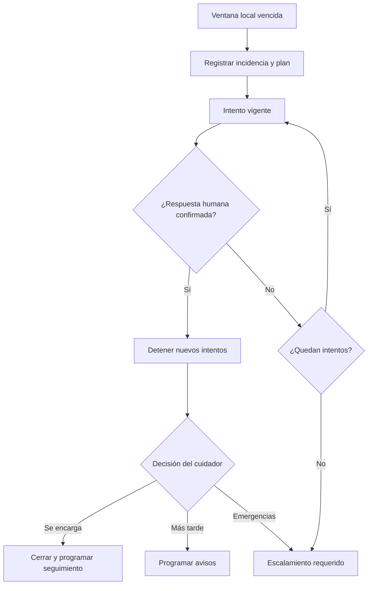

# GUARDMe — Incidencias, llamadas, escalamiento y atención

**Documento:** BE-06 de 10 · **Versión:** 1.1 · **Fecha:** 14 de noviembre de 2026  
**Estado:** desglose documental de la propuesta aprobada; no acredita implementación.  
**Origen:** secciones 8, 9, 10, 13, 19 y 20 de [Propuesta de backend](https://chatgpt.com/library?file_id=libfile_856c231c19bc819186a42b13a9a6c5c4&account_id=personal).  
**Lectura del conjunto:** [BE-01 — Índice y trazabilidad](01_Vision_Alcance_Requisitos_y_Trazabilidad.md).

Las reglas confirmadas del producto se conservan. Las precisiones nuevas se identifican como diseño propuesto; los puntos abiertos de la propuesta original siguen pendientes de definición. Este documento no contiene código de aplicación ni despliega servicios.

**Revisión 1.3 (17 nov 2026):** identidad viva = Better Auth + PostgreSQL (implementado). 911 en app = Dialer nativo (no VoIP Twilio).

**Revisión 1.1:** autenticación con Supabase Auth (histórico).

## 1. Objetivo e invariantes

La emergencia es un proceso con evidencias, no una pantalla ni un temporizador aislado. Este documento define progresión, decisiones humanas y límites de telefonía.

Invariantes: ninguna llamada a contactos antes de 30 segundos; orden 1–1–2–2; un intento activo; detención de intentos al responder; “Yo me encargo” cierra una vez; posponer después de estar informado no dispara ambulancia automática.

La identidad de las decisiones humanas se resuelve con Supabase Auth y la vinculación actual al perfil. Un callback de telefonía conserva su mecanismo de firma propio; no se autentica como cuidador usando una clave de Supabase. El cambio de plataforma no modifica la secuencia 1–1–2–2 ni las reglas de cierre.

El backend no incorpora inmovilidad ni valida clínicamente caídas. La detección física y sus falsos positivos se prueban por separado, según BE-08 y BE-10.

## 2. Primera ventana y transferencia al servidor

La detección obtiene un ID estable en el dispositivo/pasarela. Durante 30 segundos suena el bastón. La app permite indicar que la persona está bien sin producir sonido de emergencia remoto.

Una cancelación por botón o app resuelve esa detección. Se sincroniza el incremento agregado de falsa alarma. No se crea un episodio visible de emergencia para esa cancelación.

Si vence la ventana, Android persiste el evento y lo envía al servidor. El servidor guarda incidencia y acciones pendientes antes de confirmar registro.

Si el teléfono falla antes del envío, el backend no puede reconstruir un hecho que nunca recibió. La ventana local aprobada tiene esa limitación; no se añade una prealerta con escalamiento automático como si ya estuviera acordada.

## 3. Flujo principal

El diagrama resume la intención funcional. La definición de respuesta humana y el canal de llamada siguen sujetos a PD-01 y PD-03. “Escalamiento requerido” no significa llamada al 911 conectada.

## 4. Plan de contactos

| Posición | Destinatario | Intento |
| --- | --- | --- |
| 1 | Primer contacto prioritario | Primero |
| 2 | Primer contacto prioritario | Segundo consecutivo |
| 3 | Segundo contacto prioritario | Primero |
| 4 | Segundo contacto prioritario | Segundo consecutivo |
| Posterior | Servicio de emergencia | Según integración validada |

El plan toma una copia de nombres, teléfonos y prioridades al inicio, junto con la versión de política. Esto hace explicable el historial si después se cambia un número.

Antes de iniciar cada posición se comprueba estado de la incidencia, vigencia del contacto y disponibilidad del canal. Si un contacto fue retirado por seguridad o revocación, su copia histórica no autoriza a seguir llamándolo.

La duración de timbrado, pausas, ocupado, rechazo y destinatarios faltantes requieren PD-04. No se heredan automáticamente los 28 segundos ni los dos intentos a un mismo familiar de la demostración antigua.

## 5. Estados de la incidencia

| Estado | Entrada válida | Salida esperada |
| --- | --- | --- |
| Pendiente de contacto | Registro de evento vencido | Plan activado |
| Contactando | Creación de intento | Resultado o detención |
| Cuidador informado | Evidencia humana válida | Decisión sobre atención |
| Atención pospuesta | Elección explícita | Avisos y decisión posterior |
| Escalamiento requerido | Intentos agotados o acción humana | Vía validada o limitación visible |
| Cerrado con asistencia | “Yo me encargo” válido | Seguimiento independiente |

Los estados de transporte se guardan aparte. No se introduce “resuelto porque la llamada terminó”. La incidencia puede permanecer pendiente de una decisión aunque una conexión telefónica ya haya finalizado.

Cuando falte una vía de escalamiento, se conserva “escalamiento requerido” con motivo de indisponibilidad. No se marca como asistencia recibida para simplificar la interfaz.

## 6. Evidencia de respuesta humana

Una llamada puede ser respondida por buzón, centralita o máquina. Los estados de transporte de un proveedor no garantizan que un cuidador esté informado.

La propuesta conserva un adaptador de telefonía y plantea una interacción explícita: acción autenticada en la app o confirmación durante la llamada. Se debe definir qué interacción es admisible y cómo se relaciona con el contacto destinatario.

Al recibir respuesta de transporte se puede pausar el siguiente intento mientras se resuelve la confirmación. Eso no establece por sí solo el estado “cuidador informado”. Qué hacer ante buzón o confirmación ausente es PD-03 y bloquea declarar cumplido el recorrido automático.

Si otro cuidador autorizado asume atención desde la app mientras timbra una llamada, se propone que esa atención prevalezca y se solicite cancelar la llamada activa. Los callbacks tardíos conservan su hecho de transporte, sin reabrir el episodio.

## 7. Opciones del cuidador

### Yo me encargo

La operación verifica acceso y estado, registra decisión, cierra como “Recibió asistencia”, invalida nuevas acciones de contacto y crea un único seguimiento. Todos esos cambios deben confirmar de forma consistente.

Dos cuidadores concurrentes no generan dos cierres. La segunda petición recibe resultado existente o conflicto compatible con lo que ocurrió; nunca sobrescribe al primer actor silenciosamente.

El cierre acredita la decisión acordada del cuidador, no asistencia presencial comprobada.

### Contestar más tarde

Registra cuidador informado y posposición. Se programa aviso a cinco minutos y control de falta de respuesta a dos horas. Se propone contar ambos desde la decisión, pero el origen de las dos horas sigue señalado como PD-06.

El aviso a dos horas se dirige a los contactos definidos por PD-05. No reinicia por defecto la cascada 1–1–2–2 ni llama a la ambulancia automáticamente. La entrevista dejó esa decisión en la familia una vez informada.

Si antes del vencimiento se asume atención o se elige emergencias, los trabajos antiguos se vuelven incompatibles y no deben producir avisos contradictorios.

### Llamar a emergencias

Registra solicitud, actor, momento y vía. El backend ejecuta únicamente una capacidad validada. Si la app abre el marcador, se registra ese hecho como apertura/inicio solicitado y no como comunicación efectiva.

## 8. Dos formas de voz

| Modalidad | Qué permite | Qué requiere aclarar |
| --- | --- | --- |
| Telefonía convencional gestionada | Llamar a un número aunque no tenga app abierta | Cobertura, identidad del llamante, buzón, coste y respuesta humana |
| Voz dentro de GuardMe | Aceptación vinculada a cuenta y sesión de audio | Señalización, permisos de audio, funcionamiento en segundo plano y conectividad |

Una llamada automatizada que reproduce un aviso no es una conversación con la persona caída. Si se desea conversación bidireccional, el audio debe llegar al teléfono de la persona y probarse en condiciones reales.

No se presupone que el bastón tenga micrófono o altavoz apto para voz. Su buzzer y luz no implican capacidad telefónica.

## 9. Adaptador y callbacks

El adaptador debe crear, consultar y cancelar intentos, y traducir estados del proveedor a hechos del dominio sin perder información. Conserva referencia externa y correlación de la orden.

Los callbacks se autentican, deduplican y ordenan lógicamente. Un estado antiguo no reemplaza uno terminal. Un callback tardío de contestación de una llamada ya cancelada requiere registrar el hecho y evitar otro intento, no ignorar la realidad por conveniencia.

Un corte después de solicitar una llamada deja un resultado incierto. Se consulta al proveedor o se espera su evento correlacionado antes de volver a marcar. Una tabla de intentos únicos no evita por sí sola que una repetición HTTP cree dos llamadas externas.

## 10. Escalamiento al 911

Se conserva la restricción verificada en la propuesta: ACTION_CALL común de Android no permite números de emergencia; ACTION_DIAL puede abrir el marcador, con intervención. Ser marcador predeterminado implica requisitos propios.

Las guías de Twilio para Panamá no permiten llamadas a servicios de emergencia. Twilio puede evaluarse para contactos convencionales, no se adopta como vía al 911.

Por ello la primera prueba de viabilidad debe determinar una integración real para el entorno del piloto. Si solo puede abrirse el marcador, se documentará como alcance parcial. El requisito automático no se declara satisfecho ni se elimina silenciosamente.

Las pruebas rutinarias utilizan destinos y entornos autorizados. Una validación contra un servicio real de emergencias requiere coordinación específica; no forma parte de la producción documental.

## 11. Emergencia manual y falta de conectividad

La acción manual no espera la ventana de detección de caída; corresponde a una decisión directa de la persona. Se registra origen manual y se notifica a familiares conforme a la política de destinatarios.

Si la acción telefónica puede realizarse localmente pero no hay internet, la app debe distinguir “contacto telefónico solicitado” de “familiares notificados”. El evento remoto queda pendiente y luego se sincroniza con su antigüedad real.

El registro tardío no debe afirmar que el servidor conocía la emergencia en tiempo real.

## 12. Casos alternativos y revisión

| Caso | Tratamiento requerido |
| --- | --- |
| No hay contactos | Mostrar configuración insuficiente y resolver PD-04 |
| Hay uno solo | No inventar un segundo ni repetir indefinidamente |
| Todos fallan por proveedor | Estado de fallo visible; no clasificar como ausencia humana |
| La persona indica estar bien después de activación | Registrar llegada tardía; política de cancelación remota PD-12 |
| Otro incidente llega durante uno activo | Correlación y política de episodios, sin fusionar solo por proximidad |
| Cuidador pierde acceso | No ejecutar nuevas decisiones o llamadas por ese acceso |
| Trabajo se repite después del cierre | Descartar efecto incompatible y conservar trazabilidad |
| App muestra una notificación antigua | Consultar estado antes de permitir acción |

La revisión exige reproducir orden de contactos, paradas y concurrencia con un proveedor real o un sustituto de prueba claramente identificado. Una simulación sirve para validar reglas, pero no demuestra cobertura telefónica.

Relacionado: [BE-05](05_Contratos_API_Eventos_y_Sincronizacion.md), [BE-07](07_Notificaciones_Tareas_Recordatorios_y_Seguimientos.md) y [BE-10](10_Plan_de_Implementacion_Pruebas_y_Aceptacion.md). Fuentes: [Intent Android](https://developer.android.com/reference/android/content/Intent), [marcador predeterminado](https://developer.android.com/develop/connectivity/telecom/dialer-app), [guías Panamá](https://static1.twilio.com/en-us/guidelines/pa/panama--voice-guidelines---twilio) y [eventos Twilio](https://www.twilio.com/docs/voice/api/call-resource).

