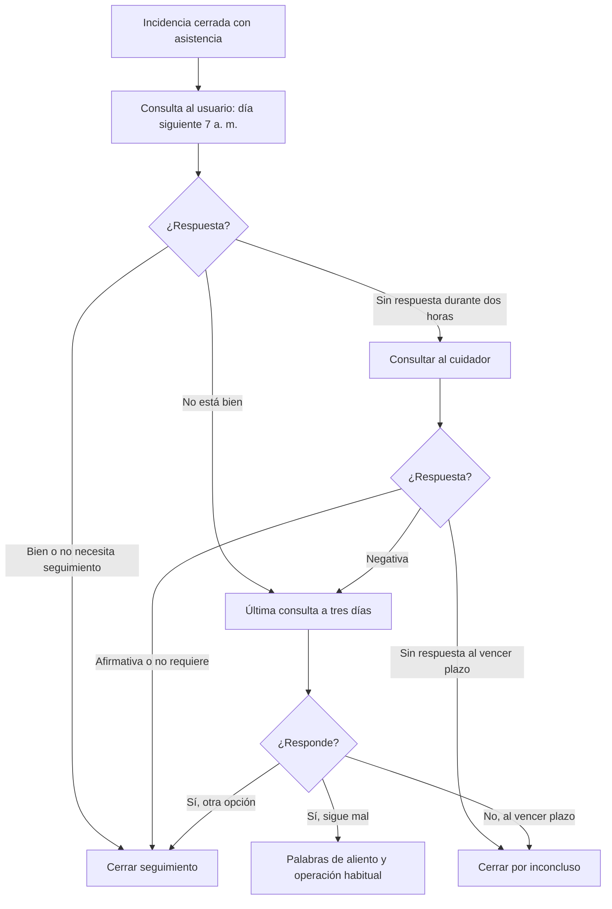

# GUARDMe — Notificaciones, tareas, recordatorios y seguimientos

**Documento:** BE-07 de 10 · **Versión:** 1.1 · **Fecha:** 14 de noviembre de 2026  
**Estado:** desglose documental de la propuesta aprobada; no acredita implementación.  
**Origen:** secciones 8, 10, 13, 14 y 15 de [Propuesta de backend](https://chatgpt.com/library?file_id=libfile_856c231c19bc819186a42b13a9a6c5c4&account_id=personal).  
**Lectura del conjunto:** [BE-01 — Índice y trazabilidad](01_Vision_Alcance_Requisitos_y_Trazabilidad.md).

Las reglas confirmadas del producto se conservan. Las precisiones nuevas se identifican como diseño propuesto; los puntos abiertos de la propuesta original siguen pendientes de definición. Este documento no contiene código de aplicación ni despliega servicios.

**Revisión 1.3 (17 nov 2026):** identidad viva = Better Auth + PostgreSQL (implementado).

**Revisión 1.1:** autenticación con Supabase Auth (histórico).

## 1. Objetivo

Los procesos diferidos no dependen de que una pantalla permanezca abierta ni de que una petición HTTP siga esperando. PostgreSQL conserva estado y vencimientos; el trabajador decide si la acción sigue siendo válida.

Se conserva pg-boss para ejecución persistente. Su entrega al menos una vez obliga a manejar repeticiones. El objetivo no es ejecutar cada manejador una sola vez, sino que repetirlo no repita indebidamente la acción del producto.

El backend no garantiza que un aviso suene a una hora exacta en un teléfono sin conexión o sin permisos. Debe registrar programación, envío y evidencias reales.

## 2. Capas de trabajo

| Capa | Contenido | Responsabilidad |
| --- | --- | --- |
| Dominio | Incidencia, seguimiento, recordatorio | Decide qué debe ocurrir |
| Acción pendiente | Recurso, efecto, vencimiento, clave | Conserva intención después de confirmar datos |
| Cola persistente | Trabajo ejecutable y reintentos | Distribuye ejecución a trabajadores |
| Adaptador | FCM o telefonía | Comunica con servicio externo |
| Evidencia | Referencia y resultado | Permite explicar lo ocurrido |

Como diseño detallado se propone utilizar acciones pendientes transaccionales como registro duradero y pg-boss para distribuir su procesamiento. Los consumidores vuelven a comprobar el registro antes de ejecutar. Se evita mantener dos programaciones independientes que puedan generar el mismo efecto.

Las tablas internas del gestor de cola no sustituyen a notificaciones, consultas y ocurrencias del dominio.

En la revisión 1.1 las acciones y datos viven en PostgreSQL de Supabase. El trabajador conserva rol y pool propios; no se ejecuta bajo el JWT del cuidador que creó el recordatorio o cerró la incidencia. Una tarea a tres días no depende de que ese access token continúe vigente. Se comprueban estado del recurso y destinatarios actuales, conservando autoría histórica sin exigir que la sesión del creador permanezca abierta.

pg-boss usa un esquema técnico no expuesto y una conexión apropiada para su modo de trabajo. El pool transaccional de la API no se adopta automáticamente para el trabajador ni para LISTEN/NOTIFY. La compatibilidad se verifica con la versión seleccionada.

## 3. Catálogo de trabajos

| Trabajo | Disparador | Momento | Verificación previa |
| --- | --- | --- | --- |
| Publicar aviso de caída | Incidencia activa | Después de registro | Destinatario autorizado y episodio vigente |
| Iniciar siguiente intento | Resultado anterior | Según política de contacto | Sin cuidador informado ni intento activo |
| Conciliar llamada incierta | Resultado ambiguo | Reintento controlado | Referencia/correlación de proveedor |
| Avisar posposición | Decisión de cuidador | Cinco minutos | Sigue pospuesta |
| Avisar falta de respuesta | Posposición sin respuesta | Dos horas según PD-06 | No hay atención posterior |
| Primera consulta | Cierre con asistencia | Día siguiente, 7:00 a. m. | Seguimiento vigente |
| Derivar consulta | Usuario sin responder | Dos horas desde consulta | Sigue sin respuesta |
| Última consulta | Respuesta negativa | Tres días después | No cerrada ni cancelada |
| Publicar recordatorio | Ocurrencia generada | Horario previsto | Definición vigente |
| Reintentar entrega | Fallo recuperable | Espera progresiva | Aviso no caducado y acceso vigente |

No existe un trabajo que vuelva a llamar automáticamente al 911 tras una posposición informada: ese comportamiento contradice la entrevista.

## 4. Ciclo de vida y errores

Una acción pendiente pasa por programada, disponible, tomada por trabajador y resultado final. La toma tiene vigencia para recuperarse si el proceso falla. El resultado puede ser realizado, reprogramado, descartado por estado obsoleto o error final visible.

| Fallo | Tratamiento |
| --- | --- |
| Base temporalmente no disponible | Conservar trabajo; recuperar conexión |
| Error recuperable de proveedor | Reintento acotado con espera |
| Token push inválido | Retirar token de esa instalación y registrar fallo |
| Destinatario revocado | Descartar envío sin cambiar el historial anterior |
| Acción ya satisfecha | Resultado idempotente |
| Estado cambió | Descartar efecto incompatible |
| Llamada pudo crearse pero no hay respuesta | Conciliar antes de marcar otra vez |
| Reintentos agotados | Error operativo visible; no silencio ni bucle infinito |

La cola de errores permite diagnóstico y recuperación autorizada. Reprocesar un trabajo exige revisar el estado actual; no es una orden para repetir llamadas de episodios cerrados.

## 5. Política de notificaciones

| Tipo | Presentación | Prioridad lógica | Caducidad |
| --- | --- | --- | --- |
| Caída activa | Aviso visible e identificador de incidencia | Urgente | Ligada a vigencia del episodio |
| Cambio de atención | Actualización comprensible | Según relevancia | No debe reactivar alarma cerrada |
| Posposición vencida | Recordatorio de decisión pendiente | Atención | Hasta decisión o política |
| Seguimiento | Pregunta de bienestar | Agenda | Hasta límite de respuesta |
| Medicamento/cita | Próxima ocurrencia | Agenda | Según horario y política |
| Desconexión | Estado discreto | Operativa | Sustituible por estado actual |

La prioridad técnica de FCM se elegirá conforme al tipo y a su documentación vigente. No se aplicará prioridad urgente a toda sincronización para intentar forzar actividad.

Se propone notificar caída a cuidadores vinculados habilitados, y llamar solo a dos contactos prioritarios. PD-05 conserva la necesidad de precisar destinatarios, especialmente del aviso colectivo tras posponer.

La notificación contiene un resumen breve que puede mostrarse sin red adicional y una referencia protegida al detalle. Evita coordenadas y medicación visibles en pantalla bloqueada.

## 6. Evidencias y deduplicación

Aceptación por FCM, recepción en instalación, apertura y acción humana tienen campos separados. Un indicador “leído” no se deriva de que FCM devolvió un identificador.

Una notificación lógica puede tener varias entregas porque una cuenta usa más de un teléfono. El reintento de una entrega no crea otro incidente ni otro aviso lógico.

En Android, el identificador estable permite actualizar la notificación. Al abrirla se comprueba el estado vigente y el acceso, especialmente si llegó tarde o fue retirado un cuidador.

La vida útil técnica ayuda a evitar avisos antiguos, pero no borra la incidencia persistida. El historial puede mostrar que se intentó avisar, que el aviso caducó y que no existe recepción confirmada.

## 7. Recordatorios: definición y ocurrencia

Una definición contiene tipo, título, autor, perfil, horarios, días, zona y vigencia. Una ocurrencia representa una ejecución concreta de esa definición. Esta separación permite editar un horario sin reescribir declaraciones previas.

Se generan ocurrencias con ID estable. Android descarga una ventana de próximas ocurrencias y programa señales locales. El backend comparte cambios y conserva respuestas. Se debe escoger un único disparador físico por ocurrencia para no duplicar luz/sonido cuando coinciden agenda local y push.

El usuario y cuidadores pueden crear recordatorios. El usuario no borra los creados por cuidadores; la procedencia se conserva aunque cambien las vinculaciones. El permiso de modificar/desactivar esos recordatorios continúa en PD-08.

## 8. Respuestas de medicamentos

| Estado | Qué representa | Regla |
| --- | --- | --- |
| Programado | Ocurrencia aún no atendida | No implica omisión |
| Avisado | Se intentó/se realizó presentación según evidencia | Separar entrega real |
| Tomado | Declaración desde la aplicación | Actor y fecha registrados |
| Pospuesto | Solicitud de volver a avisar | Duración por definir |
| Omitido | Declaración o política expresamente aprobada | No inferir por falta de push |
| Cancelado | Ocurrencia anulada por cambio válido | Conservar razón |

La entrevista aceptó Tomado, Pospuesto y Omitido. Los estados técnicos adicionales describen preparación y entrega, no agregan afirmaciones clínicas.

No se confirma medicación con el botón del bastón. La luz y el sonido son señales del aviso; su ejecución no confirma toma. La falta de respuesta y la regla de avisar al cuidador requieren política explícita.

Las citas pueden necesitar estados propios de recordatorio; no se les aplica “Tomado” por reutilizar una estructura de medicamento.

## 9. Seguimiento posterior al cierre

El diagrama desarrolla el flujo previsto. Los límites de respuesta del cuidador y de la última consulta, el destinatario final y su hora son PD-07; no se deducen automáticamente de las dos horas iniciales.

Las tres opciones base son “Me encuentro bien”, “No me encuentro bien” y “Gracias por estar pendientes, no necesito seguimiento”. Si la segunda respuesta vuelve a ser negativa, no se programa una tercera consulta ni escalamiento automático. La frase de aliento no expresa diagnóstico ni garantía de recuperación.

## 10. Calendario y zonas horarias

El primer vencimiento se calcula a las 7:00 a. m. del día siguiente al cierre, en la zona del perfil. No equivale a sumar 24 horas. Guardar zona e instante calculado permite explicar el resultado.

Para la consulta a tres días se propone misma hora local; sigue identificada como precisión pendiente. Los cambios de zona requieren regla: conservar el vencimiento ya informado o recalcular avisando del cambio. No se permite un desplazamiento silencioso que duplique consultas.

Se registran momento previsto, publicación y respuesta. Si el trabajador despierta tarde, no se cambia la programación original para ocultar el retraso.

## 11. Concurrencia y finalización

La primera respuesta válida de una consulta invalida tareas incompatibles. Una respuesta tardía después de derivar al cuidador no debe sobrescribir su decisión sin conservar la secuencia.

La incidencia sigue cerrada con asistencia mientras el seguimiento puede quedar cerrado por inconcluso. El resultado no altera automáticamente la batería, ubicación ni operación de detección.

Una cuenta revocada no recibe la consulta pendiente. La elección de otro cuidador requiere la política de destinatarios, no seleccionar arbitrariamente al primer registro de la base.

## 12. Revisión

Las pruebas deben adelantar relojes controlados para verificar cinco minutos, dos horas, día siguiente y tres días sin esperar esos plazos reales. Después se comprobará la agenda con dispositivos reales y restricciones de Android.

Se revisa reinicio antes/después de enviar, respuesta concurrente, entrega repetida, revocación y consulta vencida. Se exige que ningún fallo de notificación se traduzca automáticamente en una declaración de bienestar o ingesta.

Relacionado: [BE-04](04_Modelo_de_Datos_Diccionario_y_Persistencia.md), [BE-05](05_Contratos_API_Eventos_y_Sincronizacion.md), [BE-06](06_Incidencias_Llamadas_Escalamiento_y_Atencion.md) y [BE-08](08_Integracion_Movil_Baston_Telemetria_y_Ubicacion.md). Fuentes: [pg-boss](https://pgboss.io/introduction), [prioridad FCM](https://firebase.google.com/docs/cloud-messaging/android-message-priority) y [vida útil FCM](https://firebase.google.com/docs/cloud-messaging/customize-messages/setting-message-lifespan).

