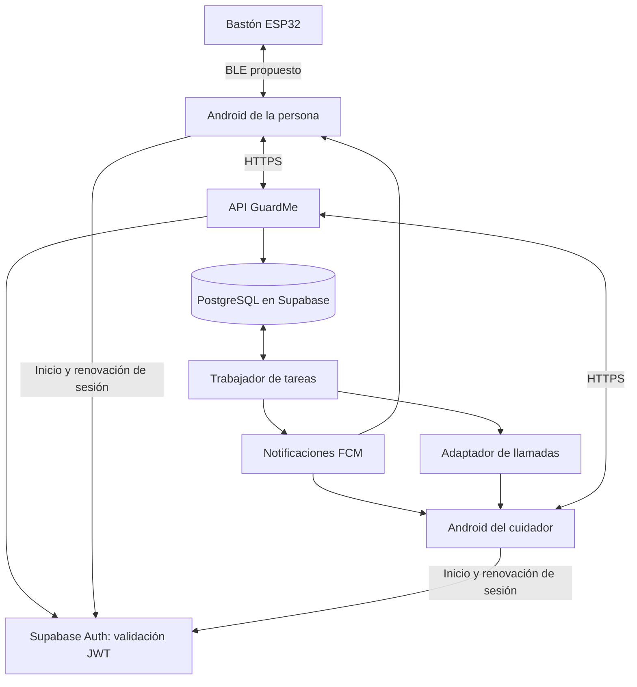
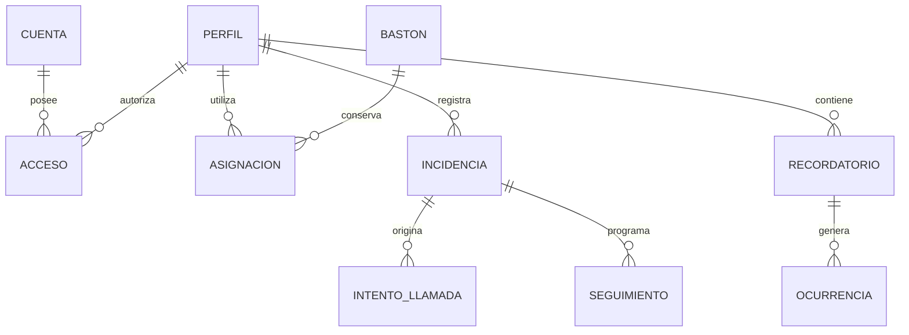

# GUARDMe — Propuesta de backend
**Fecha:** 14 de noviembre de 2026  
**Estado:** propuesta documental actualizada; no constituye implementación.  
**Versión:** 1.2 — Supabase Auth y PostgreSQL de Supabase; aclaraciones de integración ESP32.  
**Fuente funcional:** GUARDMe_Entrevista_Producto_20261114.md.  
**Alcance de esta entrega:** arquitectura, stacks, identidad, configuración inicial, comunicaciones, modelo de datos, interfaces conceptuales, operación y fases de construcción. No se crean servicios, migraciones, código de aplicación ni infraestructura.

**Revisión 1.2:** se incorpora [docs/ESP32](../ESP32/README.md) como referencia Arduino/firmware y borrador de contrato BLE. No cambia el stack seleccionado ni acredita conectividad. Se explicitan los bloqueos de conciliación entre cancelación y vencimiento.

## 1. Recomendación y objetivo

La base seleccionada es **Supabase Auth y PostgreSQL gestionado por Supabase**, con NestJS y TypeScript para la lógica del producto, Prisma como ORM, pg-boss para trabajo persistente y Firebase Cloud Messaging (FCM) para notificaciones Android. El mismo proyecto de backend tendrá dos procesos: API y trabajador. Supabase conserva identidad y datos; FCM se utiliza exclusivamente para push.

Esta es una elección de diseño para GuardMe, no una afirmación de que sea el único stack válido. Encaja con las relaciones entre usuarios y cuidadores, el historial y los cambios de estado que deben ocurrir de forma consistente. NestJS aporta una estructura modular y Prisma permite trabajar con PostgreSQL; sus integraciones están documentadas oficialmente [S1, S2]. pg-boss permite conservar tareas programadas en PostgreSQL sin añadir Redis en la primera versión [S3].

El objetivo es convertir el prototipo en un recorrido verificable entre bastón, teléfono de la persona, servidor y teléfono del cuidador. La ubicación real se intentará en la primera entrega y podrá diferirse, conforme a la entrevista.

**Decisión principal:** la lógica compartida de incidentes, permisos y seguimientos pertenece al backend. La detección física, la ventana inicial de cancelación y las señales del bastón requieren funcionamiento local.

## 2. Requisitos que condicionan la arquitectura

| Decisión de producto | Consecuencia para el backend |
| --- | --- |
| El bastón depende del teléfono | El teléfono actúa como pasarela; no se exige conexión directa bastón–nube. |
| Posibles caídas como único incidente automático | El dominio no incorpora inmovilidad ni diagnósticos automáticos. |
| 30 segundos para cancelar; solo suena el bastón | No se notifica ni llama a cuidadores durante esa ventana. |
| Cancelación física o en la aplicación | Ambas acciones deben identificar la misma detección. |
| Dos intentos consecutivos por cada uno de dos contactos | Plan de llamadas ordenado y persistente, con un único intento activo. |
| Detener intentos cuando un contacto contesta | Estado de llamada verificable y coordinación central de la secuencia. |
| Familiar y médico con capacidades equivalentes | La categoría del cuidador es descriptiva; no crea privilegios distintos. |
| Varios cuidadores y varias personas/bastones | Relaciones muchos a muchos; el acceso se comprueba por persona asistida. |
| “Yo me encargo” cierra como “Recibió asistencia” | Cierre transaccional y seguimiento posterior independiente. |
| Posposición de cinco minutos y aviso tras dos horas | Tareas persistentes que revisan el estado antes de ejecutarse. |
| Ubicación con aprobación inicial | Consentimiento, autorización vigente y antigüedad del dato. |
| Recordatorios compartidos | Cambios centralizados y sincronización a todos los participantes autorizados. |
| El usuario no borra recordatorios de cuidadores | Restricción comprobada en el servidor según autor y relación. |
| Emergencias accesibles sin PIN | La protección local no debe bloquear el flujo de emergencia; la API conserva autenticación. |

## 3. Arquitectura y responsabilidades

El diagrama representa componentes propuestos. El adaptador de llamadas no implica que esté contratada una plataforma ni que el 911 esté integrado.

### 3.1 Bastón

Detecta una posible caída, activa su alarma local, permite cancelar con el botón y comunica eventos al teléfono. Expone batería, carga y estado del sensor cuando el hardware pueda medirlos. Ejecuta señales de luz/sonido para recordatorios y desconexión.

Se propone BLE para la comunicación cercana. El servicio, las características, el emparejamiento y la autenticación del dispositivo se diseñarán en un contrato separado. El firmware actual no debe describirse como conectado hasta integrar y probar ese contrato.

El contrato lógico se documenta en [ESP-04](../ESP32/04_Contrato_BLE_Eventos_Comandos_y_Seguridad.md), versión propuesta 0.1. Sus UUID, formato físico, fragmentación, límites y seguridad siguen por cerrar. El código Arduino permanece en su carpeta de origen y su evaluación está en [ESP-01](../ESP32/01_Evaluacion_Firmware_y_Brechas.md). No se exige Wi-Fi o sesión Supabase al bastón.

### 3.2 Android de la persona

Recibe eventos BLE, conserva la ventana de 30 segundos y registra eventos localmente antes de enviarlos. Presenta la cancelación, envía incidencias, registra el resultado del envío y obtiene la ubicación cuando esté habilitada.

[ESP-03](../ESP32/03_Arquitectura_Firmware_Estados_y_Persistencia.md) propone respaldo temporal y estado recuperable en firmware; Android mantiene coordinación y publicación remota. Un episodio usa la misma identidad al detectar, cancelar, vencer y reenviar. Reinicios con tiempo incierto, arbitraje del segundo 30 y cancelación tardía siguen PD-12; no se inicia otra ventana silenciosamente al reconectar.

Mantiene una copia local de recordatorios y recibe órdenes destinadas al bastón. Para escucha BLE prolongada deben evaluarse CompanionDeviceService y los servicios en primer plano apropiados, conforme a la guía de Android [S4]. No se propone un temporizador de interfaz como único soporte del proceso ni una tarea diferida como garantía de ejecución exacta a los 30 segundos.

### 3.3 API

Autentica solicitudes, valida vinculaciones, recibe eventos, aplica reglas del producto, persiste cambios y publica trabajo pendiente. Expone el estado autorizado de las personas, bastones, incidencias y recordatorios.

La aplicación obtiene y renueva sesiones en Supabase Auth y consulta el dominio mediante la API NestJS. No accede directamente a tablas de negocio ni dispone de credenciales PostgreSQL. El esquema privado guardme no se expone mediante Data API; en esta arquitectura esa API se mantiene deshabilitada. Auth sigue siendo un servicio separado. RLS y los roles SQL se documentan como defensa adicional, sin asumir que Prisma propaga el JWT automáticamente [S5, S18, S19].

### 3.4 Trabajador persistente

Procesa notificaciones, secuencia de contactos, recordatorios y consultas posteriores. Cada ejecución comprueba que el estado todavía permite la acción. Un trabajo antiguo no debe llamar a contactos si alguien ya atendió el incidente.

No se requieren microservicios en esta etapa: API y trabajador comparten módulos y base de datos, aunque se ejecuten por separado. Esto permite reiniciar o ampliar el procesamiento sin dividir prematuramente el dominio.

## 4. Comparación de stacks y decisión actual

| Opción | Composición | Evaluación actual |
| --- | --- | --- |
| A. GuardMe sobre Supabase | Supabase Auth y PostgreSQL; NestJS, Prisma, pg-boss y FCM | **Seleccionada por el responsable del proyecto.** Conserva la lógica de incidentes y los procesos persistentes. |
| B. Más servicios nativos de Supabase | Supabase Auth, PostgreSQL y posibles Edge Functions, Realtime o Queues | Evolución posible; no se sustituyen automáticamente API, trabajador ni push. |
| C. Alternativas de la revisión anterior | Identidad de Firebase y PostgreSQL externo, o stack Firestore/Cloud Functions | Referencia histórica, no base de la versión 1.1. |

La elección aplica a autenticación y base de datos. No traslada las reglas de emergencia al cliente ni convierte Realtime en un canal de notificación móvil. FCM permanece para push; no hay dos proveedores de autenticación en el diseño vigente.

No se fijan versiones ni costes sin validarlos. Se conserva la comparación anterior como antecedente, pero deja de orientar las dependencias activas. La operación y límites del proyecto Supabase se dimensionarán con el piloto.

## 5. Stack recomendado por componente

| Componente | Propuesta | Función |
| --- | --- | --- |
| API | NestJS y TypeScript | Validación, autorización, reglas de negocio e interfaces. |
| Datos | PostgreSQL de Supabase | Relaciones, historial, consistencia y programación persistente. |
| Acceso a datos | Prisma como ORM | Consultas del backend; contexto por operación para RLS. |
| Evolución de esquema | Migraciones versionadas mediante Supabase CLI | Fuente única de cambios para dominio, grants, políticas y funciones; no ejecutar Prisma Migrate en paralelo. |
| Tareas | pg-boss | Trabajo diferido y reintentos sobre PostgreSQL. |
| Identidad | Supabase Auth | Acceso, renovación, recuperación y validación de sesiones. |
| Push Android | FCM desde el servidor | Avisos visibles y señales para sincronización. |
| Comunicación móvil | HTTPS; actualización al recibir push o volver a la app | Operaciones y consulta del estado autorizado. |
| Actualización en pantalla | SSE opcional | Refresco mientras la app está abierta; no sustituye push. |
| Llamadas | Interfaz de proveedor independiente | Evitar que incidentes dependan de una plataforma concreta. |
| Documentación de interfaces | OpenAPI | Contrato revisable para Android y backend. |
| Empaquetado futuro | Contenedores | Entornos reproducibles para API y trabajador. |

No se incorporan inicialmente Redis, MQTT, Kubernetes, un motor de búsqueda ni una base de datos especializada en series temporales. Se reevaluarán si el volumen y las mediciones lo justifican.

## 6. Identidad, tipos de usuario y permisos

### 6.1 Separar cuenta de acceso y persona asistida

Una **cuenta** identifica a quien inicia sesión. Un **perfil de persona asistida** identifica a quien utiliza el bastón. Separarlos permite que un cuidador configure el perfil de otra persona y supervise varios perfiles sin mezclar sus datos.

La capacidad de acceso se registra mediante una vinculación entre cuenta y perfil:

| Concepto | Significado |
| --- | --- |
| Cuenta | Identidad autenticada y sus datos básicos. |
| Perfil asistido | Persona que utiliza uno o más bastones. |
| Vinculación | Acceso de una cuenta a un perfil como usuario o cuidador. |
| Categoría de cuidador | Familiar o personal médico; mismos permisos funcionales. |
| Instalación móvil | Una instalación concreta con su sesión y token push. |
| Asignación de bastón | Relación del dispositivo físico con un perfil durante un período. |

Una misma cuenta puede tener diferentes relaciones según el perfil. La aplicación no debe confiar en un rol global enviado por el cliente ni permitir que seleccionar “médico” amplíe el acceso.

### 6.2 Matriz propuesta

| Operación sobre un perfil vinculado | Usuario del bastón | Cuidador familiar | Cuidador médico |
| --- | --- | --- | --- |
| Consultar bastón e historial | Sí | Sí | Sí |
| Atender un incidente | Cancelar/indicar estado propio | Sí | Sí |
| Administrar contactos y vinculaciones tras desbloqueo | Sí | Sí | Sí |
| Consultar ubicación | Propia | Con autorización vigente | Con autorización vigente |
| Crear recordatorios | Sí | Sí | Sí |
| Borrar recordatorio creado por el usuario | Sí | Sí | Sí |
| Borrar recordatorio creado por cuidador | **No** | Sí, dentro del perfil | Sí, dentro del perfil |
| Confirmar un recordatorio desde la app | Para el usuario | Registro asistido por definir | Registro asistido por definir |

Las capacidades administrativas son propuestas dentro del criterio de control por desbloqueo expresado en la entrevista. No se introduce un cuidador principal ni una jerarquía familiar/médica.

La prohibición confirmada afecta al borrado. El permiso del usuario para modificar o desactivar recordatorios creados por un cuidador queda pendiente; no se inventa una restricción como requisito definitivo.

### 6.3 PIN e identidad remota

El PIN es la protección propia de GuardMe en el teléfono. No sustituye una cuenta autenticada ni se utiliza como contraseña de la API.

La aplicación mantiene una sesión para enviar emergencias sin solicitar el PIN. El servidor comprueba identidad, estado de la instalación y vinculación al perfil. Un cliente no autenticado no obtiene acceso a los datos porque conozca un número de bastón.

Se propone gestionar el verificador del PIN y secretos locales de manera protegida; Android Keystore protege claves criptográficas, pero no debe confundirse con un servicio que valide automáticamente un PIN propio de GuardMe [S8]. No se registrará el PIN en logs.

Android presenta el access token de Supabase Auth. NestJS valida firma y claims con un verificador mantenido compatible con las claves del proyecto, comprobando emisor, audiencia, expiración y sujeto; no basta decodificar el JWT. La cuenta de dominio mantiene auth_user_id UUID vinculado de forma única a auth.users.id [S9].

Una firma válida no demuestra que la sesión o la vinculación sigan activas. El cierre de sesión puede dejar un JWT vigente hasta expirar. GuardMe comprueba instalación y accesos actuales y verifica el session_id mediante una comprobación restringida de sesión activa del servidor; las tablas de Auth no se exponen a Android. La política de cierre local/global se hace explícita [S20].

## 7. Configuración inicial

### 7.1 Si configura el usuario del bastón

1. Selecciona “Soy quien utiliza el bastón”.
2. Crea o inicia su cuenta.
3. Crea su perfil y configura el PIN.
4. Vincula físicamente el bastón y registra el teléfono como pasarela.
5. Añade los contactos y ordena los dos primeros.
6. Vincula a cuidadores mediante una invitación aceptada.
7. Decide compartir ubicación y autoriza a los participantes correspondientes.
8. Concede permisos necesarios y completa una prueba de conexión y aviso.
9. La aplicación muestra las funciones disponibles y las que aún no tienen permisos o integración.

### 7.2 Si configura un cuidador

1. Selecciona “Estoy configurando como cuidador” y su categoría.
2. Accede con su propia cuenta.
3. Crea un perfil asistido o acepta una invitación a uno existente.
4. Configura bastón, contactos, consentimiento y recordatorios.
5. Vincula el teléfono que llevará la persona.
6. Añade otros cuidadores y completa las pruebas.

Crear el perfil no debe crear otro perfil duplicado cada vez que se añade un cuidador.

### 7.3 Teléfono de la persona configurado con asistencia

No se propone dejar la cuenta personal del cuidador iniciada permanentemente en el teléfono del usuario. Se propone una identidad supervisada, vinculada solo al perfil correspondiente, si la persona no utilizará un inicio de sesión propio.

El cuidador autorizado genera un código temporal de incorporación a un perfil. Para un teléfono sin cuenta recuperable propia, se propone una sesión anónima de Supabase Auth como identidad técnica y, después, consumir ese código mediante NestJS. Solo el consumo válido crea la cuenta/vinculación autorizada; una sesión anónima por sí sola no concede acceso. No se emiten tokens personalizados de Firebase ni se entrega la sesión del cuidador [S10].

La pérdida de una sesión anónima requiere reincorporación autorizada y retirada de la instalación anterior, o vincular previamente un método recuperable. El PIN no recupera esa identidad. Se deben definir protección antiabuso, limpieza de identidades no vinculadas y experiencia de recuperación antes del piloto.

### 7.4 Vinculación de bastones y cuidadores

El número de serie identifica un bastón, pero no demuestra posesión. Se propone un código secreto de incorporación y confirmación de proximidad física; el procedimiento BLE exacto queda pendiente.

Las invitaciones a cuidadores caducan, tienen un único uso y crean acceso únicamente al perfil indicado. Debe poder retirarse el acceso, invalidando también consultas de ubicación y acciones posteriores. Desbloquear GuardMe permite gestionar los perfiles ya autorizados; no concede acceso a perfiles ajenos.

Como política propuesta del piloto, cada bastón tendrá una sola pasarela activa para evitar que dos teléfonos generen el mismo episodio. El cambio de pasarela será explícito y quedará registrado.

## 8. Comunicación de una caída

### 8.1 Ventana local de 30 segundos

El bastón genera un identificador de detección. El teléfono lo registra localmente y coordina la espera de 30 segundos. Una cancelación desde el botón o la aplicación resuelve esa misma detección.

Se propone que el evento que activa la emergencia remota se envíe **después de terminar la ventana sin cancelación**. Una falsa alarma cancelada se sincroniza como incremento agregado y no como incidencia clínica visible.

Esta decisión preserva el requisito de no avisar antes de los 30 segundos y evita una emergencia remota cuando una cancelación física no logra llegar al servidor. Tiene una limitación: si el teléfono falla antes de enviar la incidencia, el backend no puede conocerla. El recorrido no puede considerarse autónomo ni garantizado sin teléfono. En una evolución podría estudiarse una prealerta silenciosa al servidor, pero habría que acordar qué hacer si después se pierde la conexión.

### 8.2 Recepción y persistencia

El teléfono envía la detección vencida con identificador único, bastón, momento de ocurrencia, versión de protocolo y contexto de conectividad. La ubicación se adjunta solo si está habilitada y disponible; su ausencia no bloquea el incidente.

El servidor:
1. Autentica la instalación y resuelve el perfil desde la asignación vigente del bastón.
2. Valida formato, vinculación y duplicados.
3. Guarda incidencia, primer evento de historial y acciones pendientes en una transacción.
4. Devuelve confirmación de persistencia con identificador del incidente.
5. El trabajador envía las notificaciones y comienza la secuencia de contacto.
6. Cada dispositivo confirma por separado recepción o acción, cuando pueda hacerlo.

Repetir el envío por un corte de red devuelve la misma incidencia. La confirmación del servidor significa “registrado”, no “cuidador informado”.

### 8.3 Distribución de avisos

Se propone enviar la notificación de caída a todos los cuidadores vinculados habilitados para avisos, después de la ventana, mientras las llamadas respetan exclusivamente los dos contactos prioritarios. Este alcance de destinatarios es una propuesta pendiente de ratificación.

Las notificaciones contienen información breve para mostrarse sin otra petición inicial y un identificador que permite consultar el detalle autorizado. Evitar ubicación exacta o datos de medicación visibles en la pantalla bloqueada.

Se deben distinguir:
- Registrado por GuardMe.
- Aceptado por FCM.
- Recibido por la instalación, cuando exista confirmación.
- Abierto.
- Aceptado/atendido por una persona.

FCM confirma aceptación para entrega, no entrega efectiva. Su prioridad y las restricciones del dispositivo influyen en el comportamiento; no debe usarse como prueba de que alguien está enterado [S11, S12]. Android requiere permisos de notificación en las versiones correspondientes [S13].

### 8.4 Emergencia iniciada directamente

La acción crea un registro de origen “emergencia manual”, avisa a los familiares conforme a las vinculaciones y permite iniciar el contacto con emergencias.

Abrir el marcador no acredita que la llamada se haya realizado ni que se haya enviado una ambulancia. Si no hay internet, la aplicación conserva el registro pendiente e indica que el aviso remoto aún no fue enviado.

### 8.5 Puerta de integración con el episodio físico

El [mapeo ESP32–Android–API](../ESP32/06_Integracion_Backend_BetterAuth_y_Contratos_API.md) distingue el ID de registro BLE del ID de episodio remoto. NestJS verifica pasarela activa y asignación; no acepta la serie como prueba de posesión ni el perfil del cuerpo como autoridad.

Se debe completar el arbitraje transaccional entre caída vencida y cancelación: una cancelación válida registrada primero impide activar posteriormente ese mismo episodio por un vencimiento contradictorio. En el orden inverso, la política de cancelación tardía sigue pendiente y no equivale a cierre asistencial. Un silenciamiento posterior al plazo no incrementa falsas alarmas automáticamente. Las claves idempotentes independientes no resuelven por sí solas ese conflicto.

Los DTO, errores y pruebas de ese arbitraje deben formalizarse antes de habilitar avisos y llamadas desde el recorrido integrado. La [matriz ESP-07](../ESP32/07_Plan_Implementacion_Pruebas_y_Aceptacion.md) complementa los criterios backend; las rutas documentadas todavía no existen en el código revisado.

## 9. Llamadas y escalamiento al 911

### 9.1 Tres comunicaciones diferentes

| Canal | Función | Evidencia de respuesta |
| --- | --- | --- |
| Push | Alertar y abrir el detalle | Acuse de instalación o acción autenticada. |
| Llamada dentro de GuardMe | Comunicación de voz mediante proveedor de audio | Aceptación de sesión y conexión de audio según contrato del proveedor. |
| Llamada telefónica convencional | Alcanzar el número prioritario | Eventos del proveedor o integración telefónica comprobada. |

Una notificación sonora no se documentará como una llamada real. La elección entre llamada dentro de la app y llamada telefónica sigue abierta en la memoria de producto.

### 9.2 Recomendación para las llamadas a contactos

Probar primero un adaptador de telefonía gestionada para llamadas convencionales a cuidadores. Twilio es un candidato para esta prueba, no un compromiso definitivo: sus guías contemplan llamadas a números de Panamá, sujetas a condiciones del servicio [S14].

El adaptador debe iniciar, consultar y cancelar intentos; recibir eventos firmados; y asociar cada llamada a la incidencia y su posición. El mensaje de voz puede informar del incidente y remitir a GuardMe para elegir una acción. Si se desea conversación directa con la persona, se necesitará además un canal de audio al teléfono y una prueba de voz de extremo a extremo. No se presupone micrófono ni altavoz de conversación en el bastón.

Una conexión telefónica puede ser atendida por un buzón. Los estados de proveedor no equivalen necesariamente a respuesta humana [S15]. Propuesta: pausar nuevos intentos cuando exista respuesta de transporte y confirmar presencia humana mediante acción en la app o interacción explícita durante la llamada. Qué hacer si solo responde un buzón debe acordarse antes de declarar cumplida la regla “se detiene cuando contesta”.

### 9.3 Secuencia persistente

El plan contiene cuatro posiciones: contacto 1/intento 1; contacto 1/intento 2; contacto 2/intento 1; contacto 2/intento 2. Se toma una copia de los contactos al comenzar el episodio, para que un cambio de prioridad durante la emergencia no desordene los intentos. Una revocación de acceso o contacto sí debe comprobarse antes de marcar.

Solo existe un intento activo por incidente. Al contestar se invalidan los trabajos de marcación restantes. El historial conserva cada resultado y distingue no contestado, ocupado, fallido, cancelado y respuesta de transporte.

Si no hay cuatro intentos posibles por falta de contactos, la configuración debe mostrarlo. No se inventan contactos ni llamadas exitosas. La política exacta con cero o un contacto está pendiente.

### 9.4 Limitación comprobada para el 911

La API común de Android ACTION_CALL no permite llamadas a números de emergencia; ACTION_DIAL permite abrir el marcador para ellas. El papel de marcador predeterminado tiene reglas adicionales y no se obtiene por añadir un permiso [S16, S17].

Además, las guías de Twilio para Panamá indican que las llamadas a servicios de emergencia no están permitidas en esa plataforma [S14].

Por tanto:
- **No se propone Twilio como vía al 911 de Panamá.**
- El backend puede registrar que corresponde escalar y avisar a los cuidadores.
- El acceso al marcador de emergencia con intervención de la persona es una alternativa parcial.
- Una llamada automática al 911 sin intervención requiere una integración validada para el dispositivo y el entorno de operación. No se promete en este documento.
- La alternativa parcial no cumple por sí sola el requisito original de escalamiento automático.

El requisito se conserva como objetivo y dependencia de viabilidad. Debe resolverse en la primera fase técnica, antes de considerar completo el recorrido. No se harán pruebas no coordinadas contra una línea real de emergencias.

## 10. Estados y temporizadores

### 10.1 Incidencia y atención

| Estado conceptual | Significado | Próxima acción |
| --- | --- | --- |
| Pendiente de contacto | Incidencia persistida y activada | Ejecutar plan de contactos. |
| Contactando | Hay intento activo | Esperar resultado verificable. |
| Cuidador informado | Se ha confirmado respuesta humana | Presentar las tres acciones. |
| Atención pospuesta | Cuidador eligió contestar más tarde | Programar aviso de cinco minutos y control de dos horas. |
| Escalamiento requerido | Se agotaron los intentos sin respuesta | Invocar vía disponible; señalar limitaciones. |
| Cerrado con asistencia | Se confirmó “Yo me encargo” | Registrar “Recibió asistencia” y crear seguimiento. |

El escalamiento solicitado, el marcador abierto y la llamada conectada son hechos distintos. Ninguno se convierte automáticamente en “ayuda en camino”.

### 10.2 Política temporal

| Regla | Plazo | Fuente de tiempo |
| --- | --- | --- |
| Cancelación inicial | 30 segundos | Reloj monotónico local; estado persistido. |
| Aviso por posposición | Cinco minutos | Servidor, desde la decisión del cuidador. |
| Aviso colectivo por falta de respuesta | Dos horas | Se propone contar desde esa misma decisión. |
| Primera consulta posterior | Día siguiente, 7:00 a. m. | Zona horaria del perfil. |
| Derivación de consulta al cuidador | Dos horas sin respuesta del usuario | Servidor, desde la primera consulta. |
| Última consulta tras respuesta negativa | Tres días después | Se propone misma hora local. |

El origen del plazo de dos horas tras posponer y la hora de la consulta a tres días son convenciones propuestas, no decisiones explícitas de la entrevista. Se sugiere América/Panamá como zona inicial del piloto, editable; los instantes se guardan en UTC y los horarios de calendario conservan su zona IANA.

### 10.3 Seguimiento independiente

“Yo me encargo” cierra la incidencia, no espera a que termine el seguimiento.

El seguimiento consulta primero a la persona y, si no responde en dos horas, al cuidador. Si no hay respuesta, se cierra por inconcluso. Falta precisar la ventana de respuesta del cuidador; se propone que sea configurable antes del piloto.

Una respuesta afirmativa cierra el seguimiento. La respuesta de agradecimiento sin necesidad de seguimiento también lo cierra. Una respuesta negativa programa una única consulta a tres días. Si vuelve a indicar que está mal, se muestran palabras de aliento y termina el seguimiento programado sin alterar la operación habitual. Si no responde a la última consulta, se cierra por inconcluso. No se añade escalamiento médico automático a este flujo.

## 11. Modelo de base de datos

### 11.1 Identidad y dispositivos

| Entidad | Datos principales | Relaciones y reglas |
| --- | --- | --- |
| Cuentas | ID de dominio; auth_user_id UUID; nombre; tipo de incorporación; estado | auth_user_id único y relacionado con auth.users.id; sin duplicar contraseñas ni administrar el esquema Auth con el ORM. |
| Perfiles asistidos | Identificador, nombre, zona horaria, estado | Independientes de una cuenta de cuidador. |
| Accesos a perfiles | Cuenta, perfil, relación, categoría, estado | Una vinculación activa por cuenta/perfil; categoría no eleva permisos. |
| Invitaciones | Perfil, emisor, secreto resumido, caducidad, consumo | Uso único y revocable. |
| Instalaciones móviles | Cuenta, identificador de instalación, plataforma, token push, actividad | Token reemplazable; revocación por instalación. |
| Bastones | Identificador, serie, modelo, versión de firmware, estado | Serie única; incorporación acreditada por secreto/proximidad. |
| Asignaciones de bastón | Bastón, perfil, inicio, fin | Sin dos asignaciones activas para el mismo bastón. |
| Pasarelas | Instalación, asignación de bastón, período activo | Una pasarela activa por bastón en el piloto. |

### 11.2 Incidencias y comunicación

| Entidad | Datos principales | Relaciones y reglas |
| --- | --- | --- |
| Contactos prioritarios | Perfil, nombre, teléfono, orden, cuenta vinculada opcional | Teléfono no equivale a cuenta; prioridad única por perfil. |
| Incidencias | Perfil, bastón opcional, origen, evento fuente, estado, fechas, versión | Identificador fuente único; admite origen manual sin bastón. |
| Eventos de incidencia | Incidencia, tipo, actor, instante, contexto mínimo | Cronología de cambios y decisiones. |
| Intentos de llamada | Incidencia, posición, destinatario copiado, proveedor, estado, fechas | Posición única por incidencia; referencia de proveedor única cuando exista. |
| Decisiones del cuidador | Incidencia, cuenta, opción, instante, versión | Permite auditar atención y posposición. |
| Notificaciones | Destinatario, perfil, tipo, recurso, vigencia | Estado lógico del aviso, independiente del envío. |
| Entregas | Notificación, instalación, canal, referencia, estado, intentos | Separa aceptación del proveedor, recepción y apertura. |
| Seguimientos | Incidencia, ronda, destinatario, vencimiento, respuesta, estado | Una secuencia por cierre; rondas acotadas. |

### 11.3 Recordatorios, ubicación y operación

| Entidad | Datos principales | Relaciones y reglas |
| --- | --- | --- |
| Recordatorios | Perfil, tipo, título, autor, relación del autor al crearlo, estado, versión | La procedencia de cuidador se conserva aunque cambie su vinculación. |
| Horarios de recordatorio | Recordatorio, hora local, días, zona, vigencia | Conserva repetición y zona; no solo texto libre de hora. |
| Ocurrencias | Recordatorio, instante previsto, estado, actor de confirmación | Un registro por ocurrencia; Tomado, Pospuesto y Omitido según corresponda. |
| Consentimientos de ubicación | Perfil, autorización, participantes, fecha, revocación | Verificación antes de cada lectura remota. |
| Última ubicación | Perfil, coordenadas, precisión, captura, recepción | Una posición vigente; sin historial de recorridos por defecto. |
| Último estado del bastón | Bastón, batería, carga, sensor, enlace, última recepción | Datos desconocidos se muestran como desconocidos. |
| Contadores de falsas alarmas | Perfil/bastón, acumulado, última actualización | Valor agregado mostrado al usuario. |
| Recepciones de eventos | Clave fuente, tipo, resultado, recepción | Deduplicación mínima; no convierte falsas alarmas en incidencias visibles. |
| Acciones pendientes | Tipo, recurso, clave, vencimiento, estado, intentos | Publicación duradera de efectos externos. |
| Auditoría | Actor, perfil, operación, instante, resultado | Cambios de acceso, consentimientos y administración. |

### 11.4 Relaciones principales

### 11.5 Convenciones de persistencia

Se proponen identificadores UUID, fechas con zona/instantes UTC, claves foráneas y restricciones de unicidad. JSON se reserva para contexto variable, no para sustituir relaciones principales.

Índices iniciales: incidencias por perfil y fecha; accesos activos por cuenta; ocurrencias por vencimiento; trabajo pendiente por estado y fecha; historial por incidencia; referencias de proveedor.

Se utilizará una versión de registro para controlar modificaciones concurrentes. La eliminación de una vinculación no borra el historial de atención. La política de conservación se definirá antes de un uso operativo; este documento no fija períodos clínicos ni legales.

No se propone subir aceleración bruta continuamente. El backend recibe eventos y telemetría resumida; los datos de calibración del detector pertenecen a una fase específica de validación.

### 11.6 Organización en Supabase y RLS

Auth administra su propio esquema auth. El dominio se ubica en guardme, fuera de los esquemas expuestos; pg-boss usa su esquema técnico separado. La cuenta de dominio conserva una referencia al usuario de Auth, mientras las relaciones de cuidado permanecen en tablas propias.

Se proponen roles diferenciados para API, trabajador y migraciones. El rol ordinario de API no es propietario de tablas ni tiene BYPASSRLS. Cada transacción establece únicamente contexto verificado por NestJS y local a esa transacción, de modo que las políticas puedan evaluar al sujeto actual. El JWT del cliente no configura automáticamente una conexión Prisma, ni su claim authenticated cambia por sí solo el rol SQL [S18, S19].

Las políticas cubren pertenencia al perfil, atribución de eventos, autoría de recordatorios y consentimiento de ubicación; evitan recursión al consultar accesos. El trabajador usa una identidad de servicio y operaciones limitadas y auditadas, sin conservar JWT personales para ejecutar tareas días después. Claves secretas y service_role permanecen en servidor para administración expresamente necesaria, no como credencial ordinaria del ORM.

Las migraciones del dominio y sus políticas tienen una sola autoridad: historial versionado mediante Supabase CLI. Prisma deriva su modelo de ese esquema para consultar; no se aplican dos motores de migración sobre las mismas tablas. Los esquemas gestionados por Supabase se excluyen del control de migración del dominio [S21].

## 12. Interfaces conceptuales

Estas son superficies de servicio propuestas, no una especificación ejecutable ni endpoints implementados. En una fase posterior se formalizarán en OpenAPI.

| Área | Operaciones previstas | Validaciones principales |
| --- | --- | --- |
| Cuenta y sesión | Consultar cuenta, registrar instalación, revocar instalación | Token válido, identidad y dispositivo. |
| Configuración inicial | Consultar progreso, completar pasos, comprobar disponibilidad | Perfil autorizado y requisitos reales, sin marcar listo por defecto. |
| Perfiles | Crear, consultar, actualizar, listar perfiles accesibles | Relación vigente y versión de cambios. |
| Vinculaciones | Invitar, aceptar, listar, retirar | Alcance por perfil y consumo único. |
| Bastones | Reclamar, asignar, cambiar pasarela, consultar estado | Posesión, exclusividad de asignación y autenticación. |
| Contactos | Crear, editar y ordenar | Teléfonos normalizados; prioridades coherentes. |
| Eventos del teléfono | Enviar incidencia vencida, cancelación agregada y telemetría | Identificador fuente, orden y deduplicación. |
| Incidencias | Consultar historial, consultar detalle, registrar decisión | Estado permitido, perfil y concurrencia. |
| Notificaciones | Listar, confirmar recepción/apertura | Destinatario real; no aceptar respuestas en nombre de otro. |
| Telefonía | Recibir eventos de proveedor, reconciliar intento | Firma, repetición, referencia y orden de eventos. |
| Seguimientos | Consultar pendiente y responder | Destinatario, ronda y plazo. |
| Recordatorios | Crear, editar, borrar, consultar y registrar estado | Autoría, prohibición de borrado, versión y ocurrencia. |
| Ubicación | Publicar posición, consultar última, gestionar consentimiento | Fuente autorizada, permiso, precisión y antigüedad. |
| Sincronización | Obtener cambios desde cursor y confirmar aplicación | Identificadores estables y paginación. |

Los errores deben distinguir falta de identidad, acceso no permitido, conflicto de versión, evento repetido, estado incompatible y proveedor temporalmente indisponible. No se responderá “aviso enviado” si solo se creó una fila pendiente.

## 13. Persistencia de tareas y consistencia

### 13.1 Publicación duradera

Guardar una incidencia y después enviar un push sin registro intermedio permite perder el aviso si el proceso falla entre ambas acciones. Se propone registrar, en la misma transacción, la incidencia y la acción pendiente de publicación.

El trabajador procesa esa acción, conserva la referencia externa y reintenta cuando corresponde. Puede combinarse una tabla de acciones pendientes con pg-boss, o utilizar su integración transaccional tras validar la versión elegida. La exigencia es que un cambio confirmado no pierda sus efectos pendientes.

pg-boss documenta entrega al menos una vez: un trabajo puede ejecutarse de nuevo tras un fallo [S3]. Por eso los manejadores deben ser idempotentes. No se promete ejecución externa exactamente una vez.

### 13.2 Duplicados y concurrencia

- La clave de origen incluye dispositivo, arranque y secuencia, o un identificador persistente equivalente.
- Reenviar una emergencia no crea una segunda incidencia ni reinicia llamadas.
- Una cancelación agrega una vez al contador aunque se sincronice desde dos caminos.
- Dos cuidadores que seleccionan “Yo me encargo” no generan dos cierres ni dos seguimientos.
- Cada trabajo incluye versión/estado esperado y se descarta si ya no es vigente.
- Los eventos de proveedor se procesan con deduplicación y orden lógico; pueden llegar desordenados [S15].
- Si una solicitud de llamada tiene resultado incierto por un corte de red, primero se reconcilia con el proveedor. No se vuelve a marcar a ciegas.

### 13.3 Recuperación tras reinicios

Al arrancar el trabajador revisa tareas vencidas e incidencias pendientes, sin reproducir acciones incompatibles con el estado actual. Habrá intentos acotados y una cola de errores visibles para operaciones, en lugar de reintentos infinitos.

## 14. Desconexión y sincronización

| Situación | Comportamiento propuesto |
| --- | --- |
| Bastón sin teléfono | Luz intermitente; detección y alarma local disponibles según firmware. No se afirma aviso remoto. |
| Teléfono sin internet | Icono pequeño; cola local persistente y estado “pendiente de envío”. |
| Teléfono sin enlace BLE | Icono de enlace distinto; conservar antigüedad del último estado. |
| Servidor sin respuesta | Reintento con espera progresiva; no marcar datos como sincronizados. |
| FCM no entrega | Aviso conserva estado pendiente/no confirmado; llamadas son un canal independiente si están integradas. |
| Cuidador sin conexión | Historial disponible al volver; ninguna entrega se da por leída sin evidencia. |
| Reconexión | Sincronizar identificadores y estados; separar eventos recientes de históricos. |

Se propone un umbral configurable de antigüedad para no iniciar una cascada de llamadas por una incidencia antigua sincronizada mucho después. Los eventos retrasados siempre se registran y se identifican como tales; la acción remota apropiada debe validarse en el piloto. No se fija aquí un umbral numérico como si fuera una decisión ya acordada.

Las notificaciones llevarán caducidad y versión. Una notificación tardía debe llevar al estado actual del incidente y no ejecutar una acción obsoleta. Las opciones de vida útil de FCM permiten limitar mensajes pendientes, pero no reemplazan el estado persistente en GuardMe [S12].

## 15. Recordatorios compartidos y señales del bastón

El servidor conserva definición, autor y horarios. Genera ocurrencias con identificadores estables y comparte los cambios con los participantes. Android conserva próximas ocurrencias localmente para seguir avisando sin internet.

Cuando llega una ocurrencia, Android muestra el aviso y ordena la señal de luz/sonido al bastón. Se propone que la orden incluya identificador de ocurrencia y caducidad para evitar señales duplicadas al reconectar. La confirmación corresponde a la aplicación, según la entrevista.

Tomado, Pospuesto y Omitido son estados registrados; la falta de respuesta no debe convertirse automáticamente en “Omitido” sin una política acordada. El texto de “Tomado” no demuestra ingesta.

La política de cuánto posponer y cuándo informar al cuidador sigue abierta. Se propone no duplicar notificaciones entre servidor y agenda local para una misma ocurrencia. Ante coincidencia con una posible caída, la señal de emergencia tendrá prioridad; los patrones concretos se definirán con el hardware.

## 16. Ubicación opcional en la entrega

La posición procede del teléfono, con fecha de captura y precisión. El servidor ofrece la última posición autorizada; un mapa es una presentación posterior y no obliga a utilizar PostGIS en la primera versión.

Se recomienda comenzar con última posición, sin almacenar recorridos. Una consulta del cuidador puede solicitar una actualización, pero debe mostrar si no fue posible obtenerla. La consulta “en cualquier momento” no garantiza una posición instantánea cuando el teléfono está desconectado o sin permisos.

La revocación deja de permitir lecturas y nuevas publicaciones según la política vigente; las apps sincronizan ese cambio y eliminan sus copias de consulta cuando corresponda. Los permisos de ubicación del sistema operativo son independientes del consentimiento registrado en GuardMe.

Si se difiere la integración, la interfaz debe mostrarla como no disponible en esa versión y no rellenar coordenadas de demostración.

## 17. Despliegue y operación propuestos

### Entornos

- Desarrollo: datos ficticios y servicios de prueba.
- Pruebas integradas: API accesible desde dos teléfonos reales y proveedor de llamadas en entorno autorizado.
- Piloto: configuración separada, controles de acceso, copias de seguridad y supervisión.

Para el piloto se propone PostgreSQL y Auth gestionados por Supabase y procesos de API/trabajador con disponibilidad continua. Un servicio que se suspenda por inactividad debe evaluarse por su impacto en los avisos; no se elige por el simple hecho de ofrecer un plan gratuito.

### Conexiones y configuración de Supabase

Prisma utiliza una conexión de ejecución con rol limitado; el contexto de RLS vive dentro de cada transacción, no en ajustes de sesión que puedan filtrarse a otro usuario al reutilizar una conexión. Las migraciones y tareas que requieren continuidad usan una conexión directa o modo sesión apropiado. pg-boss dispone de pool dedicado; la compatibilidad de su versión y el uso de LISTEN/NOTIFY se verifican antes de elegir pooler transaccional. El presupuesto de conexiones suma API, trabajador y herramientas [S18, S22].

Los proyectos de desarrollo, integración y piloto separan Auth, datos, claves y destinos. La disponibilidad de copias o restauración puntual se verifica para el plan contratado; no se presupone por elegir Supabase.

### Supervisión mínima

Medir latencia desde persistencia hasta envío, antigüedad de pasarelas, trabajo vencido, fallos por proveedor, acuses de dispositivos, llamadas de resultado incierto y conflictos de sincronización. Los logs deben relacionarse por incidencia y acción sin exponer PIN, tokens, ubicación exacta o medicación.

Probar restauración de base de datos y recuperación de trabajo, no solo creación de copias. La indisponibilidad de push o telefonía debe ser visible para operación y en el estado de entrega.

### Costes a presupuestar

| Partida | Qué la determina |
| --- | --- |
| Base de datos | Capacidad, copias, almacenamiento y conexiones. |
| API y trabajador | Disponibilidad, CPU, memoria y tráfico. |
| Identidad | Método de acceso y volumen; SMS si se elige. |
| Llamadas | Destino, minutos, números y funciones de voz. |
| Observabilidad | Retención de logs y métricas. |
| Mapas, si se incorporan | Proveedor y uso de mapas/geocodificación. |

No se ofrece un presupuesto numérico sin tamaño del piloto, volumen de llamadas y proveedor elegido. La propuesta no contrata servicios ni crea recursos facturables.

## 18. Plan de implementación posterior

| Fase | Resultado esperado | Condición para avanzar |
| --- | --- | --- |
| 0. Viabilidad de comunicación | Probar BLE en segundo plano, entrega entre dos teléfonos, respuesta humana y vía de emergencias. | Conocer qué recorrido real es factible; identificar explícitamente el requisito 911 pendiente. |
| 1. Identidad y configuración | Cuentas, perfiles, PIN local, vinculaciones, incorporación de bastón y contactos. | Un cuidador no consulta perfiles ajenos; varias personas se administran sin duplicados. |
| 2. Incidencia real | Ventana local, cancelación por ambas vías, persistencia e idempotencia. | Un mismo evento crea una sola incidencia o un solo incremento agregado. |
| 3. Avisos y atención | Push, llamadas a contactos según adaptador validado, decisiones y cierre compartido. | Secuencia correcta y detención al responder; evidencias por canal. |
| 4. Seguimientos y recordatorios | Trabajo persistente, consultas, ocurrencias y señales físicas. | Reiniciar procesos no pierde tareas; permisos de autoría se respetan. |
| 5. Ubicación y piloto | Última posición, consentimiento y observabilidad. | Posición real con antigüedad visible; si se difiere, se declara fuera de esa entrega. |

La fase 0 evita construir el resto sobre una suposición de llamadas automáticas. Si el 911 automático no es viable con la vía elegida, se documentará el alcance reducido antes de presentar el producto como completo.

## 19. Criterios de aceptación de la futura construcción

1. Un evento real del bastón llega al teléfono y permite cancelar desde ambos medios durante 30 segundos.
2. No se avisa ni llama a cuidadores antes de terminar esa ventana.
3. Una falsa alarma se cuenta una vez; no aparece como llamada sin respuesta.
4. Una emergencia vencida se guarda y aparece en otro teléfono con identidad y acceso correctos.
5. Las llamadas siguen el orden 1–1–2–2, con un único intento activo y tratamiento explícito del buzón.
6. “Yo me encargo” cierra una vez como “Recibió asistencia” y crea un único seguimiento.
7. Posponer genera aviso a cinco minutos y aviso posterior conforme a la política de dos horas, sin escalamiento automático a ambulancia en ese recorrido.
8. El seguimiento respeta usuario primero, derivación, una última consulta y cierre por inconcluso cuando corresponda.
9. El usuario no borra recordatorios de cuidadores aunque intente hacerlo directamente contra la API.
10. Dos cuidadores ven los cambios del mismo perfil; ninguno accede a perfiles sin vinculación.
11. Quitar una vinculación o revocar ubicación deja de permitir nuevas lecturas.
12. Repetir eventos, reiniciar el trabajador o recibir mensajes desordenados no duplica atención ni llamadas.
13. “Aviso aceptado”, “recibido”, “abierto”, “contestó” y “se encargó” se muestran como hechos diferentes.
14. El 911 solo se considera integrado tras una validación específica. Abrir el marcador no satisface el escalamiento automático.
15. La ubicación, si está presente, procede de un teléfono real; si no está integrada, se identifica como pendiente.

## 20. Decisiones abiertas antes de implementar

| Tema | Recomendación o siguiente comprobación |
| --- | --- |
| Canal de llamadas | Telefonía gestionada como primera prueba; comparar con voz dentro de GuardMe si no resulta adecuada. |
| 911 automático | Resolver viabilidad Android/entorno local; Twilio no es la vía propuesta para Panamá. |
| Respuesta humana | Acordar confirmación explícita y comportamiento ante buzón. |
| Tiempo de cada intento | Definir tras pruebas; no heredar automáticamente temporizadores del prototipo. |
| Destinatarios del push de caída | Se propone todos los cuidadores autorizados; llamadas solo a dos prioritarios. |
| Cero o un contacto | Definir reglas y señalarlas en configuración. |
| Dos horas tras posponer | Se propone contar desde la elección de posposición. |
| Seguimiento del cuidador | Fijar plazo de respuesta y quién recibe la segunda consulta. |
| Recordatorios de cuidador | Resolver modificación/desactivación por el usuario y avisos por falta de confirmación. |
| Identidad supervisada | Validar incorporación, recuperación y revocación del teléfono de la persona. |
| Retención y datos retrasados | Definir conservación, ventana de deduplicación y tratamiento de incidencias antiguas. |
| Tamaño del piloto | Determinar bastones, cuidadores y volumen para dimensionar y presupuestar. |

Estas decisiones no invalidan la entrevista: convierten sus reglas en casos que el sistema deberá manejar sin asumir comportamientos que todavía no se han acordado.

## 21. Fuentes y trazabilidad

Consulta de fuentes técnicas: 14 de noviembre de 2026. Las elecciones de arquitectura, tablas y fases son propuestas propias derivadas de la memoria de producto; las fuentes respaldan capacidades o restricciones de las plataformas.

- **P1. Memoria de producto vigente:** GUARDMe_Entrevista_Producto_20261114.md, entrevista confirmada en esta conversación.
- **P2. Inspección local:** archivo de configuración del módulo Android y manifiesto actuales. Se observan Kotlin/Compose y ausencia de permisos declarados de red, Bluetooth, ubicación, llamadas y notificaciones en el manifiesto de la aplicación revisado. No se ejecutó ni modificó la aplicación durante esta propuesta.
- **S1. NestJS:** [Documentación oficial](https://docs.nestjs.com/).
- **S2. Prisma con NestJS:** [Guía oficial](https://docs.prisma.io/docs/guides/frameworks/nestjs).
- **S3. pg-boss:** [Introducción, persistencia y entrega al menos una vez](https://pgboss.io/introduction).
- **S4. Android BLE:** [Comunicación en segundo plano](https://developer.android.com/develop/connectivity/bluetooth/ble/background).
- **S5. Supabase:** [Auth](https://supabase.com/docs/guides/auth) y [seguridad por fila](https://supabase.com/docs/guides/database/postgres/row-level-security).
- **S6. Firestore, referencia histórica no seleccionada:** [Transacciones y escrituras agrupadas](https://firebase.google.com/docs/firestore/manage-data/transactions).
- **S7. Firebase, referencia histórica no seleccionada:** [Funciones encoladas con Cloud Tasks](https://firebase.google.com/docs/functions/task-functions).
- **S8. Android:** [Keystore](https://developer.android.com/privacy-and-security/keystore).
- **S9. Supabase Auth:** [JWT y verificación](https://supabase.com/docs/guides/auth/jwts).
- **S10. Supabase Auth:** [Sesiones anónimas para incorporación asistida](https://supabase.com/docs/guides/auth/auth-anonymous).
- **S11. FCM:** [Prioridad de mensajes en Android](https://firebase.google.com/docs/cloud-messaging/android-message-priority).
- **S12. FCM:** [Vida útil y aceptación de mensajes](https://firebase.google.com/docs/cloud-messaging/customize-messages/setting-message-lifespan).
- **S13. Android:** [Permisos de notificación](https://developer.android.com/develop/ui/compose/notifications/notification-permission).
- **S14. Twilio:** [Guías de voz de Panamá](https://static1.twilio.com/en-us/guidelines/pa/panama--voice-guidelines---twilio).
- **S15. Twilio:** [Estados y eventos de llamada](https://www.twilio.com/docs/voice/api/call-resource).
- **S16. Android:** [Referencia Intent y llamadas de emergencia](https://developer.android.com/reference/android/content/Intent).
- **S17. Android:** [Aplicación de telefonía predeterminada](https://developer.android.com/develop/connectivity/telecom/dialer-app).

- **S18. Supabase y Prisma:** [Conexión e integración](https://supabase.com/docs/guides/database/prisma).
- **S19. Supabase:** [Protección de Data API y esquemas](https://supabase.com/docs/guides/api/securing-your-api) y [roles PostgreSQL](https://supabase.com/docs/guides/database/postgres/roles).
- **S20. Supabase Auth:** [Cierre de sesión](https://supabase.com/docs/guides/auth/signout) y [validación de sesión activa](https://supabase.com/docs/guides/auth/sessions).
- **S21. Supabase:** [Migraciones versionadas](https://supabase.com/docs/guides/deployment/database-migrations).
- **S22. Supabase:** [Conexiones y poolers](https://supabase.com/docs/guides/database/connecting-to-postgres).

## 22. Entregables documentales posteriores sugeridos

A partir de esta propuesta, y antes de programar, preparar:
1. Decisión de arquitectura y selección definitiva de stack.
2. Modelo entidad–relación detallado y diccionario de datos.
3. Especificación de estados, reglas temporales y casos alternativos.
4. Contrato de comunicación bastón–teléfono.
5. Contrato de API y eventos para Android.
6. Especificación de incorporación, permisos y recuperación de acceso.
7. Plan de pruebas integradas y criterios del piloto.
8. Guía de despliegue, configuración y recuperación.

No se incluyen implementaciones de esos componentes en esta entrega.

