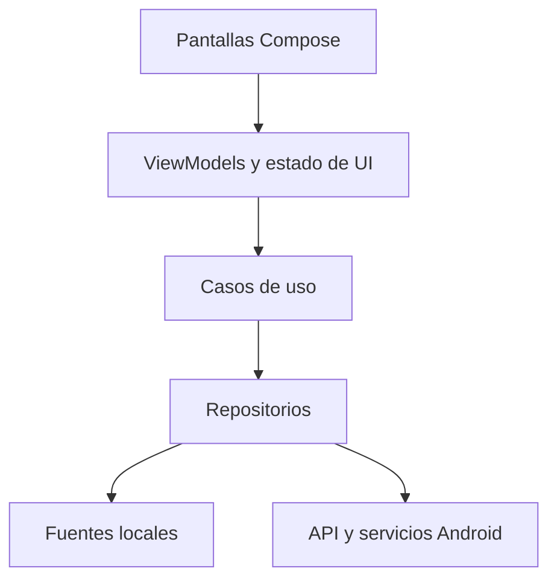

# GUARDMe — 08. Arquitectura Android, stack y organización

**Documento:** FE-D08 · **Versión:** 1.1 · **Fecha:** 14 de noviembre de 2026.  
**Base:** propuesta frontend v1.1, arquitectura y elección tecnológica.  
**Alcance:** diseño de implementación futura, sin creación de código ni modificación de versiones del proyecto.

## 1. Decisión arquitectónica

Continuar Kotlin, Jetpack Compose y Material 3 en la misma aplicación Android. Persona y Cuidador comparten infraestructura y componentes, con funciones de presentación diferenciadas. No se inicia una migración de framework para incorporar la segunda experiencia.

El patrón existente de ViewModel, StateFlow, coroutines y reducers permite conservar trabajo útil. La evolución consiste en introducir datos persistentes, casos de uso y repositorios sin mantener hechos remotos sólo en memoria de un overlay.

La estructura en capas y el flujo de estado siguen recomendaciones generales de arquitectura Android; las fronteras concretas siguientes son decisiones propuestas para GuardMe [R1].

## 2. Stack por responsabilidad

| Responsabilidad | Elección | Estado |
|---|---|---|
| Lenguaje y presentación | Kotlin, Compose y Material 3 | Existente, se conserva |
| Estado observable | ViewModel y StateFlow | Existente, se amplía |
| Asincronía | Coroutines | Existente, con límites de ciclo de vida explícitos |
| Navegación | Navigation Compose | Existente, se incorporan acceso y entradas remotas |
| Datos estructurados locales | Room | Propuesto |
| Preferencias y progreso | DataStore | Propuesto |
| API HTTPS | Retrofit y OkHttp | Propuesto, compatibilidad por validar |
| Serialización | kotlinx.serialization | Propuesto |
| Identidad | Supabase Auth; access token para NestJS | Proveedor seleccionado; integración móvil pendiente |
| Push | FCM | Propuesto para dispositivos compatibles con servicios requeridos |
| Sincronización diferible | WorkManager | Propuesto |
| Bastón | APIs Android; evaluar BLE y dispositivo compañero | Transporte y soporte pendientes |
| Mapas | Proveedor por seleccionar | Condicionado a ubicación real |
| Dependencias | Constructores y factorías al inicio | Añadir Hilt sólo por necesidad demostrada |
| Verificación | JUnit y Compose UI Test | Existen bases; ampliación futura |

Room se orienta a datos estructurados persistentes; DataStore a preferencias y objetos pequeños de configuración. Ninguno sustituye por sí solo la sincronización remota ni un diseño de protección de secretos [R2–R3].

### 2.1 Componentes necesarios para ESP32

La propuesta de integración utiliza un cliente BLE, un repositorio de bastón, un coordinador persistente de episodio y una cola remota. El enlace, el plazo y la resolución física no pueden depender solo del ViewModel. Los nombres y las fronteras propuestos están en [ESP-05](../../ESP32/05_Integracion_Android_Pasarela_y_Sincronizacion.md).

El manifiesto y las dependencias actuales no acreditan Internet, BLE, Room, servicio de escucha ni FCM. Antes de implementar hay que completar permisos por versión, estrategia de segundo plano, registro de instalación y sesión Supabase. WorkManager sirve para sincronización diferible; la escucha BLE prolongada y la ventana de 30 segundos necesitan su propio responsable local. Los modelos deben expresar batería desconocida, antigüedad y capacidad no soportada.

## 3. Fronteras y dependencias

La pantalla presenta un modelo preparado y emite intención. El ViewModel coordina su estado visible y recoge resultados. Los casos de uso expresan acciones con reglas: cancelar un episodio, confirmar una ocurrencia o aceptar una decisión. Los repositorios concilian fuentes; no exponen detalles de transporte a cada composable.

La comunicación con el bastón y la recepción de avisos tienen responsables fuera de la vida de una pantalla. Se evita que cerrar un ViewModel sea equivalente a dejar de escuchar una situación que el producto debe manejar.

## 4. Organización por funcionalidad

Mantener inicialmente el módulo app y agrupar por funciones, extrayendo elementos comunes cuando tengan uso real. No se exige crear un módulo Gradle por pantalla.

| Área propuesta | Contenido |
|---|---|
| Configuración y acceso | Identidad, progreso, PIN y vinculación |
| Persona | Presentación y navegación propia |
| Cuidado | Selector de perfiles y presentación de cuidador |
| Incidentes | Modelos de presentación y decisiones |
| Recordatorios | Definiciones, ocurrencias y registros |
| Dispositivos | Estado del bastón y capacidades |
| Datos | Repositorios, API y persistencia |
| Integraciones Android | Bastón, avisos y programación local |
| UI compartida | Tema, componentes y accesibilidad |
| Demostración | Repositorios simulados y escenarios aislados |

Los nombres son una guía documental; no implican carpetas nuevas ya creadas en el código. Antes de mover archivos se deben identificar dependencias y mantener compilación.

## 5. Modelos y estado

| Modelo | Ejemplo de responsabilidad | Regla |
|---|---|---|
| Transporte | Datos recibidos de API o dispositivo | No se utiliza directamente como texto de pantalla |
| Dominio | Incidente, perfil, ocurrencia, intento | Conserva identidad y significado |
| Persistencia | Entidades locales y operaciones pendientes | Conserva estado durable |
| Presentación | Valores, etiquetas y acciones permitidas | Derivado del contexto autorizado |

El estado de presentación se propone inmutable y por pantalla/contexto. Debe incluir carga, contenido, errores, capacidad y condición de actualización. Los hechos importantes permanecen en datos persistidos, no en mensajes de una sola emisión que puedan perderse.

Una acción visual puntual, como abrir el marcador, necesita evitar repetición por recomposición o restauración. No se usa el simple hecho de observar «emergencia activa» para lanzar una nueva llamada cada vez que se vuelve a la pantalla.

## 6. Navegación y entradas externas

La navegación raíz distingue configuración pendiente, experiencia Persona y experiencia Cuidador a partir de sesión y vínculos reales. Las rutas reciben identificadores, no un rol arbitrario que otorgue permisos.

Los avisos abren incidente, seguimiento u ocurrencia después de validar contexto. El estado se consulta de nuevo: una notificación antigua no puede habilitar acciones vencidas. Si el vínculo desapareció, la entrada devuelve un resultado comprensible.

La pila conserva la tarea previa cuando una emergencia la interrumpe. Los borradores se asocian a perfil. Rotar o recrear actividad restaura selección y referencias, mientras los datos se vuelven a observar desde repositorios.

## 7. Tiempo, trabajos y vida de proceso

| Trabajo | Responsable conceptual |
|---|---|
| Cuenta local de 30 segundos | Integración de episodio local con referencia temporal persistida |
| Pintar tiempo restante | Estado de UI derivado, sin reiniciar el plazo |
| Aviso a cinco minutos | Backend y trabajador persistente |
| Plazo de dos horas | Backend |
| Seguimiento del día siguiente | Backend según zona del perfil |
| Próximas ocurrencias locales | Agenda persistida y mecanismo Android validado |
| Reintentos de sincronización | Cola y trabajo diferible |
| Conexión con bastón | Servicio/integración Android apropiados |

WorkManager se propone para trabajo diferible, no como garantía de una cuenta crítica exacta. La elección de servicio o APIs de dispositivo compañero se validará por versión y restricciones reales. No se promete actividad permanente por mantener una coroutine.

## 8. Errores y recuperación

Los repositorios traducen errores de red, autenticación, permisos, conflicto, estado incompatible y capacidad no disponible a resultados comprensibles. La UI decide el mensaje contextual, conservando datos y borradores.

| Resultado | Tratamiento |
|---|---|
| Renovación de sesión posible | Recuperación controlada sin bucles |
| Sesión revocada | Retirar contextos remotos y ofrecer recuperación |
| Conflicto de versión | Consultar estado vigente y explicar |
| Tiempo de espera agotado | Consultar operación identificada antes de repetir |
| Dispositivo incompatible | No mostrar configuración completada |
| Dato fuera de rango | No convertir automáticamente a un valor favorable |

No se repiten operaciones críticas de forma ilimitada desde un botón. La idempotencia y la conciliación se especifican en D09.

## 9. Seguridad y configuración de entorno

Separar producción y demostración en origen de datos y credenciales. Los escenarios demo no publican incidentes en producción. Los secretos privilegiados no se distribuyen dentro de la app.

El endpoint de API, identificadores públicos de integración y capacidades de entorno se configuran según despliegue. Antes de almacenar datos sensibles se revisan reglas actuales de backup, retención local y cierre de sesión.

Los logs técnicos utilizan referencias de correlación y evitan PIN, tokens, códigos de incorporación o ubicación precisa por defecto. Los mensajes de producto se mantienen en recursos de texto y no en trazas del servidor.

## 10. Compatibilidad y alternativas

El proyecto revisado declara minSdk 24, compileSdk/targetSdk 37 y un catálogo de versiones ya existente. Se registra como inventario, no como compilación certificada. P-15 exige validar wrapper, AGP, Kotlin, JDK y bibliotecas antes de añadir componentes.

| Alternativa | Consecuencia en este proyecto | Decisión |
|---|---|---|
| Mantener Compose | Conserva pantallas Kotlin y componentes | Recomendada |
| Flutter | Reimplementa UI y necesita validar integración de plataforma | Fuera de primera entrega |
| React Native | Reimplementa pantallas y capacidades nativas | Fuera de primera entrega |
| PWA para persona/cuidador | Exige demostrar el recorrido completo en navegador | No sustituye la app actual |
| iOS | Nueva validación móvil y de capacidades | Evaluación futura |

Un panel interno opcional puede utilizar React, TypeScript y Vite con autorización independiente. No es el frontend del cuidador. Antes de adoptarlo debe existir una necesidad operativa, evitando ampliar el proyecto por disponibilidad de una tecnología.

## 11. Migración progresiva

1. Estabilizar compilación y preservar escenarios de referencia.
2. Reconciliar reglas de roles, llamadas y mango.
3. Introducir repositorios y modelos con datos demo aislados.
4. Añadir persistencia y recuperación sin modificar de golpe todas las pantallas.
5. Conectar configuración e identidad.
6. Integrar episodio local y aviso real.
7. Conectar recordatorios, seguimiento e historial.
8. Verificar navegación externa, accesibilidad y límites de segundo plano.

Cada paso necesita evidencia de la conducta nueva y ausencia de mezcla entre demo y real. No se reescribe todo el árbol para alcanzar una arquitectura ideal antes de comprobar el recorrido principal.

## 12. Archivos de referencia y trazabilidad

Las bases observadas incluyen GuardMeRoot.kt, PersonaApp/State/ViewModel, CuidadorApp/State/ViewModel, componentes GuardButtons/GuardChrome/GuardSurfaces, Color.kt, Type.kt, Theme.kt, Motion.kt, AndroidManifest.xml y los archivos Gradle del proyecto. D01 conserva el estado de corte; D10 documenta futuras comprobaciones.

**Criterios relacionados:** FE-01–FE-04, FE-07, FE-20 y FE-21.  
**Integración:** [D09](09_Integracion_Backend_Baston_Persistencia_y_Sincronizacion.md).  
**Referencias:** [R1 — Arquitectura Android](https://developer.android.com/topic/architecture), [R2 — Room](https://developer.android.com/training/data-storage/room), [R3 — DataStore](https://developer.android.com/topic/libraries/architecture/datastore).
