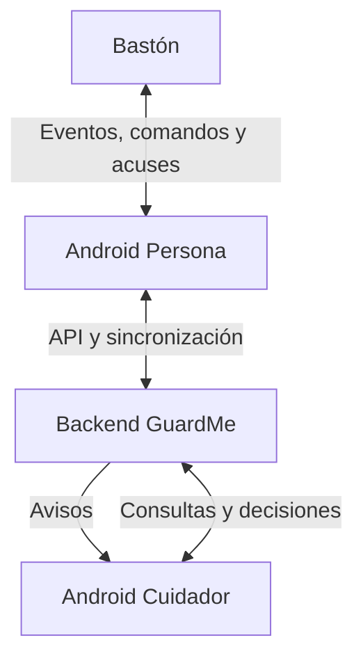

# GUARDMe — 09. Integración con backend y bastón, persistencia y sincronización

**Documento:** FE-D09 · **Versión:** 1.1 · **Fecha:** 14 de noviembre de 2026.  
**Base:** propuesta frontend v1.1, arquitectura e integración; coordinación conceptual con la propuesta de backend.  
**Límite:** requisitos de integración; los contratos ESP32 se centralizan en [ESP-04](../../ESP32/04_Contrato_BLE_Eventos_Comandos_y_Seguridad.md). No hay endpoints ejecutables ni protocolo BLE implementado acreditados por este documento.

## 1. Objetivo y topología

El sistema debe conservar el mismo significado de un episodio al pasar del bastón al teléfono y del teléfono al servicio remoto. El cuidador recibe información autorizada y devuelve una decisión que todos los clientes pueden consultar.

El backend vigente selecciona NestJS, PostgreSQL de Supabase, Prisma, pg-boss, Supabase Auth y FCM, con API y trabajador persistente. Android utiliza su access token de Supabase Auth para consumir NestJS; no accede directamente a tablas de dominio. FCM se conserva solo como canal push. El ESP32 se conecta a Android por BLE y no necesita sesión Supabase.

DemoHub no participa en esta topología real: comparte un indicador dentro de un proceso y no comunica instalaciones.

## 2. Autoridad y consistencia

| Dato o hecho | Fuente de autoridad propuesta | Responsabilidad del cliente |
|---|---|---|
| Detección física y botón | Bastón, según protocolo validado | Recibir, identificar y conservar |
| Ventana local | Coordinación local validada | Derivar tiempo sin reiniciar |
| Incidente compartido | Backend | Mostrar versión vigente |
| Resultado de intento | Subsistema de llamadas validado | No inferir de navegación |
| Decisión de cuidador | Backend tras autorización | Mantener intención hasta confirmación |
| Programación remota | Trabajador persistente | Mostrar vencimientos recibidos |
| Registro local sin Internet | Cola del teléfono | Indicar que aún no está conciliado |
| Consentimiento compartido | Estado autorizado del servicio | No publicar ubicación fuera de permiso |
| Captura de ubicación | Teléfono de la persona | Conservar hora de captura y precisión |

La copia local permite leer sin red y conservar operaciones, pero no se convierte automáticamente en verdad compartida. Un cierre local pendiente no cancela otros avisos hasta que el responsable remoto lo acepte. Las diferencias se muestran con claridad en vez de ocultarlas mediante actualización optimista de hechos críticos.

## 3. Identificadores y tiempo

Cada perfil, instalación, bastón, episodio, incidente, intento, seguimiento, definición y ocurrencia requiere identidad estable. Se propone que cada operación tenga una referencia de idempotencia y que los eventos aporten origen y orden/versionado aplicable.

| Referencia | Para qué se necesita |
|---|---|
| Episodio de origen | Conciliar cancelación, vencimiento y duplicados del mismo hecho |
| Instalación/pasarela | Saber qué teléfono publicó el evento |
| Operación | Consultar si una solicitud sin respuesta ya se aplicó |
| Versión de recurso | Resolver cambios concurrentes |
| Cursor de sincronización | Recuperar cambios sin depender de haber recibido todos los avisos |
| Captura/ocurrencia | Preservar momento real y zona |
| Recepción | Explicar retraso y latencia observada |

No se utiliza la posición de una fila o una hora formateada como identificador. Los instantes remotos se representan inequívocamente; los horarios de calendario conservan zona del perfil. Los relojes locales pueden cambiar y no deben ordenar por sí solos todos los hechos distribuidos.

La durabilidad e idempotencia buscan un resultado único ante reintentos, sin prometer entrega exactamente una vez en toda la red.

## 4. Contrato requerido al bastón

| Capacidad conceptual | Información requerida | Resultado esperado |
|---|---|---|
| Identificación | Dispositivo, versión y capacidades | No asociar por nombre de Bluetooth solamente |
| Detección | Episodio, origen temporal y tipo de evento | Posible caída, no diagnóstico |
| Estado de alarma | Activa, cancelada u otro estado validado | Recuperar situación al reconectar |
| Cancelación desde app | Episodio y operación | Acuse de recepción/aplicación según contrato |
| Cancelación física | Episodio y hecho del botón | Mismo resultado de episodio |
| Recordatorio | Ocurrencia, patrón y vigencia | No repetir señales vencidas |
| Telemetría | Valor, unidad y momento | Distinguir desconocido de cero |
| Reconexión | Estado vigente y secuencia disponible | Conciliar sin duplicar avisos |

Estos son requisitos de información. UUID, empaquetado, cifrado, autenticación de enlace, almacenamiento del bastón y límites de retransmisión son P-03/P-12. El hardware actual no acredita esas funciones.

El borrador de [ESP-04](../../ESP32/04_Contrato_BLE_Eventos_Comandos_y_Seguridad.md) concreta familias de mensajes, órdenes, IDs y acuses. Su tabla de transporte físico sigue pendiente: no se deben implementar UUID o frames diferentes por separado en Android y firmware. [ESP-03](../../ESP32/03_Arquitectura_Firmware_Estados_y_Persistencia.md) propone estado temporal recuperable en el bastón, manteniendo coordinación y publicación remota en Android; no es una función existente.

Debe distinguirse recibir una orden de ejecutarla. Si el dispositivo sólo confirma recepción, la UI no asegura apagado. Si al reconectar informa alarma ya cancelada, se puede conciliar aunque el acuse anterior se perdiera.

La incorporación requiere posesión física y autorización del contexto. Una dirección o serie conocida no autoriza una orden a un bastón ajeno.

## 5. Superficies conceptuales de API

| Dominio | Operaciones requeridas | Validación relevante |
|---|---|---|
| Identidad e instalación | Consultar sesión, registrar/revocar teléfono | Identidad y estado de instalación |
| Perfiles | Listar, crear, consultar y actualizar | Vínculo vigente |
| Configuración | Guardar avance y comprobar preparación | Evidencia de capacidades |
| Equipo | Invitar, aceptar y revocar | Alcance, caducidad y uso único |
| Bastones | Incorporar, asignar y cambiar pasarela | Posesión y política de asignación |
| Contactos | Crear, editar y ordenar | Validación de número y prioridades |
| Eventos locales | Publicar episodio vencido, cancelación agregada y telemetría | Origen autorizado y deduplicación |
| Incidentes | Consultar, decidir y recuperar historial | Estado y versión |
| Intentos | Consultar plan y resultados | Fuente de evidencia de telefonía |
| Seguimientos | Consultar pendiente y responder | Destinatario y ronda |
| Recordatorios | Definir, cambiar y registrar ocurrencias | Autor, permiso y versión |
| Ubicación | Publicar, consultar y modificar compartición | Fuente y consentimiento |
| Sincronización | Obtener cambios y confirmar aplicación | Cursor y aislamiento por contexto |

El contrato final se formalizará junto con backend. No se inventan rutas como si ya existieran. Tampoco se añade un endpoint de respuesta de llamada que permita al cliente declarar arbitrariamente un hecho del proveedor.

Los errores deben distinguir identidad ausente, acceso prohibido, conflicto, estado incompatible, dato inválido, operación repetida y fallo temporal. La repetición idempotente puede devolver el resultado existente sin considerarse otro incidente.

## 6. Push y actualizaciones de pantalla

Se propone FCM para avisar al cuidador y abrir la entidad pertinente. El mensaje no es la base de datos ni prueba que alguien leyó el aviso. La recepción varía con estado de app y plataforma; se debe validar la integración real de primer plano y segundo plano [R1].

La notificación lleva referencia, tipo de entidad y versión o vigencia según contrato. Al abrir, el cliente consulta estado actual. Si el incidente ya fue atendido, presenta el cierre. Si el vínculo fue revocado, no expone datos recuperados desde un payload antiguo.

La actualización con la app abierta puede utilizar SSE si backend lo ofrece. Su pérdida no implica pérdida de hechos: se recupera mediante consulta/cursor. WebSocket sólo se incorpora si una necesidad bidireccional real lo justifica. Ningún canal abierto reemplaza push o persistencia.

El registro de token push debe distinguir instalación y cuenta. Una renovación no crea otro cuidador y cerrar sesión no deja el token asociado a un perfil que ya no debe recibir.

## 7. Persistencia local propuesta

| Almacén conceptual | Datos | Precaución |
|---|---|---|
| Room | Perfiles autorizados, recordatorios, ocurrencias e historial necesario | Migraciones y alcance por identidad |
| Cola de salida persistente | Operación, recurso, intento y resultado conocido | Reintentar sin duplicar |
| Estado de sincronización | Cursor y versiones aplicadas | Actualizar junto con cambios correspondientes |
| DataStore | Preferencias y progreso pequeño | No tratarlo como base de incidentes |
| Protección de secretos | Claves y sesión según identidad elegida | No guardar PIN o tokens en texto plano |
| Referencias de UI | Selección y entidad abierta | Restaurables sin ser autoridad de negocio |

La arquitectura con fuentes locales y remotas es una base para funcionamiento sin red, no una garantía de que una emergencia se entregue cuando no hay conectividad [R2].

Si se acepta localmente una acción, su estado y operación pendiente deben guardarse de forma coherente. Un fallo entre mostrar «registrado» y persistirlo no debe hacer desaparecer el registro al reiniciar.

## 8. Proceso de envío y recuperación

1. Validar capacidad y contexto autorizado con la información disponible.
2. Crear una operación identificada y guardar su intención cuando sea necesario.
3. Presentar envío o condición local pendiente.
4. Enviar mediante el responsable de integración.
5. Aplicar el resultado confirmado y su versión.
6. Si no se obtiene respuesta, consultar por operación o recurso antes de repetir una acción crítica.
7. Conciliar cambios entrantes y actualizar la interfaz.

El reintento aplica espera progresiva y condiciones adecuadas. No se fija aquí una cadencia numérica ni un máximo sin conocer el servicio. Un error permanente de permiso no se reintenta como fallo temporal de red.

La recuperación al abrir incluye sesión, vínculos, operaciones pendientes y estado actual del incidente. La UI no relanza una llamada por observar otra vez el mismo estado.

## 9. Matriz de desconexiones

| Situación | Mantener | No afirmar |
|---|---|---|
| Bastón sin teléfono | Función local del hardware si está validada | Aviso remoto entregado |
| Teléfono con bastón, sin Internet | Evento y cola persistente | Cuidador informado |
| Teléfono sin enlace local | Última información con antigüedad | Detección nueva recibida |
| API indisponible | Operaciones pendientes y lectura local | Decisión compartida aceptada |
| Cuidador sin red | Historial conocido y pendientes | Atención registrada remotamente |
| Push no recibido | Consulta al volver y canal de llamadas independiente si existe | Que la persona ignoró el aviso |
| Reconexión tras largo período | Hora original y política de retraso | Que todo evento es actual |

WorkManager se propone para sincronización diferible. La comunicación con un periférico en segundo plano exige una estrategia Android específica, incluyendo evaluar APIs de dispositivo compañero o servicio apropiado; debe medirse en dispositivos objetivo [R3].

## 10. Conflictos y eventos fuera de orden

| Conflicto | Resolución requerida |
|---|---|
| Dos cierres | Resultado vigente único, con actor y hora |
| Ediciones de recordatorio | Detectar versión diferente antes de sobrescribir |
| Cancelación y vencimiento | Regla específica de episodio, pendiente P-04 |
| Acuse duplicado | Reutilizar mismo resultado |
| Aviso anterior a estado más reciente | No retroceder la entidad |
| Revocación durante consulta | Retirar acceso y evitar nuevas acciones |
| Datos de otro perfil llegan tarde | No sobrescribir contexto actual |

No se aplica automáticamente «última escritura gana» a todas las reglas. Los hechos remotos tienen versionado/orden para evitar que un push tardío reabra un incidente cerrado.

## 11. Eventos antiguos y caducidad

Backend propone un umbral de antigüedad configurable para no lanzar cascadas de llamadas por eventos históricos sincronizados tarde. El valor y la acción apropiada siguen P-14. Se conserva el hecho con su hora original y se muestra su condición de retraso.

Las órdenes de recordatorio también requieren vigencia. Un teléfono que recupera red no debe encender una señal por todas las dosis antiguas sin política. La cancelación o confirmación posterior se concilia con el estado existente.

La caducidad de un push no elimina el incidente persistente. Una notificación perdida puede recuperarse consultando estado; una notificación recibida tampoco autoriza ejecutar una decisión caducada.

## 12. Seguridad, observabilidad y límites

Todas las consultas remotas validan perfil e instalación. El PIN protege acciones locales pero no reemplaza esa verificación. Compartición de ubicación, invitaciones y acceso a datos requieren sus propios controles de contexto.

Los registros técnicos deben permitir seguir episodio, operación e intento sin almacenar PIN, token, código secreto o ubicación precisa innecesaria. Las mediciones de latencia separan detección, recepción local, aceptación remota y recepción del cuidador. No se fija un objetivo de segundos que la propuesta no haya aprobado.

La evaluación incluye corte de red, repetición, pérdida de acuse, reinicio y concurrencia real entre teléfonos. Ningún resultado de esas pruebas se presume completado en este documento.

**Criterios relacionados:** FE-02–FE-18 y FE-20–FE-21, según función.  
**Pendientes principales:** P-03–P-06, P-12–P-15.  
**Referencias:** [R1 — FCM recepción Android](https://firebase.google.com/docs/cloud-messaging/android/receive-messages), [R2 — Android sin conexión](https://developer.android.com/topic/architecture/data-layer/offline-first), [R3 — BLE en segundo plano](https://developer.android.com/develop/connectivity/bluetooth/ble/background).  
**Validación:** [D10](10_Verificacion_Criterios_Aceptacion_y_Entrega.md).

## 13. Obligaciones de integración ESP32

| Paso | Android | Confirmación necesaria |
|---|---|---|
| Conectar | Identidad, autorización BLE, versión y capacidades | Dispositivo correcto; nombre público insuficiente |
| Recibir detección | Persistir registro/episodio y derivar plazo restante | No reiniciar 30 segundos desde una recepción tardía |
| Cancelar desde app | Guardar y enviar orden con ID de episodio | Resultado aplicado o estado conciliado; write GATT insuficiente |
| Recibir botón | Resolver el mismo episodio | No duplicar contador frente a cancelación desde app |
| Recuperar enlace | Snapshot, cursor y registros sin huecos | Consultar resolución antes de enviar vencimiento pendiente |
| Publicar | Cola durable, sesión e instalación autorizadas | Resultado persistido individual de NestJS |

La app no debe transformar un silenciamiento posterior al vencimiento en falsa alarma cancelada durante la ventana. Cancelación/vencimiento concurrentes y tiempo incierto tras reinicio siguen como bloqueos PD-12; su tratamiento se registra en [ESP-06](../../ESP32/06_Integracion_Backend_BetterAuth_y_Contratos_API.md).

La primera prueba local y la prueba con dos teléfonos se detallan en [ESP-07](../../ESP32/07_Plan_Implementacion_Pruebas_y_Aceptacion.md). `DemoHub`, porcentajes precargados y temporizadores de demostración no satisfacen esos criterios.
