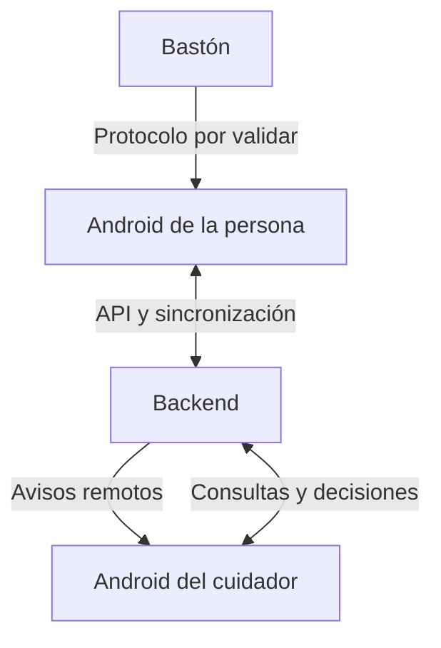

# GUARDMe — Propuesta de frontend

**Fecha:** 14 de noviembre de 2026.  
**Versión:** 1.2, alineación con Supabase y documentación ESP32.  
**Aclaración de alcance:** la interfaz del cuidador también es móvil y forma parte de la aplicación Android.  
**Base funcional:** entrevista de producto del 14 de noviembre de 2026.  
**Base técnica:** revisión estática de GuardMeMobile y Arduino/ESP32_main.  
**Entregable:** documentación de diseño, arquitectura y selección tecnológica; no implementa funcionalidades.

**Revisión 1.2:** Supabase Auth es la identidad remota seleccionada por backend; FCM permanece como push. La documentación técnica Arduino y el borrador BLE se centralizan en [docs/ESP32](../ESP32/README.md). Su existencia no acredita implementación.

## 1. Recomendación

Continuar la aplicación Android existente con **Kotlin, Jetpack Compose y Material 3**, manteniendo una sola aplicación con experiencias diferenciadas para la persona que usa el bastón y para el cuidador. Conservar la marca y los componentes visuales desarrollados, y evolucionar los estados de demostración hacia datos persistentes e integración real.

La interfaz del cuidador también será una **experiencia móvil dentro de la misma aplicación Android**, con Kotlin y Jetpack Compose. Ambas experiencias pertenecen a la primera entrega y se ejecutan en los teléfonos respectivos. React, TypeScript y Vite quedan únicamente como una opción para un eventual panel interno de soporte, si se define esa necesidad.

La prioridad de la primera versión sigue siendo el recorrido real **bastón → teléfono de la persona → teléfono del cuidador → registro de la atención**, con recordatorios incluidos. La ubicación real se intentará incorporar y puede trasladarse a la siguiente entrega, según la memoria de producto.

Las elecciones de este documento son propuestas técnicas. Los requisitos de integración del frontend deberán conciliarse con la propuesta de backend del proyecto; aquí se definen las necesidades de los clientes móviles sin dar por implementados los servicios, la base de datos o el mecanismo de llamadas.

## 2. Fuentes y criterio de autoridad

1. **Entrevista de producto vigente:** define las reglas funcionales. Se consultó la copia GUARDMe_Entrevista_Producto_20261114(1).md y la entrevista presente en la raíz del proyecto.
2. **Código actual:** acredita componentes, navegación, dependencias, estados y limitaciones de integración.
3. **Memoria técnica de reconstrucción:** aporta contexto del análisis previo; sus observaciones se contrastaron con archivos actuales relevantes.
4. **Documentación UI histórica:** sirve como antecedente visual; no sustituye la entrevista ni acredita funcionalidades conectadas.
5. **Documentación oficial:** fundamenta las restricciones de plataforma y las capacidades de las tecnologías propuestas; referencias en la sección 18.
6. **Aclaración del responsable:** la experiencia del cuidador es una interfaz móvil. No se incluye un portal web de cuidado en el alcance recomendado.

En el documento se distingue entre **existente**, **simulado**, **propuesto** y **pendiente de decisión o validación**. Una pantalla ya dibujada no implica una función disponible en un teléfono real.

## 3. Estado actual y aprovechamiento del trabajo existente

### 3.1 Inventario funcional

| Área | Evidencia actual | Tratamiento propuesto |
|---|---|---|
| Plataforma móvil | Proyecto Android con Kotlin, Compose, Material 3, Navigation Compose, ViewModel y StateFlow | Mantener esta base |
| Entrada | GuardMeRoot abre un selector de personas, roles y escenarios demo | Sustituir la entrada de producción por registro/configuración; conservar escenarios en un entorno de demostración separado |
| Experiencia Persona | Inicio, Contactos, Recordatorios y Bastón | Reutilizar estructura, componentes y buena parte de la presentación |
| Experiencia Cuidador | Inicio, Historial, Recordatorios, Bastón y Equipo, con restricciones al rol médico | Unificar capacidades de familiares y personal médico |
| Componentes | Botones, tarjetas, campos, chips, avatares, pestañas, iconos, sheets y overlays | Consolidar un catálogo visual reutilizable |
| Marca | Tema claro, colores cálidos, Figtree y Atkinson Hyperlegible | Preservar identidad, verificando contraste y escalado |
| Accesibilidad | Semántica, foco en overlays, anuncios y reducción de animación en partes de la UI | Conservar y ampliar con pruebas sobre dispositivos |
| Datos | Datos de ejemplo y modificaciones en memoria de ViewModels | Introducir repositorios y persistencia |
| Comunicación | DemoHub comparte un indicador dentro del mismo proceso | Sustituirlo por integración real; no equivale a comunicación entre teléfonos |
| Hardware | Sketch con MPU6050, botón y buzzer; detección local de golpes | Requiere protocolo de comunicación y validación del detector |
| Servicios móviles | Sin permisos declarados para Internet, Bluetooth, ubicación o notificaciones; sin clientes backend, mapas ni persistencia entre las dependencias revisadas | Diseñar e integrar por etapas |
| Otras interfaces | No se encontró proyecto frontend web | Evaluar únicamente un panel interno opcional si surge una necesidad operativa |

La configuración Android declara minSdk 24, targetSdk y compileSdk 37. Son valores observados, no una certificación de compatibilidad. Antes de añadir dependencias se debe conseguir una compilación reproducible del proyecto y validar la combinación Gradle, AGP, Kotlin y JDK. Esta propuesta no actualiza versiones ni acredita una compilación exitosa.

### 3.2 Diferencias que deben corregirse al implementar

| Tema | Comportamiento o texto del prototipo | Regla vigente |
|---|---|---|
| Cuidador médico | Oculta o bloquea alertas, ubicación y Bastón | Familiares y personal médico tienen las mismas capacidades; el acceso depende de la vinculación y del consentimiento correspondiente |
| Llamadas por caída | Dos intentos al contacto preferido | Contacto 1 dos veces, contacto 2 dos veces; detener al responder cualquiera |
| Atención | Tomar responsabilidad y resolver aparecen como pasos distintos | Confirmar «Yo me encargo» cierra como «Recibió asistencia» |
| Medicamentos | Hay ejemplos de confirmación con botón físico | La confirmación se realiza desde la aplicación |
| Botón del bastón | Algunas guías anuncian petición de ayuda o confirmación de pastilla | Su función confirmada es cancelar la alarma de posible caída; el patrón de pulsación aún no está fijado |
| Inmovilidad | Hay avisos demo de bastón quieto | La detección automática se limita a posibles caídas |
| Estado del sistema | Datos simulados de batería, pasos, firmware, ubicación y sensores | Mostrar datos reales, antigüedad o «No disponible» |
| Asistencia externa | Algunos overlays sugieren que ya hay ayuda en camino | Mostrar solamente hechos confirmados; una llamada iniciada no acredita despacho de asistencia |
| Seguimiento | No se acredita el recorrido completo acordado | Separar el cierre del incidente y el seguimiento del día siguiente |

## 4. Interfaces y alcance por etapa

| Interfaz | Público | Función | Etapa | Stack propuesto |
|---|---|---|---|---|
| Android — Persona | Usuario habitual del bastón | Cancelación, emergencia directa, recordatorios, contactos y estado del bastón | Primera entrega | Kotlin + Compose |
| Android — Cuidador | Familiar o personal médico vinculado | Recepción y atención de incidentes, varias personas, recordatorios e historial | Primera entrega | Misma app y mismos componentes, otra densidad de información |
| Panel interno | Equipo de soporte, si se incorpora | Diagnóstico técnico y gestión operativa con acceso delimitado | Opcional, posterior | React + TypeScript + Vite; autorización independiente |
| Sitio informativo | Público general | Explicar el producto y su configuración | Opcional | Sitio estático; evaluar framework según contenido |
| iOS | Usuarios con iPhone | Experiencia móvil futura | Fuera de la primera entrega | Evaluación específica cuando exista ese requisito |

El panel de soporte no crea por sí mismo un tercer rol funcional del producto. Su necesidad, permisos y alcance deben definirse antes de implementarlo. El personal médico sigue siendo cuidador, no administrador del sistema.

El teléfono de la persona es la pasarela con el bastón y el teléfono del cuidador recibe los avisos remotos. Ambos utilizan la aplicación móvil GuardMe con la experiencia correspondiente. El cuidado cotidiano, la atención de incidentes y los recordatorios compartidos se resuelven desde esas interfaces móviles.

## 5. Diseño móvil y sistema visual

### 5.1 Identidad que se conserva

Se mantienen el nombre GuardMe, el lema «Que la distancia no sea un riesgo», el tema claro y la distinción de jerarquía entre emergencia, cuidado cotidiano y recordatorios. No se introduce un rediseño de marca como condición para integrar el producto.

| Token existente | Valor | Aplicación propuesta |
|---|---|---|
| Cream | #F8F4EE | Fondo principal |
| White | #FFFFFF | Tarjetas y superficies |
| Brown | #8A5A35 | Acciones cotidianas y navegación activa |
| Sand | #F1E6D8 | Agrupaciones suaves |
| Navy | #1E2A38 | Texto principal |
| WarmGray | #5C5650 | Texto secundario |
| Emergency | #B3261E | Emergencia y acciones críticas |
| Ok | #2E7D4F | Confirmación y estado correcto |
| Attention | #A8620A | Advertencias |
| Meds | #2C4A6E | Medicamentos y citas |
| Caramel | #C08A5B | Acentos decorativos; revisar contraste si transmite información |

Las experiencias Persona y Cuidador comparten directamente los tokens y componentes Compose existentes, ajustando la densidad y jerarquía de información. Si se desarrolla un panel interno web, podrá reflejar estos valores mediante variables CSS. Las licencias OFL de las fuentes deben acompañar su distribución.

### 5.2 Tipografía, tamaño y adaptación

| Elemento | Base existente | Propuesta |
|---|---|---|
| Títulos | Figtree, 26 sp | Conservar; permitir varias líneas |
| Crisis | Figtree, 34 sp | Mantener jerarquía, sin recortar instrucciones |
| Texto | Atkinson Hyperlegible, 16 sp | Mantener como mínimo de partida; ensayar 18 sp en la experiencia Persona |
| Botón Persona | Figtree, 24 sp | Conservar legibilidad y espacio suficiente |
| Botón Cuidador | Figtree, 18 sp | Conservar, verificando escalado |
| Botones principales | Componentes con mínimo habitual de 64 dp | Mantener en Persona; crecer según contenido |
| Controles pequeños | Tamaños diversos | Área interactiva mínima propuesta de 48 × 48 dp |
| Distribución | Referencia histórica de 390 × 844 | Adaptar al ancho disponible; no fijar un lienzo de píxeles |

Los 48 dp corresponden al criterio Android de área táctil y se aplican a ambas experiencias móviles. Son criterios de diseño a verificar, no resultados de una auditoría ya realizada.

Se propone usar márgenes de 18–24 dp y una escala de espaciado de 4, 8, 12, 16 y 24 dp. En teléfonos compactos se conserva una columna. En tabletas puede aparecer una lista y un detalle simultáneos, manteniendo el orden de lectura. Las emergencias conservan una jerarquía clara en cualquier tamaño.

### 5.3 Accesibilidad y lenguaje

- Comunicar estados con texto e icono además de color.
- Comprobar contraste de al menos 4,5:1 para texto normal y 3:1 para texto grande según WCAG; revisar también controles y foco.
- Permitir ampliación de fuente, probar al 200 % y evitar alturas rígidas o elipsis en instrucciones críticas.
- Mantener navegación con TalkBack, orden de foco lógico y encabezados reconocibles.
- Anunciar el comienzo y los hitos relevantes de la cuenta de caída; evitar anuncios cada segundo que oculten las acciones.
- Respetar reducción de movimiento; no introducir destellos en el teléfono.
- Escribir «Sin conexión con el bastón» o «Sin Internet», según corresponda.
- Usar «Posible caída»; la interfaz no debe afirmar un diagnóstico confirmado.
- Mostrar una hora absoluta junto a expresiones relativas cuando la antigüedad sea importante.

### 5.4 Composición de Inicio — Persona

| Orden vertical | Contenido | Comportamiento |
|---|---|---|
| 1 | Marca, saludo y acceso a ajustes | Ajustes protegidos por PIN |
| 2 | Estado resumido del bastón y conectividad | Icono pequeño de desconexión; al tocarlo explica el problema |
| 3 | «Llamar a emergencias» | Acción grande y reconocible, sin PIN |
| 4 | «Llamar a mi contacto» | Identifica a quién se llamará |
| 5 | Próximo recordatorio | Hora, nombre y acceso a confirmación |
| 6 | Acceso a historial y seguimiento pendiente | Información breve, sin saturar Inicio |
| 7 | Navegación inferior | Inicio, Contactos, Recordatorios y Bastón |

«Todo bien» no debe depender únicamente de que el bastón esté conectado. Se propone «Bastón conectado» y un estado separado para incidentes. Si no hay medición de batería, no aparece un porcentaje inventado. Pasos, distancias y búsqueda sonora se mantienen fuera del alcance comprometido mientras no exista soporte real y una decisión de producto.

## 6. Navegación y pantallas

### 6.1 Experiencia Persona

| Pantalla | Información y acciones | Acceso |
|---|---|---|
| Inicio | Estado, emergencia, contacto prioritario y próximo aviso | Sesión de uso habitual |
| Contactos | Lista, orden de los dos contactos prioritarios y acceso a llamadas | Consulta habitual; cambios con PIN |
| Recordatorios | Medicamentos y citas por fecha, pendientes y confirmaciones | Uso habitual |
| Detalle de recordatorio | Hora, autor, indicaciones y estado | Uso habitual |
| Bastón | Identidad del dispositivo, conexión, última señal y capacidades disponibles | Consulta habitual; vincular/desvincular con PIN |
| Historial | Incidentes y llamadas en secciones separadas; contador agregado de falsas alarmas | Acceso desde Inicio o perfil, sin añadir una quinta pestaña |
| Seguimiento | Pregunta sobre bienestar y tres respuestas acordadas | Acceso directo desde aviso o Inicio |
| Ajustes | PIN, privacidad, ubicación, dispositivos y equipo | Con PIN |
| Posible caída | Cuenta restante y «Estoy bien» | Sin PIN |
| Emergencia en curso | Estado verificable del aviso y acciones disponibles | Sin PIN |

Mantener cuatro pestañas aprovecha la estructura existente y evita añadir densidad al usuario del bastón. Las pantallas de emergencia interrumpen visualmente el contenido cotidiano sin borrar los borradores ni perder la navegación previa.

### 6.2 Experiencia Cuidador

Se conservan Inicio, Historial, Recordatorios, Bastón y Equipo para ambos tipos de cuidador. Se incorpora un selector de persona claramente visible, ya que el prototipo se centra en un perfil de ejemplo y la memoria exige supervisar varias personas/bastones.

| Pantalla | Contenido propuesto |
|---|---|
| Inicio general | Personas vinculadas, incidentes activos y seguimientos pendientes; ordenar por urgencia |
| Inicio de persona | Resumen de la persona seleccionada, último contacto y próximos recordatorios |
| Incidente | Persona, hora, origen, ubicación si existe, llamadas y decisiones de atención |
| Historial | Incidentes y llamadas, con filtros por persona, fecha y estado |
| Recordatorios | Calendario/lista y alta o edición dentro del contexto seleccionado |
| Bastón | Dispositivos vinculados, última señal y datos reales disponibles |
| Equipo | Cuidadores vinculados, invitaciones y orden de contactos prioritarios |
| Ubicación | Consentimiento, fuente, hora, precisión y estado de disponibilidad |
| Notificaciones | Avisos leídos/no leídos, sin confundir lectura con atención |

Cada detalle mantiene visibles el nombre de la persona y, si corresponde, el bastón involucrado. El acceso desde una notificación debe abrir el contexto correcto aunque el cuidador estuviera consultando otra persona.

### 6.3 Configuración inicial y vinculación

| Paso | Pantalla | Resultado esperado |
|---|---|---|
| 1 | «¿Quién está configurando GuardMe?» | Usuario del bastón o cuidador |
| 2 | Identificación y acceso | Establecer una identidad remota; método por definir junto con backend |
| 3 | Crear PIN de GuardMe | Protección local; explicar qué acciones protege |
| 4 | Preparar el contexto | Persona: configurar su perfil. Cuidador: vincularse a una persona o ayudar a configurarla |
| 5 | Vincular bastón | Descubrimiento, identificación física, confirmación y lectura de prueba |
| 6 | Vincular cuidadores | Invitación y aceptación verificables; propuesta de QR o código de un solo uso |
| 7 | Ordenar contactos | Seleccionar contacto 1 y 2, con validación y estado de disponibilidad |
| 8 | Permisos | Bluetooth, notificaciones y ubicación cuando corresponda, con explicación contextual |
| 9 | Consentir ubicación | Aceptar o rechazar compartir; mostrar consecuencias y cómo cambiarlo |
| 10 | Comprobar preparación | Bastón enlazado, Internet, avisos y prueba controlada entre teléfonos |

El cuidador que ayuda a configurar no convierte automáticamente su teléfono en la pasarela permanente. Debe quedar identificado el teléfono que llevará la persona y completarse allí la vinculación necesaria. Un QR no sustituye la prueba de posesión del bastón ni el control de autorización del servidor.

La identidad remota utiliza Supabase Auth conforme al backend vigente. El método concreto de acceso y recuperación se integra con BE-03; la selección de rol o un PIN local no autentican por sí solos frente a la API. El teléfono de la persona utiliza su propia sesión, incluida la modalidad asistida autorizada, sin heredar la sesión del cuidador. La longitud del PIN continúa pendiente de definición.

La configuración puede guardarse incompleta para continuar después, pero se debe mostrar «Configuración incompleta» y enumerar lo que falta. Los casos con cero o un contacto no se resolverán silenciosamente usando una política inventada.

### 6.4 PIN y acciones de emergencia

El PIN protege vinculaciones, permisos y ajustes del contexto correspondiente. Se propone proteger también los cambios del orden de contactos. Las acciones de emergencia, incluida la cancelación de la posible caída y el acceso a llamadas, permanecen disponibles sin introducirlo.

Para un cuidador ya autenticado, el acceso urgente al incidente y las decisiones acordadas deben funcionar sin un nuevo desafío de PIN local. Esto no elimina la autorización remota: una sesión revocada o una persona no vinculada no obtiene acceso por abrir un enlace. Debe diseñarse la recuperación de sesión sin bloquear el acceso al marcador de emergencias.

La recuperación del PIN es una decisión pendiente. No se debe ofrecer «Restablecer PIN» como botón funcional hasta disponer de un mecanismo que preserve las vinculaciones y la identidad.

## 7. Emergencias: comportamiento de la interfaz

### 7.1 Posible caída y ventana de 30 segundos

La pantalla muestra «Detectamos una posible caída», la cuenta restante y un botón grande «Estoy bien». Durante esta ventana suena únicamente el bastón. En el teléfono se propone presentación visual silenciosa, sin sonido, vibración ni lectura automática añadida por la app; el uso voluntario de tecnologías de asistencia debe seguir siendo posible.

La cancelación desde la aplicación y la realizada en el mango convergen en el mismo episodio. Al confirmarse que la persona está bien, se actualiza una sola vez el contador agregado de falsas alarmas. Los eventos duplicados no deben incrementar el contador varias veces.

La interfaz distingue «Cancelando…» de «Alarma cancelada» cuando depende de una confirmación del dispositivo. Si el bastón está desconectado, se informa que no pudo confirmarse el apagado local y se recuerda el uso del botón físico. La coordinación de una cancelación próxima al vencimiento de los 30 segundos requiere un protocolo explícito; la pantalla no puede resolverla sólo ocultando el overlay.

La cuenta debe reconstruirse a partir del episodio y su vencimiento, sin reiniciarse al rotar la pantalla o abrir de nuevo la aplicación. La autoridad temporal del período local y su conciliación con el backend se acordarán en el contrato bastón–teléfono–servidor.

### 7.2 Aviso inicial y llamadas

| Orden | Estado que puede mostrar la UI | Evidencia necesaria |
|---|---|---|
| 1 | Contacto 1 — intento 1 | Inicio confirmado del intento |
| 2 | Contacto 1 — intento 2 | Finalización sin respuesta del intento anterior |
| 3 | Contacto 2 — intento 1 | Ambos intentos previos terminados sin respuesta |
| 4 | Contacto 2 — intento 2 | Resultado del intento anterior |
| 5 | Escalamiento a emergencias | Resultado de los cuatro intentos y capacidad real de integración |

En cualquier intento, una respuesta confirmada detiene la secuencia. Abrir una notificación, verla en pantalla o tocar una tarjeta no prueba que una llamada fue contestada. El detalle debe diferenciar «Enviando aviso», «Registrado por el servicio», «Recepción confirmada en el teléfono», «Llamada contestada» y «Recibió asistencia», sólo cuando exista evidencia para cada estado.

**Restricción decisiva:** Android documenta que ACTION_CALL no puede utilizarse para números de emergencia y que ACTION_DIAL abre el marcador para que la persona inicie la llamada. Por ello, «Abrir marcador con 911» es una alternativa manual verificable, pero no cumple por sí sola el escalamiento automático acordado. La modalidad de llamadas a contactos y la detección de respuesta también deben validarse antes de prometer ese recorrido [R4].

El frontend debe recibir capacidades y resultados del subsistema de llamadas. Si sólo se abre el marcador, muestra «Marcador abierto», no «Llamando al 911» ni «Ayuda en camino». El cumplimiento de llamadas automáticas y escalamiento al 911 queda como condición técnica pendiente de la entrega completa, no como una función resuelta por esta propuesta.

### 7.3 Decisiones del cuidador

| Acción | Efecto funcional | Resultado visible |
|---|---|---|
| «Yo me encargo» | Cierra el incidente y programa seguimiento | «Recibió asistencia», persona que confirmó y hora |
| «Llamar a emergencias» | Inicia el mecanismo disponible para la llamada | Estado real de esa acción; no implica por sí solo cierre del incidente |
| «Contestar más tarde» | Posposición y nueva notificación a los cinco minutos | Hora prevista del nuevo aviso |

«Yo me encargo» puede mostrar una confirmación breve de intención; no se añade una comprobación presencial o una segunda resolución obligatoria. Mientras la operación no esté confirmada por el servidor se muestra «Enviando confirmación». Si otro cuidador ya cerró el incidente, se actualiza la pantalla con el cierre existente y no se crea otro registro de asistencia.

Para «Contestar más tarde», el aviso a contactos tras dos horas queda separado de los intentos iniciales. Una vez informado el cuidador no se inicia automáticamente una ambulancia por esta posposición. Se propone contar las dos horas desde la aceptación de la posposición por el servidor y avisar a los cuidadores vinculados autorizados; el origen del plazo y los destinatarios siguen siendo decisiones de producto pendientes de confirmar.

### 7.4 Emergencia directa

El botón de emergencia está disponible sin PIN y permite acceder al mecanismo real de llamada. La acción genera además el aviso a familiares acordado. Si falta Internet, la interfaz distingue la disponibilidad del marcador telefónico del envío remoto pendiente o fallido. No presenta la notificación familiar como entregada sin confirmación.

La cuenta manual de cinco segundos del prototipo no se incorpora como requisito confirmado. Si se desea conservar una prevención de toques accidentales, debe validarse explícitamente sin impedir el acceso de emergencia.

### 7.5 Seguimiento posterior

El incidente permanece cerrado como «Recibió asistencia» mientras el seguimiento tiene su propio estado.

| Situación | Experiencia propuesta |
|---|---|
| Día siguiente a las 7:00 a. m. | Preguntar primero al usuario del bastón cómo se encuentra |
| Sin respuesta del usuario en dos horas | Dirigir la consulta al cuidador |
| «Me encuentro bien» | Agradecimiento y cierre del seguimiento |
| «Gracias por estar pendientes, no necesito seguimiento» | Cierre sin nuevas consultas |
| «No me encuentro bien» en primera consulta | Informar que habrá una última consulta tres días después |
| Segunda respuesta negativa | Palabras de aliento y continuidad normal de GuardMe; sin nuevas consultas ni escalamiento automático |
| Seguimiento sin respuesta | Mostrar cierre inconcluso cuando lo determine la política del servicio |

Se propone programar según la zona horaria configurada para la persona, almacenando instantes inequívocos y presentando la hora local. Quedan pendientes la hora exacta de la segunda consulta, la política ante cambios de zona y el plazo de respuesta del cuidador antes del cierre inconcluso. El frontend mostrará la programación del servicio y no inventará esos vencimientos.

## 8. Recordatorios, ubicación e historial

### 8.1 Recordatorios compartidos

Las listas incluyen medicamentos y citas. Cada registro muestra persona destinataria, autor, horario y estado de sincronización. Las dosis u ocurrencias de un recordatorio deben distinguirse: marcar una dosis como tomada no confirma las siguientes.

Para medicamentos se conservan «Tomado», «Pospuesto» y «Omitido». «Tomado» representa una confirmación registrada por la persona, no una medición de ingesta. Las citas utilizan estados propios que deben definirse, sin etiquetarlas como medicamentos tomados.

| Operación | Usuario del bastón | Cuidador familiar | Cuidador médico |
|---|---|---|---|
| Crear recordatorio | Sí | Sí | Sí |
| Consultar cambios compartidos | Sí | Sí | Sí |
| Editar recordatorio propio | Sí | Sí | Sí |
| Borrar recordatorio propio | Sí | Sí | Sí |
| Borrar uno creado por cuidador | No | Sí, dentro de la vinculación autorizada | Sí, misma capacidad |
| Modificar o desactivar uno creado por cuidador | Pendiente de definir | Sí, dentro del contexto autorizado | Sí, misma capacidad |
| Confirmación desde la app | Sí | Alcance para confirmar en nombre de la persona pendiente | Mismo criterio que cuidador familiar |

La restricción al borrado debe aplicarse tanto en UI como en backend. Mostrar «Creado por tu cuidador» y explicar la falta de acción de borrado. No equiparar edición o desactivación con borrado sin una decisión: se propone mantenerlas pendientes de habilitación hasta definir su política.

Los avisos del bastón por luz y sonido requieren confirmación del protocolo y capacidad del hardware. La app puede mostrar un recordatorio guardado aunque la propagación al bastón esté pendiente, pero debe distinguir ambos resultados. Las duraciones de posposición y las notificaciones por falta de confirmación no se toman de los valores demo como políticas aprobadas.

### 8.2 Ubicación

La fuente es el teléfono que lleva la persona. El cuidador autorizado puede consultar la ubicación si se aprobó compartirla en la configuración inicial. La pantalla siempre informa fuente, hora de captura y precisión disponible.

| Estado | Presentación |
|---|---|
| Posición recién obtenida | «Ubicación del teléfono», hora y precisión |
| Posición anterior | «Última ubicación conocida», con antigüedad visible |
| Consentimiento no otorgado o retirado | «La ubicación no se comparte» |
| Permiso del sistema denegado | Explicación y acceso contextual a ajustes |
| Sin posición válida | «Ubicación no disponible» |
| Integración aplazada | Función identificada como pendiente; no dibujar coordenadas de ejemplo como reales |

No se promete consulta instantánea o disponibilidad permanente por mostrar un mapa. El servicio define antigüedad aceptable y frecuencia de actualización. Una solicitud de actualización indica «Solicitando ubicación» y puede terminar sin datos si el teléfono no está disponible.

### 8.3 Historial y contador de falsas alarmas

Mantener dos vistas: **incidentes** y **llamadas del sistema GuardMe**. Los intentos de llamada muestran contacto, orden, inicio, duración si se conoce y resultado verificable. Si no se puede conocer el resultado, aparece «Resultado no disponible», sin convertirlo en «Sin respuesta».

El historial de llamadas tiene apariencia familiar, pero no requiere importar el registro completo del teléfono. Las falsas alarmas se presentan como contador agregado; no se convierten obligatoriamente en incidencias individuales visibles. Los seguimientos se asocian al incidente con estado separado. Retención, filtros definitivos y exportación quedan por definir.

## 9. Arquitectura de frontend e integración

### 9.1 Distribución de responsabilidades

El gráfico representa componentes propuestos y su relación, no una integración que ya funcione. El subsistema de llamadas y sus proveedores se definirán aparte.

| Componente | Responsabilidad |
|---|---|
| Pantallas Compose de Persona y Cuidador | Presentar datos, recoger intención y explicar estados |
| ViewModels y estado de presentación | Preparar el modelo de pantalla y coordinar acciones de UI |
| Casos de uso | Reglas compartidas dentro del cliente: cancelación, confirmación, selección de contexto y mapeo de capacidades |
| Repositorios | Integrar almacenamiento local, API y eventos |
| Integración Android con bastón | Recepción local, comandos, acuses y recuperación de conexión |
| Backend | Autorizar, persistir, coordinar cuidadores, ejecutar plazos remotos y mantener el estado compartido |
| Subsistema de llamadas | Ejecutar intentos y aportar resultados verificables según modalidad validada |

La interfaz no coordina por sí sola llamadas o temporizadores remotos. Cerrar una pantalla no detiene un incidente. Los recordatorios de cinco minutos, los plazos de dos horas y el seguimiento posterior no dependen de que un ViewModel continúe vivo.

### 9.2 Evolución interna de Android

Mantener el módulo app inicialmente y organizar por funcionalidades: configuración, persona, cuidado, incidentes, recordatorios, dispositivos y ajustes. Extraer componentes visuales y modelos comunes sin convertir cada pantalla en un módulo Gradle.

Conservar el flujo unidireccional existente: la pantalla emite acciones; el ViewModel ejecuta casos de uso; los repositorios publican datos; el estado vuelve a la pantalla. Los reducers puros pueden seguir resolviendo transiciones de presentación. Las mutaciones remotas y los hechos del hardware necesitan confirmación externa.

Reemplazar progresivamente los datos demo mediante repositorios, conservando las pantallas como consumidoras. El modo demo usará implementaciones separadas y una etiqueta visible; no compartirá eventos con sesiones reales.

### 9.3 Contrato mínimo requerido del backend

La tabla define información necesaria, no rutas de API implementadas ni un esquema definitivo de base de datos.

| Recurso o evento | Información mínima que necesita el frontend |
|---|---|
| Identidad y sesión | Identificador estable, sesión válida, contexto autorizado y revocación |
| Vinculaciones | Persona, cuidadores, dispositivos, invitaciones y capacidades permitidas |
| Incidente | Identificador, persona, bastón, origen, tiempos, estado y versión |
| Intento de llamada | Incidente, contacto, posición de intento, inicio, resultado y origen de esa evidencia |
| Decisión de atención | Actor, acción, momento, resultado y versión vigente |
| Seguimiento | Consulta, destinatario, programación, respuesta y cierre separado |
| Recordatorio y ocurrencia | Autor, persona, horario/zona, permisos, estado de cada ocurrencia y versión |
| Telemetría | Capacidad, valor, unidad y hora de observación; valores desconocidos explícitos |
| Ubicación | Fuente, captura, coordenadas/precisión si existen y autorización |
| Aviso | Identificador, entidad asociada y estados diferenciados de recepción/lectura si se conocen |

Todos los eventos relevantes necesitan identificadores para deduplicar y una estrategia de orden/versionado. Las acciones repetidas por reintento deben ser idempotentes. Si la versión cambió, el cliente vuelve a consultar y explica el resultado; no debe sobreescribir silenciosamente una decisión de otro cuidador.

Para la primera integración se propone API HTTPS para consultas y comandos; push móvil para avisar; y actualización de la pantalla mediante consulta del estado vigente. SSE es una opción inicial para pantallas abiertas si el backend lo soporta; WebSocket se reserva para una necesidad bidireccional demostrada. Ninguna de las dos conexiones sustituye la recuperación del estado al reconectar.

### 9.4 Persistencia y funcionamiento sin conexión

Propuesta Android: Room para incidentes, historial, recordatorios y operaciones pendientes; DataStore para preferencias y avance de configuración. Los secretos requieren almacenamiento protegido acorde con la autenticación seleccionada: no se propone guardar el PIN ni tokens en texto plano en preferencias.

| Situación | Comportamiento propuesto |
|---|---|
| Sin bastón, con Internet | Icono pequeño y detalle de desconexión; no presentar sensor/batería como actuales |
| Con bastón, sin Internet | Mantener recepción local disponible; mostrar que el aviso remoto no está confirmado |
| Confirmación de medicamento sin Internet | Guardar localmente con estado «Pendiente de sincronización» |
| «Yo me encargo» sin Internet | Mantener intención pendiente, sin mostrar cierre compartido confirmado |
| Reinicio o muerte del proceso | Reconstruir desde almacenamiento y consultar estado remoto; no reiniciar las cuentas |
| Evento recibido tarde | Mantener hora original y distinguir incidente antiguo; política de aviso por definir |
| Reconexión | Reintentar de forma controlada, deduplicar y conciliar conflictos |

La detección y alarma local sin red son objetivos que también requieren trabajo en firmware. El sketch actual no acredita la ventana de 30 segundos ni persistencia de episodios. La UI debe reflejar el nivel real de preparación del dispositivo.

WorkManager se propone para sincronización diferible y recuperación. La conexión con el bastón en segundo plano requiere evaluar las APIs de dispositivo compañero y/o servicio apropiado con restricciones de Android; no se plantea un trabajo periódico como temporizador de emergencia de 30 segundos [R2–R3].

### 9.5 Integración concreta con ESP32

El [contrato BLE propuesto](../ESP32/04_Contrato_BLE_Eventos_Comandos_y_Seguridad.md) describe mensajes de identidad, detección, cancelación, vencimiento, estado y recordatorios. UUID, formato físico y seguridad deben cerrarse conjuntamente antes de implementar Android y firmware. El ESP32 no requiere conexión directa a Supabase.

Android necesita cliente BLE, escucha apropiada en segundo plano, persistencia del episodio y cola de salida. La ventana se deriva de una referencia monotónica y del estado físico recuperado; no se reinicia por abrir pantalla o reconectar. «Estoy bien» envía una orden identificada y espera resultado aplicado/conciliado, no solo aceptación de escritura GATT.

Los pasos de vinculación, cancelación y recuperación están en [ESP-05](../ESP32/05_Integracion_Android_Pasarela_y_Sincronizacion.md). Los conflictos de cancelación/vencimiento y tiempo tras reinicio siguen pendientes; [ESP-07](../ESP32/07_Plan_Implementacion_Pruebas_y_Aceptacion.md) contiene las pruebas para habilitar cada capacidad. Se conserva la coordinación Android y se propone respaldo temporal en firmware, todavía sin implementar.

## 10. Stack móvil propuesto

| Capa | Elección | Motivo y alcance |
|---|---|---|
| Lenguaje y UI | Kotlin + Compose + Material 3 | Aprovecha la aplicación y los componentes ya desarrollados |
| Estado | ViewModel, StateFlow y coroutines | Continúa el patrón presente |
| Navegación | Navigation Compose | Mantener rutas; añadir acceso/configuración y entradas desde avisos |
| Persistencia estructurada | Room | Datos locales y cola de operaciones propuesta |
| Preferencias | DataStore | Configuración y preferencias pequeñas |
| Cliente remoto | Retrofit + OkHttp, propuestos | Separar API de pantallas; validar compatibilidad al integrar |
| Serialización | kotlinx.serialization, propuesto | Contratos tipados, con validación de compatibilidad |
| Identidad remota | Supabase Auth, seleccionado por backend | Sesión propia, renovación y access token para NestJS; PIN local separado |
| BLE | APIs Android; evaluar CompanionDeviceManager | Sólo si el transporte aprobado es BLE; requiere trabajo en ESP32 |
| Push | Firebase Cloud Messaging, propuesto para teléfonos con servicios de Google | Avisos remotos; no equivale a telefonía ni a almacenamiento de incidentes |
| Trabajo diferible | WorkManager | Reintentos y sincronización; no garantiza plazos críticos exactos |
| Mapas | Selección aplazada | Resolver tras comprobar captura real, proveedor, condiciones y presupuesto |
| Inyección de dependencias | Constructor/factorías al inicio | Añadir Hilt únicamente si la complejidad lo justifica |
| Verificación futura | JUnit y Compose UI Test | Validar reglas acordadas y flujos críticos |

Usar FCM para push no obliga a seleccionar Firebase como backend completo. Su idoneidad depende de los dispositivos objetivo y de la configuración de servicios y permisos [R5]. Ningún push debe interpretarse como confirmación de que el cuidador respondió.

### Comparación de alternativas móviles

| Opción | Aprovechamiento de lo actual | Consecuencia para GUARDMe | Decisión propuesta |
|---|---|---|---|
| Kotlin + Compose | Alto: pantallas y componentes Kotlin existentes | Permite concentrar el esfuerzo en integración Android | Elegir para primera entrega |
| Flutter | Reutiliza concepto visual y reglas documentadas, no los composables existentes | Implica desarrollar otra implementación de UI y validar integración de plataforma | Reevaluar si un requisito multiplataforma justifica la inversión |
| React Native | Reutiliza diseño conceptual y conocimientos del ecosistema React, no la UI Compose | Requiere reimplementar pantallas y validar capacidades nativas necesarias | No iniciar migración con el alcance actual |
| Web/PWA como cliente del bastón | Reutiliza una eventual base web | Necesita demostrar todas las capacidades de conexión, ejecución y avisos del recorrido | No elegir como sustituto del Android actual |

La recomendación se deriva del trabajo observado y del alcance actual. No supone que las alternativas sean incapaces de integrar hardware; cambiar de framework no elimina la necesidad de validar llamadas, segundo plano y comportamiento real.

## 11. Diseño de la experiencia móvil del cuidador

### 11.1 Una aplicación, dos experiencias

La propuesta utiliza una sola base Android y una misma aplicación GuardMe. En el teléfono que lleva la persona se configura la experiencia Persona; en el teléfono del familiar o del personal médico se configura la experiencia Cuidador. No es necesario desarrollar un frontend web para que el cuidador consulte o gestione el cuidado.

Ambas experiencias forman parte de la primera entrega. Comparten componentes, identidad visual, persistencia, cliente de API y tratamiento de errores, manteniendo pantallas y estados de presentación adaptados a sus funciones.

| Aspecto | Persona | Cuidador |
|---|---|---|
| Objetivo principal | Usar el bastón, cancelar alarmas y registrar recordatorios | Recibir avisos, atender incidentes y acompañar a personas vinculadas |
| Relación con el bastón | El teléfono que lleva actúa como pasarela | Consulta el estado remoto; no necesita estar cerca del bastón |
| Inicio | Acciones grandes y pocas decisiones | Incidentes prioritarios, selector de persona y tareas pendientes |
| Navegación | Inicio, Contactos, Recordatorios y Bastón | Inicio, Historial, Recordatorios, Bastón y Equipo |
| Datos compartidos | Su contexto autorizado | Uno o varios contextos de personas vinculadas |
| Stack | Kotlin + Compose + ViewModel/StateFlow | El mismo stack móvil |
| Comunicación | Enlace local con bastón y API remota | API remota y recepción de notificaciones |

La configuración asistida por un cuidador sigue requiriendo identificar el teléfono que llevará la persona. No se exige Bluetooth permanente en el teléfono del cuidador para recibir un incidente remoto. Si se ofrece una herramienta de configuración local desde ese teléfono, se habilitará como una capacidad específica.

### 11.2 Composición de Inicio — Cuidador

| Orden vertical | Contenido | Comportamiento |
|---|---|---|
| 1 | Marca, perfil y notificaciones | Acceso al estado de avisos y configuración |
| 2 | Selector de persona o vista general | Nombre visible y cambio de contexto sin mezclar datos |
| 3 | Incidentes activos | Prioridad máxima, con acceso directo a «Yo me encargo», llamada y posposición |
| 4 | Estado del bastón y última comunicación | Distinguir datos actuales, antiguos y desconocidos |
| 5 | Recordatorios y seguimiento pendientes | Accesos breves a las tareas del día |
| 6 | Resumen de personas vinculadas | Visible especialmente en la vista general |
| 7 | Navegación inferior | Inicio, Historial, Recordatorios, Bastón y Equipo |

En pantallas compactas se mantiene una columna, acciones con etiquetas claras y listas desplazables. Las cinco pestañas deben probarse con fuentes ampliadas; si no caben, se adaptará la navegación manteniendo el acceso a las mismas secciones. En tabletas Android se puede utilizar una distribución de lista y detalle.

Una notificación abre directamente el incidente de la persona afectada. El cambio de contexto no debe ocultar una emergencia activa ni atribuir una acción al perfil que se consultaba antes. El detalle del incidente mantiene visibles nombre, hora, estado de atención y cuidador que confirmó el cierre.

### 11.3 Stack y alcance móvil compartido

Se aplica el stack de la sección 10 a ambas experiencias: Kotlin, Jetpack Compose, Material 3, Navigation Compose, ViewModel/StateFlow, persistencia local y cliente remoto. La recepción de avisos del cuidador incorpora la integración push propuesta. Los cambios de recordatorios y las decisiones de atención se sincronizan mediante el backend.

No se incorpora React, Vite ni una capa de navegador para implementar las pantallas del cuidador. El código de presentación puede organizarse por funcionalidades Persona y Cuidador dentro del módulo actual, compartiendo repositorios y componentes sin duplicar reglas de negocio.

No se fijan versiones exactas de dependencias futuras. Al implementar se elegirán versiones estables compatibles y se conservarán los archivos de bloqueo aplicables, sin modificar el stack existente por adoptar automáticamente la versión más reciente.

### 11.4 Panel interno opcional

Si aparece una necesidad de soporte técnico, se podrá evaluar un panel web con React, TypeScript y Vite para consultar conectividad, errores de entrega y datos de diagnóstico permitidos. Esta es una interfaz operativa adicional, ajena a las pantallas móviles del cuidador.

Para ese panel, React Router y TanStack Query son opciones de navegación y consulta de datos, con variables CSS que reflejen la marca. Su adopción depende de un alcance específico; no añade una fase obligatoria al recorrido de cuidado [R9–R11].

Su identidad y autorización deben ser independientes de las relaciones familiares/médicas. Definir primero las tareas concretas, la trazabilidad y el acceso mínimo necesario. No se incluye por defecto acceso global a ubicaciones, datos clínicos o decisiones de atención. Una interfaz administrativa no debe aparecer dentro de la experiencia Persona.

## 12. Estados transversales y confianza de la interfaz

| Estado | Presentación requerida |
|---|---|
| Cargando | Conservar contexto y explicar qué se consulta |
| Sin registros | Explicar que todavía no hay elementos y ofrecer una acción pertinente |
| Datos guardados anteriormente | Mostrar última actualización y disponibilidad de red |
| Enviando | Evitar toques duplicados y mantener la operación identificada |
| Pendiente de sincronización | Mostrar el estado local sin atribuirle confirmación remota |
| Error recuperable | Mensaje breve y reintento contextual |
| Sin permiso o vínculo revocado | Retirar la información del contexto afectado y explicar el acceso |
| Conflicto entre cuidadores | Mostrar el resultado vigente, autor y hora |
| Capacidad no disponible | Explicar la ausencia sin reemplazarla por datos demo |

Los mensajes críticos no dependen únicamente de un toast que desaparece. Deben permanecer en la pantalla o en el registro correspondiente. Un mapa ilustrado, una métrica precargada o un texto «Aviso enviado» no se conservan en producción como sustitutos de integración.

## 13. Seguridad de experiencia y permisos

- Separar bloqueo local mediante PIN, autenticación remota y autorización por vinculación.
- Aplicar las mismas reglas funcionales a familiares y personal médico.
- Solicitar permisos en el momento en que se necesitan; mantener vías de recuperación tras denegarlos.
- La ubicación requiere consentimiento de compartición además del permiso Android.
- Minimizar información visible en notificaciones de pantalla bloqueada; proponer mensaje breve y acceso autorizado al incidente.
- Un enlace a un incidente identifica el destino, pero no concede acceso por sí mismo.
- Al cambiar de persona o cerrar sesión, limpiar datos y cachés que no correspondan al contexto activo.
- No incorporar secretos de backend o de proveedores privilegiados en el frontend.
- En web, acordar protección de sesión con backend; si se usan cookies de sesión, considerar HttpOnly, Secure, SameSite y defensa CSRF según la arquitectura.

Se debe revisar la política actual de copias de seguridad Android antes de introducir identidades, PIN o datos sensibles. La configuración existente de backup no debe asumirse adecuada para los nuevos datos sin evaluación.

## 14. Plan de evolución

| Etapa | Trabajo | Condición de salida |
|---|---|---|
| A. Reconciliación | Pantallas y textos frente a memoria; capacidades iguales de cuidadores; guía correcta del botón; separar demo | Matriz de reglas consistente y compilación base reproducible |
| B. Acceso y datos | Configuración, identidad, PIN, vinculaciones, contextos y persistencia | Dos teléfonos conservan sus datos y obtienen sólo los contextos autorizados |
| C. Emergencia real | Transporte del bastón, ventana de 30 segundos, cancelaciones, aviso y decisiones remotas | Episodio real persistido y atendido desde otro teléfono; restricciones de llamadas documentadas y probadas |
| D. Alcance completo de primera versión | Recordatorios, historiales, posposición, seguimiento y recuperación | Criterios de aceptación de la primera versión satisfechos, incluyendo modalidad de llamadas validada |
| E. Ubicación | Captura, consentimiento y presentación real | Posición verificable con hora/precisión; puede pasar a siguiente entrega |
| F. Soporte y expansión | Panel interno o iOS si se justifican | Alcance adicional aprobado y validado |

Las etapas C y D pueden producir demostraciones parciales, pero la primera versión completa exige los criterios funcionales acordados. Si el escalamiento automático al 911 no es técnicamente viable en la modalidad elegida, debe registrarse como brecha de alcance y resolverse con el responsable; abrir el marcador no se declarará equivalente.

## 15. Criterios de aceptación del frontend

Las siguientes comprobaciones se proponen para la implementación; **no se ejecutaron como parte de este documento**.

| ID | Criterio |
|---|---|
| FE-01 | La entrada de producción pregunta quién configura y no abre escenarios demo |
| FE-02 | Una persona puede tener varios cuidadores y un cuidador cambiar entre varias personas sin mezclar datos |
| FE-03 | Familiar y médico disponen de las mismas capacidades para una vinculación equivalente |
| FE-04 | Vinculaciones y permisos requieren PIN; las acciones de emergencia funcionan sin introducirlo |
| FE-05 | Una detección real abre la ventana restante de 30 segundos; durante ella sólo suena el bastón |
| FE-06 | Cancelar desde app o mango converge en el mismo episodio y aumenta una sola vez el contador |
| FE-07 | Rotar, reabrir o recuperar el proceso no reinicia cuentas ni crea otro incidente |
| FE-08 | La secuencia visible respeta dos intentos por cada uno de los dos contactos y se detiene por respuesta confirmada |
| FE-09 | No se muestra llamada contestada, aviso recibido o asistencia externa sin evidencia correspondiente |
| FE-10 | «Yo me encargo» confirma cierre como «Recibió asistencia» en todos los clientes; el seguimiento permanece separado |
| FE-11 | Dos cuidadores actuando sobre un incidente no producen cierres duplicados ni sobrescrituras silenciosas |
| FE-12 | La posposición muestra aviso a cinco minutos y aplica la política acordada de dos horas sin ambulancia automática por ese recorrido |
| FE-13 | El seguimiento va primero al usuario a las 7:00 a. m., deriva al cuidador tras dos horas y admite la última consulta prevista |
| FE-14 | Los recordatorios muestran cambios compartidos, autor y estados; el usuario no borra los creados por cuidador |
| FE-15 | Las confirmaciones se registran desde la app; el botón físico no se presenta como confirmación de medicamento |
| FE-16 | La desconexión bastón–teléfono se distingue de falta de Internet y aparece mediante icono pequeño con explicación accesible |
| FE-17 | Una ubicación antigua se identifica como última conocida y nunca se sustituye por coordenadas ficticias |
| FE-18 | Historial de incidentes, llamadas y contador de falsas alarmas conservan su significado independiente |
| FE-19 | TalkBack y fuente ampliada permiten completar cancelación, atención y confirmación sin recortes críticos |
| FE-20 | Notificaciones y enlaces abren el contexto correcto con la app abierta, en segundo plano y tras recuperación admitida por el sistema |
| FE-21 | Persona y Cuidador funcionan como experiencias móviles de GuardMe; la atención desde el teléfono del cuidador no depende de un portal web |

Las pruebas de segundo plano deben incluir permisos denegados, pantalla bloqueada, ahorro de batería, pérdida de Internet, desconexión del bastón, reinicio y cierre forzado. Se registrarán los límites reales de cada condición; no se promete recepción continua en cualquier estado del sistema operativo. Las pruebas del escalamiento de emergencia deben tener un mecanismo de ensayo que evite generar llamadas reales accidentales.

## 16. Decisiones que quedan abiertas

| Decisión | Propuesta de trabajo | Dependencia |
|---|---|---|
| Registro y recuperación | Identidad remota estable separada del PIN | Backend y producto |
| Recuperación de PIN | Definir procedimiento antes de habilitar UI | Seguridad y producto |
| Transporte al bastón | Evaluar BLE como primera opción | Hardware, firmware y Android |
| Cancelación al vencer los 30 s | Episodio único, acuse y regla explícita de conciliación | Contrato de comunicación |
| Llamadas y respuesta real | Validar modalidad y evidencia de respuesta | Android y subsistema de llamadas |
| Escalamiento automático al 911 | Verificar posibilidad real; no asumir que un intent lo resuelve | Plataforma y modalidad de telefonía |
| Intentos y contactos insuficientes | Definir duración, pausas y casos con cero/un contacto | Producto |
| Plazo de posposición | Propuesto desde aceptación del servidor; destinatarios por confirmar | Producto y backend |
| Segunda consulta y cierre inconcluso | Definir hora, zona y plazo del cuidador | Producto |
| Recordatorio creado por cuidador | Definir edición/desactivación por el usuario y confirmación por terceros | Producto |
| Avisos de recordatorios | Definir posposición, repetición y falta de confirmación | Producto y firmware |
| Telemetría y luces | Habilitar sólo capacidades informadas y verificadas | Hardware/firmware |
| Ubicación | Definir cadencia, antigüedad máxima y proveedor | Producto e integración |
| Eventos atrasados | Evitar tratarlos automáticamente como recientes | Producto y backend |
| Panel interno opcional | Evaluar sólo si se define una necesidad de soporte | Prioridad del proyecto |

Estas decisiones no reabren las reglas ya confirmadas. Delimitan lo necesario para que una interfaz pueda representar correctamente el producto.

## 17. Archivos locales revisados y límites del análisis

Rutas relativas a D:/PROYECTOS/GUARDMe:

- GUARDMe_Entrevista_Producto_20261114.md.
- GuardMeMobile/app/build.gradle.kts y gradle/libs.versions.toml.
- GuardMeMobile/app/src/main/AndroidManifest.xml.
- GuardMeMobile/app/src/main/java/com/example/guardmemobile/GuardMeRoot.kt.
- Paquetes persona y cuidador: estados, ViewModels, entrada y presentación relevante.
- ui/theme/Color.kt, Type.kt y Theme.kt; componentes GuardButtons, GuardChrome y GuardSurfaces; ui/a11y/Motion.kt.
- Arduino/ESP32_main/ESP32_main.ino.
- Memoria técnica y documentación visual histórica conservadas durante la reconstrucción.

Se realizó revisión estática de estructura, archivos y reglas relevantes. No se ejecutó la app, no se auditó visualmente en dispositivo y no se cargó firmware. No se modificó código, configuración, recursos ni pruebas del prototipo. La ausencia de un backend en el material inspeccionado no prueba que no exista trabajo externo no compartido.

## 18. Referencias técnicas oficiales

Consultadas el 14 de noviembre de 2026. Las decisiones de arquitectura son recomendaciones para GUARDMe; estas referencias documentan capacidades y restricciones, no validan por sí mismas el prototipo.

- **[R1]** Android, accesibilidad de Compose: https://developer.android.com/develop/ui/compose/accessibility/api-defaults
- **[R2]** Android, comunicación BLE en segundo plano: https://developer.android.com/develop/connectivity/bluetooth/ble/background
- **[R3]** Android, arquitectura con funcionamiento sin conexión: https://developer.android.com/topic/architecture/data-layer/offline-first
- **[R4]** Android, Intent: ACTION_CALL y ACTION_DIAL: https://developer.android.com/reference/android/content/Intent
- **[R5]** Firebase, configuración de FCM en Android: https://firebase.google.com/docs/cloud-messaging/android/get-started
- **[R6]** Firebase, recepción de mensajes en Android: https://firebase.google.com/docs/cloud-messaging/android/receive-messages
- **[R7]** Android, persistencia con Room: https://developer.android.com/training/data-storage/room
- **[R8]** Android, DataStore: https://developer.android.com/topic/libraries/architecture/datastore
- **[R9]** React, crear una aplicación desde una herramienta de compilación: https://react.dev/learn/build-a-react-app-from-scratch
- **[R10]** Vite, guía: https://vite.dev/guide/
- **[R11]** TanStack Query, estado remoto: https://tanstack.com/query/latest/docs/framework/react/overview
- **[R12]** W3C, contraste mínimo WCAG 2.2: https://www.w3.org/WAI/WCAG22/Understanding/contrast-minimum/
